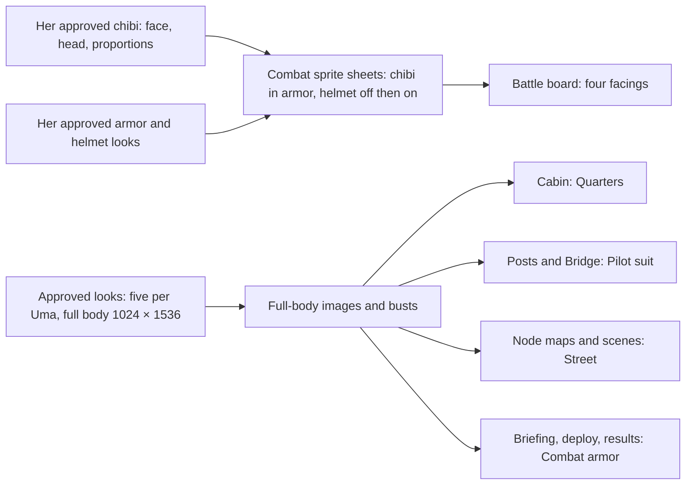

# Character looks and sprites: the authoring spec

> **Status: 2026-11-13 (D23, narrowed by D24).** The owner asked for the character art in the Uma Platform app's
> Character Art (the Cyberpunk universe's approved looks of the first two pilot Umas) to inform the game's looks, and for
> a spec of how the character sprites are authored from that art and Triangle Strategy's camera. On reading it, the
> owner asked for a focused, image-only sprite request and questioned sprites for every outfit (D24): **sprites are for
> combat only, as chibis**, and every other look shows as its approved image. This page is the game's side,
> **nameless**: Umas are outfit ids, and the per-Uma notes are private (`content/design/character-looks/`). Its calls
> are **LK1–LK14**, each a recommendation, adopted until the owner changes one. The sprite format it builds on is
> uma-platform's ([format.md](https://github.com/luismlorenzana/uma-platform/blob/main/docs/sprites/format.md), v1),
> unchanged. What ChatGPT draws is [the combat sprites request](combat-sprites-request.md). Visual page:
> [previews/character-sprites.html](previews/character-sprites.html).

## The short answer

- **Five looks per Uma, each tied to where she is** (LK1): **Street** when exploring worlds and cities, **Quarters** in
  her cabin and her evenings aboard, **Pilot suit** at her ship station, **Combat armor** on the battle board, and the
  **helmet** closed only when a map is sealed or for the cut-in's strike.
- **Sprites only for combat** (LK1, LK4, D24). The battle board is the one place she's a small figure that walks and
  acts, so only the combat armor (helmet off, then on) gets sprites. Street, Quarters and Pilot suit show as **the
  approved full-body images and their busts**, which already exist.
- **The sprites are chibis** (LK6): her approved chibi from the platform's sprite set, the same face, head and about
  three heads of height, **re-dressed in her combat armor**. The platform's format, cell and checks stay as they are,
  and a drawn pilot stands at the same scale as every other Uma still on her original chibi set.
- **One template per look, shared by every Uma** (LK3): the same jacket cut, plugsuit, Modular Frame armor and Helmet,
  personalised by her **palette**, her **emblem** and her **head** (hair, ears, eyes, accessory). That's what the ten
  approved looks already do, and it's how a hundred Umas stay consistent and affordable.
- **The board's camera is ours, not Triangle Strategy's** (LK5): Triangle Strategy's camera turns a full circle, which
  had its team build every map for every side. Ours is uma-stage's orthographic view, fixed at 35°, along the grid's
  axes, so a sprite needs **four facings** (front, back and true side profiles), never diagonals, and nothing rotates.
- **One combat set per Uma** (LK9): 73 poses helmet off (the identity sheet, walking in four facings, reactions in four
  facings, a victory), and the same 73 with the helmet, made by **editing only the head** of the approved sheets.
- **ChatGPT generates images, nothing else** (LK13): pose sheets, from [the request](combat-sprites-request.md) and the
  private prompts. Cutting, alignment, the atlas, checks, publishing and the game's use come later (LK14).

## 1. What the approved looks establish

The Cyberpunk universe in Uma Character Art (published 2026-11-13, style "Hardline Anime", revision 3) holds ten
approved full-body looks, 1024 × 1536: **five looks each for the two pilot Umas** (outfits 106801 and 112901).

| Look (its id in the art) | Its title there | The template |
|---|---|---|
| `street` | Street | A cropped jacket or shell over a top with her emblem, cargo pants with knee pads, fingerless gloves, high-top sneakers |
| `quarters` | Quarters: pajama shorts and crop top | A crop top with her emblem, drawstring shorts, slippers |
| `pilot` | Ship operating: pilot suit | A skintight plugsuit in her palette, line panels, clamps or knots at the hips, gloves, boots |
| `armor` | Combat armor: Modular Frame 01 | Chest plate with her emblem, segmented abdomen, big shoulder pads, forearm gauntlets, thigh, knee and shin plates, armored boots; head bare |
| `armor-helmet` | Helmeted combat armor: Helmet 01 | The same armor and a full helmet with armored ear housings, a dark visor band and her emblem on the forehead |

**Across her five looks, these never change:** her hair, ears, eyes, tail and signature head accessory (except under the
helmet), her emblem (carried onto every outfit), and her palette. **The tail is always out; the ears always show** (the
helmet houses them). **Every look is asymmetric** (a hair ornament on one side, a braid, a crest on one sleeve, a shield
on one forearm), so sprites are never mirrored.

## 2. The five looks in the game (LK1, LK2)

**LK1, a look per context.** Each screen or scene shows the Uma in the look her situation calls for. Only combat
needs sprites (D24):

| Look | When | Where in the game | Art used |
|---|---|---|---|
| **Street** | Exploring a world | A world's node map and its scenes, Intel scenes (TC35), shore leave outings to a market (TC61) | The approved image and its bust; **no sprites** |
| **Quarters** | Off duty aboard | Her cabin (TC60), where she stands over the cabin's diorama as in a visual novel; visits and invitations to the Observation Deck or the Galley (TC61); bond scenes in her cabin; the ship's evening scenes | The approved image and its bust; **no sprites** (CY14 stands her bust in until the image is wired) |
| **Pilot suit** | On duty aboard | Her post (TC67) on the cutaway and her room's page, the Bridge's scenes, a visit at her post, the cut-in of a ship support Order she's posted to (TC64) | The approved image, and its bust on her post's card; **no sprites** |
| **Combat armor** | In a mission | The battle board; the briefing and deploy screens, the results, the debrief aboard, the Hangar, the timeline and unit card | **Chibi board sprites**; the approved image and bust; cut-in keys |
| **Helmet on** | A sealed fight | Sealed maps (vacuum, toxic smoke, a boarding in space), the suit-up's last beat (TC39), the cut-in's strike frame | **The helmet sprite sheets**; the approved image; cut-in keys |

There's precedent in part: Octopath shows a character's second-job outfit only in battle and keeps her own clothes on
the field, while Triangle Strategy keeps one sprite everywhere and changes it on a promotion. This game goes further,
because its looks are the life aboard made visible: she dresses for where she is.

**LK2, the context decides, a scene can override.** The game picks by context: a world location is Street, her cabin and
the ship's spots are Quarters, a post is Pilot suit, a mission is Combat. A scene or bond scene can name a look
(`look` in the story format, live with the packet that first plays looks) when the story wants another, such as her
pilot suit in a Bridge emergency at night.

**The helmet rule** (part of LK1): on the board the helmet stays **off** by default, because her face, hair and
accessory are how she's told apart at 69 pt. It closes on **sealed maps** (a map flag, every Uma at once, so it's a
visible "this place is hostile" signal), for the **suit-up's last beat**, and on the **cut-in's strike**. On a sealed
map her identity rests on her helmet's palette, ear housings and emblem, her ring's colour, and her face on the timeline
chip and unit card, which stay helmet-off. Her rig's **Visor** part (TC17) recolours the helmet's visor band, so the
part reads on the helmet.

## 3. The template system (LK3)

**LK3, five templates for every Uma, personalised three ways.** The approved looks already work this way: both pilots
wear the same jacket cut, plugsuit, Modular Frame and Helmet.

| Layer | Shared by every Uma | Hers |
|---|---|---|
| **Template** | The look's cut and silhouette: the plates, the panels, the seams | — |
| **Palette** | — | Three roles: **base** (the largest areas), **accent** (her identity colour, TC41's hue), **trim** (piping, buckles, glow); taken from her original outfit |
| **Emblem** | Where it sits on each template (chest, collar, forehead, shoulder) | Its shape: one simple mark readable at a few texels |
| **Head** | Ears in the helmet's housings | Her hair, ears, eyes, accessory and tail, unchanged across looks |
| **Motif** | One optional slot per template (a sleeve crest, a forearm shield, a belt bow) | One detail from her original outfit, on one side |

What it buys: a new Uma's five looks are one consistent family; a board of twelve armored Umas reads as a squad, each
told apart by head and accent; and the art can be checked against a fixed list (does the emblem sit where the template
puts it, is the accent hers).

## 4. Two kinds of character art (LK4)

**LK4, sprites for the board, the approved images for everything else.** Fire Emblem pairs its map sprites with
separate battle animations and portraits, and Unicorn Overlord cuts from small map figures to side-on fighters.
Triangle Strategy and Octopath draw their portraits apart from their sprites (a Triangle Strategy mod swaps one
heroine's portrait on its own), and Octopath's sprites were converted by hand from the illustrations, finished to look
best as sprites with stronger colours. This game does the same, with the cut-in's keys as the battle close-up.

| Art | Size | Shows | Made from | Asked |
|---|---|---|---|---|
| **Board sprites** | The platform's 256-texel cells, about 208 tall | Her combat armor on the battle board, helmet off and on | Her approved chibi, re-dressed from her approved armor look | **[The combat sprites request](combat-sprites-request.md)** |
| **Portraits** | The approved 1024 × 1536 looks, and a bust crop of each | Scenes, bond scenes, visits, her cabin, her post, briefings, deploy, results, menus | Used as published | Done: approved 2026-11-13 |
| **Cut-in keys** | Side view, about 360 px tall in a 512 cell | The attack cut-in (TC28): stance, melee, shot, launcher, hack, guard, hurt, Rig Break, victory | The combat armor look, helmet on for the strike | A separate request, later |

The cut-in keys follow uma-quest's adult travelers (twelve battle keys from the Character Art Studio's Combat Adult
Character category, P143): a few large poses, not an animation set.

## 5. The camera (LK5)

**LK5, the board's camera is uma-stage's, fixed.** Triangle Strategy's camera is a reference for the look, not the
geometry:

| | Triangle Strategy | This game's board (uma-stage) |
|---|---|---|
| **Rotation** | **A full 360°** on the right stick, the big change from Octopath's fixed camera; its team built map parts for every direction and argued long over the map edges | **None** (TC16, TC48: 90° steps only if a map ever needs them) |
| **Tilt and zoom** | Zoom on the shoulder buttons in battle and in town; the view tilts from near isometric to nearly top-down | Fixed pitch; a two-axis pan, no zoom in v1 |
| **Projection** | Not published; reads as a narrow-angle perspective | Orthographic |
| **Pitch** | Not published; reads as about 30–40° at the default view (Final Fantasy Tactics' usual camera is about 26.5°) | **35°, fixed** |
| **Grid on screen** | Any angle, since the camera turns | Axis-aligned: rows run across the screen, the back row at the top |
| **Facing as a rule** | Four grid facings, chosen as a turn ends; a hit from behind is a critical | Four, the same (TC23: side +25%, back +50%), shown as a wedge on the base ring |
| **Views drawn** | Not published; with a free camera, the view shown follows her facing against the camera's angle | **Front, back and true side profiles**, each seen from one angle only |
| **Scale** | Not published; a unit about a tile and a half tall, about 2.5 to 3 heads, by eye | 128 texels a tile; a standing Uma about 208 texels, 1.6 tiles, about three heads |
| **Light** | Real light on the sprites, like a diorama (Octopath reworked its point lights to touch the pixel art) | The scene's light and night grade on the quads; drawn light from the top front-left |
| **Depth** | Tilt-shift, parallax; depth of field as a PC setting | Tilt-shift and bloom (D18), off under the saver; the tilt-shift held at 0.8 so the rows units stand on stay sharp |

Triangle Strategy's free camera was a deliberate cost: Square Enix says a tactics game must let the player see the
field from every side, so every map had to look right from every angle. On a phone, a fixed camera keeps the board a
one-hand read and spares building every map for every side, and the facing wedge and the forecast card (TC29) answer
what rotation answers there, who's behind whom.

**What follows for the sprites:** four facings and no diagonals, each drawn once and seen only from its one angle. If
90° rotation ever arrives, the same four views still cover it: the game shows the view her facing makes against the
camera, as Triangle Strategy must. The sprites are **drawn at eye level**, like every platform chibi: uma-stage stands
each one upright and stretches its quad by 1/cos 35°, so the figure isn't squashed by the pitch and one texel lands on
one device pixel at DPR 3. Sprites are never scaled by a fraction, and never enlarged through a smoothing filter
(Tactics Ogre Reborn's most criticised change).

## 6. The sprite (LK6–LK8)

**LK6, her chibi, in armor, in the platform's format as it is.**

| Rule | Value | From |
|---|---|---|
| Cell | 256 × 256 texels, transparent, clear border | format.md §2, unchanged |
| Foot point | (128, 240); feet on row 240 | Unchanged |
| Standing height | About 208 texels, ears and boots included | Unchanged |
| **Proportions** | **Her approved chibi's:** about 2.6 to 3 heads below the ears, the same head size, face and rendering, drawn fresh at sprite size, never a shrunk illustration | format.md §10, unchanged |
| **Clothes** | Her approved combat armor look, simplified to chibi scale: chunky plates, her emblem, her one-sided motif, her three colours; seams and slots dropped | New (D24) |
| On the phone | One texel a device pixel at DPR 3; a standing Uma about 69 pt | uma-stage |
| Light | From the top front-left, moderate shading, clean antialiased edges, no outline glow, no shadow, no floor | format.md §10 |

**Why chibi.** Three reasons, each enough on its own:
- **The board is mixed for a long time.** Every Uma whose combat set isn't drawn walks the board on her original chibi
  set (D19). A drawn pilot at the same three heads stands beside them at the same scale. A taller adult figure would
  jump out of the squad.
- **Triangle Strategy does it.** Its units are deformed figures, about 2.5 to 3 heads by eye. Its director describes
  a search for "the right line" of deformation: the taller the figure, the smaller each pixel and the more it reads as
  a shrunk illustration, so they drew deformed figures and added believable light on top.
- **Her head carries her identity at 69 pt.** A chibi's head is about a third of her height. It holds the hair, ears,
  accessory and face that tell twelve armored Umas apart.

The chibi also keeps the platform's format, its 14 checks and its prompt templates unchanged, and her approved chibi is
the exact reference for the face. Octopath II made its figures taller to suit sharper backgrounds and give each skill
its own motion. This board leaves the big motion to the cut-in, so it doesn't need that.

**LK7, five views, each drawn, never mirrored.** The **key** (three-quarter, turned to image-left: the identity
reference) and the four the board plays:
- **front** (toward the camera, row-down);
- **back** (away, row-up);
- **left** and **right**, which are true side profiles, as the owner asked for the platform's chibi sets (P105).

The board's N, S, E and W map to back, front, right and left (uma-stage's `Facing`). Drawing three views and mirroring
the side would save a quarter of the frames, but anything on one side changes sides when flipped: a hair ornament, a
braid, a crest, a forearm shield, the weapon hand. Every approved look has such a detail.

**LK8, readability at 69 pt.** Each sprite keeps, at full size:
- **the head readable:** hair shape, ears and accessory; the face a few clear marks (eyes, mouth);
- **her accent colour** in two big areas at least (the shoulders and shins or boots);
- **the emblem** as one clear mark of four to eight texels;
- **the armor's silhouette:** chunky shoulder pads and boots change her outline from her chibi's dress;
- **the tail** always visible, in her colour;
- **the back view told apart at a glance:** a hit from behind does +50% (TC23), so her back (hair, tail, the armor's
  back plate) must never be mistaken for her front; the wedge carries the rule, the sprite confirms it.

**Two checks on every identity sheet:**
- **The silhouette:** filled solid black at 69 pt, it still reads as her in armor. Ears, shoulder pads and gauntlets are
  at least two texels thick, with no one-texel detail.
- **The night board:** she doesn't sink into it. Her palette passes through the scene's grade. A dark palette keeps a
  lit accent (crimson, gold) and a lighter edge on her lit side, top-left. A light palette is fine as it is.

## 7. The combat set (LK9)

**LK9, one combat set per Uma, nothing for the other looks.** It's drawn as pose sheets (the request's S1–S7), and the
helmet sheets are edits of the approved ones.

| Batch | What | Sheets | Frames |
|---|---|---|---|
| **1. Standing and walking**, helmet off | The key and the four standing views; `walk` in four facings (6 each) | S1, S2, S3 | 29 |
| **2. Reactions**, helmet off | Per facing: `act` (3: the moment of an attack; the cut-in plays the rest), `hurt` (2), `guard` (2: Cover, a shield up), `kneel` (3: the Rig Break, held; played backwards it's a reboot); `victory` front (4) | S4–S7 | 44 |
| **3. The helmet** | The same sheets with only the head replaced by her helmet: same poses, scale and positions | S1h–S7h | 73 |
| | | **Per Uma** | **146** |

That's against v1's Traveler profile of 130 frames for one outfit. The board plays batch 1 today: standing stills and
walking. Batch 2 waits for a board that shows reactions, and batch 3 for the first sealed map. Both are drawn now so the
set is whole.

**Motion held back, on purpose.** Octopath kept its frame counts low to keep the stepped feel of sprites, and the
board's sprites do the same: a six-frame walk at about 110 ms a frame (v1's timing), a still stand with the game's
breathing bob, and the big motion left to the cut-in.

## 8. Portraits and cut-in keys (LK10, LK11)

**LK10, the approved looks are the portraits.** Each 1024 × 1536 look shows full size where a scene or screen is about
her: a visit, a bond scene, her cabin (standing over its diorama), the deploy screen's selected Uma, the results. A
**bust crop** (head to chest, fixed per look) shows in the text box, on her post's card, on the unit card and on the
timeline chip. Each is in the context's look: her quarters bust in a cabin scene, her pilot bust at a post, her armor
bust in battle. They're read from the Uma Platform app's universe looks (CA4) at run time, the same private way as
master data's art, never in git. Until a look exists, master data's bust or render stands in.

**LK11, a few cut-in keys per Uma, a separate request later.** Side view, combat armor, about 360 px tall in a 512 cell,
light from the front: `stance`, `melee`, `shot`, `launcher` (the Back unit firing over her shoulder), `hack`, `guard`,
`hurt`, `kneel`, `victory`, and `strike` with the helmet on (the visor down for the hit). Ten keys, drawn as stills; the
cut-in moves them (slides, shakes, a flash), as uma-quest's fights do with their keys. They aren't in the combat sprites
request.

## 9. Authoring and order (LK12, LK13)

**LK12, tiers, so the cost follows the story.**

| Tier | Who | Looks (portraits) | Combat sprites | Cut-in keys |
|---|---|---|---|---|
| **Pilots** | The two Umas with approved looks | All five ✓ | **Now** (the request) | Later |
| **Leads** | Each lead the story names (TC51) | All five | As the story casts them | Yes |
| **Featured crew** | Crew with bond scenes (TC57) | All five | Next | Yes |
| **Everyone else** | The rest aboard | Combat and Quarters | Later; her chibi set meanwhile | Later |

**While a look isn't drawn, the game falls back:**
- a missing combat set: her original-outfit chibi set from master data (D19), else her face card;
- a missing portrait: master data's bust or render.

Nothing waits on art.

**LK13, ChatGPT generates images, nothing else.**
1. **The looks** (portraits): ChatGPT draws each Uma's five looks in the Character Art Studio, from her master data art
   and the five templates (the pilots' looks are the reference sheets). The owner approves them, and they're published
   to Uma Character Art (CA4). The pilots' are done.
2. **The combat sprites:** ChatGPT generates the pose sheets of [the request](combat-sprites-request.md), using each
   Uma's private paste-ready prompts. Her reference board holds her approved chibi stills and her approved armor and
   helmet looks. The sheets are saved privately with their prompts.
3. **The owner's gates:** the owner looks at the identity sheet (S1) before anything else is drawn, and at the walks
   (S2, S3) before the reactions. Any change is redrawn before the next step.
4. **Everything after the images is later** (LK14): cutting the sheets into frames, alignment, the atlas, the checks,
   publishing, and the game's use.

## 10. What changes where (LK14)

**LK14, one image request now; the integration later.**
- **Now:** [the combat sprites request](combat-sprites-request.md) for ChatGPT, with the private prompts and reference
  boards in `content/design/character-looks/`. It asks for images only.
- **Later, once the sheets exist and pass the gates:**
  - their export into the platform's format (format.md, unchanged);
  - a way to key a set by outfit **and look** in master data's release, beside today's chibi set;
  - the universe looks readable by this game's API.

  That's one uma-platform request under the change protocol, written then from what the sheets need. D23's draft of it
  is withdrawn (D24).
- **In this game,** with the packets that first show each look:
  - a `look` per screen and per scene (LK2);
  - the portraits and busts from the universe looks, with their fallbacks;
  - the combat set on the board, the helmet sheets on sealed maps (a map flag);
  - the cut-in playing the keys.

## 11. The research behind it

A research pass on Triangle Strategy and its neighbours, 2026-11-13. Several sources (The Spriters Resource, the Unreal
Engine interviews, StrategyWiki) refused automated reads, so **no frame sizes or counts of Triangle Strategy's sprites
were measured**; rows above marked "not published" or "by eye" are estimates.

| Finding | Source |
|---|---|
| The camera turns 360°, unlike Octopath's fixed one; map parts were built for every direction, and the edges took long debate; the facing choice came partly from staff who wanted to set facing themselves | [4Gamer interview](https://www.4gamer.net/games/553/G055388/20220228038/), [English summary](https://nintendoeverything.com/triangle-strategy-devs-on-how-the-game-uses-accurate-hd-2d) |
| The deformation line: more heads means smaller pixels and an illustration's read; deformed figures first, realistic light on top | [4Gamer interview](https://www.4gamer.net/games/553/G055388/20220228038/) |
| Right stick turns the camera, a click resets it; ZL and ZR zoom in battle and exploration | [Game8](https://game8.co/games/Triangle-Strategy/archives/368826) |
| Four grid facings chosen at the turn's end; height adds damage and range | [Kotaku](https://kotaku.com/triangle-strategy-tips-characters-square-enix-guide-tac-1848643925), [Denfaminicogamer](https://news.denfaminicogamer.jp/kikakuthetower/220325b) |
| Portraits are separate assets (a mod swaps one alone) | [Nexus Mods](https://www.nexusmods.com/trianglestrategy/mods/7) |
| Octopath: sprites converted by hand from the illustrations, more saturated; point lights reworked to touch the pixel art | [Famitsu](https://www.famitsu.com/news/201807/17160714.html), [Nintendo Everything](https://nintendoeverything.com/octopath-traveler-devs-on-character-origins-visual-style-initial-hd-rumble-plans-much-more/2) |
| Octopath: motion held back to keep the stepped sprite feel | [Game Watch](https://game.watch.impress.co.jp/docs/interview/1128111.html) |
| Octopath II: taller characters for sharper backgrounds and a motion per skill; a rig tool, broken pixels fixed by hand | [Nintendo Everything](https://nintendoeverything.com/octopath-traveler-ii-devs-on-the-games-evolved-use-of-hd-2d-and-more/), [Denfaminicogamer](https://news.denfaminicogamer.jp/kikakuthetower/231218g) |
| Tactics Ogre Reborn: a rotating 3D field; enlarged, filtered sprites that split players | [RPGFan](https://rpgfan.com/review/tactics-ogre-reborn) |
| Fire Emblem: map sprites (standing and moving) apart from battle animations and portraits | [LT Maker docs](https://lt-maker.readthedocs.io/en/latest/source/editors/resource-editors/Map-Sprites-Editor.html) |
| Mirroring saves views but breaks one-handed and one-sided details | [How many sprites do perspectives need](https://cxong.github.io/2022/03/how-many-sprites-do-different-perspectives-need) |

## The calls

| # | Call | Section |
|---|---|---|
| LK1 | *(amended D24)* Five looks per Uma tied to context: Street exploring, Quarters off duty, Pilot suit on duty, Combat armor in missions, the helmet on sealed maps, the suit-up's last beat and the cut-in's strike; **sprites only for combat**, every other look shown as its approved image and bust | [2](#2-the-five-looks-in-the-game-lk1-lk2) |
| LK2 | The context picks the look; a scene can name another | [2](#2-the-five-looks-in-the-game-lk1-lk2) |
| LK3 | One template per look for every Uma, personalised by palette (base, accent, trim), emblem, head and one motif | [3](#3-the-template-system-lk3) |
| LK4 | *(amended D24)* Board sprites for combat only; the approved looks as portraits and busts everywhere else; cut-in keys in a separate request later. As Fire Emblem splits map sprites, battle art and portraits | [4](#4-two-kinds-of-character-art-lk4) |
| LK5 | The board's camera stays uma-stage's: orthographic, 35°, fixed, axis-aligned (Triangle Strategy's turns 360° at the cost of every map built for every side); four facings, no diagonals, enough even if 90° rotation arrives; sprites drawn at eye level | [5](#5-the-camera-lk5) |
| LK6 | *(amended D24)* The sprites are her approved chibi (about three heads), re-dressed in her approved armor, in the platform's format as it is (256 cell, foot point, about 208 texels); the same scale as every chibi still on the board | [6](#6-the-sprite-lk6lk8) |
| LK7 | *(amended D24)* Five views, each drawn, never mirrored: the key, front, back, and true side profiles left and right | [6](#6-the-sprite-lk6lk8) |
| LK8 | Readable at 69 pt: the head, two big areas of her accent, the emblem, the armor's silhouette, the tail, a back view never taken for the front; the black-silhouette and night-board checks | [6](#6-the-sprite-lk6lk8) |
| LK9 | *(amended D24)* One combat set per Uma: 73 frames helmet off (identity, walks and reactions in four facings, victory), 73 with the helmet by editing only the head; none for the other looks; motion held back | [7](#7-the-combat-set-lk9) |
| LK10 | The approved looks are the portraits, with a fixed bust crop per look (her cabin, her post's card, battle), read at run time; master data's bust while missing | [8](#8-portraits-and-cut-in-keys-lk10-lk11) |
| LK11 | Ten side-view cut-in keys per Uma, helmet on for the strike; a separate request, later | [8](#8-portraits-and-cut-in-keys-lk10-lk11) |
| LK12 | *(amended D24)* Tiers: the pilots' combat sprites now, then leads and featured crew as the story casts them, everyone else on her chibi set meanwhile; fallbacks so nothing waits on art | [9](#9-authoring-and-order-lk12-lk13) |
| LK13 | *(amended D24)* ChatGPT generates images only, from the request and the private prompts; the owner gates the identity sheet and the walks; everything after the images is later | [9](#9-authoring-and-order-lk12-lk13) |
| LK14 | *(amended D24)* One image request now; the export, look-keyed sets and the API's reads in one uma-platform request later, once the sheets exist; D23's draft withdrawn | [10](#10-what-changes-where-lk14) |
