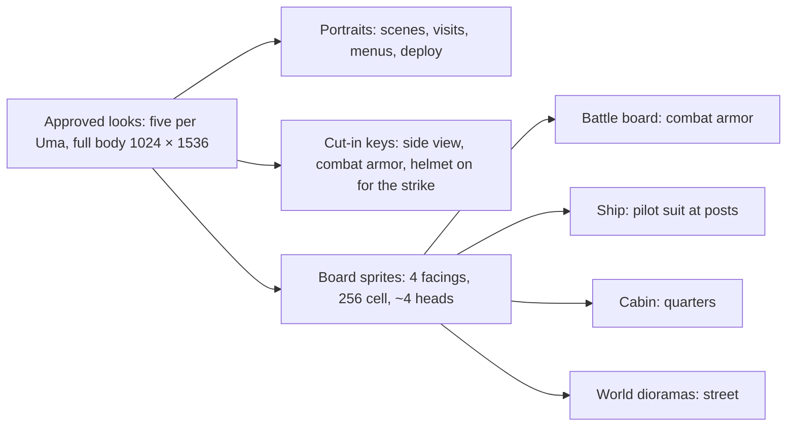

# Character looks and sprites: the authoring spec

> **Status: 2026-11-13 (D23), for the owner's review.** The owner asked for the character art in the Uma Platform app's
> Character Art (the Cyberpunk universe's approved looks of the first two pilot Umas) to inform the game's looks, and for
> a spec of how the character sprites are authored from that art and Triangle Strategy's camera. This page is the
> game's side, **nameless**: Umas are outfit ids, and the per-Uma notes are private (`content/design/character-looks/`).
> Its calls are **LK1–LK14**, each a recommendation, adopted until the owner changes one. The sprite format it builds on
> is uma-platform's ([format.md](https://github.com/luismlorenzana/uma-platform/blob/main/docs/sprites/format.md), v1);
> what it needs from uma-platform is [a request](art-requests/character-looks.md). Visual page:
> [previews/character-sprites.html](previews/character-sprites.html).

## The short answer

- **Five looks per Uma, each tied to where she is** (LK1): **Street** when exploring worlds and cities, **Quarters** in
  her cabin and her evenings aboard, **Pilot suit** at her ship station, **Combat armor** on the battle board, and the
  **helmet** closed only when a map is sealed or for the cut-in's strike.
- **One template per look, shared by every Uma** (LK3): the same jacket cut, plugsuit, Modular Frame armor and Helmet,
  personalised by her **palette**, her **emblem** and her **head** (hair, ears, eyes, accessory). That's what the ten
  approved looks already do, and it's how a hundred Umas stay consistent and affordable.
- **Two kinds of character art, split by camera** (LK4):
  - **Board sprites** stand in the HD-2D diorama: small, four facings, few frames, read at about 69 pt on the phone.
  - **Portraits and cut-in keys** carry the drama: the approved full-body looks as portraits in scenes, visits and
    menus, and a few large side-view combat keys for the cut-in. Fire Emblem splits its art the same way (map
    sprites, battle animations, portraits), and Triangle Strategy and Octopath draw their portraits apart from their
    sprites.
- **The board's camera is ours, not Triangle Strategy's** (LK5): Triangle Strategy's camera turns a full circle, which
  had its team build every map for every side. Ours is uma-stage's orthographic view, fixed at 35°, along the grid's
  axes, so a sprite needs **four facings** (front, back, left, right), never diagonals, and nothing rotates.
- **The sprite** (LK6–LK9): uma-platform's 256-texel cell and foot point kept, a standing Uma about 212 texels tall,
  **adult HD-2D proportions of about four heads** (the platform's chibi sets are three), **redrawn at sprite size, never
  shrunk** from the full body, light from the top front-left, never mirrored. A small set per look, about 64 frames for
  combat and fewer elsewhere, with held-back motion; the helmet as a **head patch**, not a second set.
- **Authoring** (LK10–LK13): ChatGPT draws the character art (uma-platform P126, P147) from the approved looks; the
  pilots' combat set first, then their station, quarters and exploration sets; then the other leads. The game picks the
  look by context and falls back to the original-outfit chibi set or a face card while a look isn't drawn.

## 1. What the approved looks establish

The Cyberpunk universe in Uma Character Art (published 2026-11-13, style "Hardline Anime", revision 3) holds ten
approved full-body looks, 1024 × 1536: **five looks each for the two pilot Umas** (outfits 106801 and 112901).

| Look (its id in the art) | Its title there | The template |
|---|---|---|
| `street` | Street | A cropped jacket or shell over a top with her emblem, cargo pants with knee pads, fingerless gloves, high-top sneakers |
| `quarters` | Quarters: pajama shorts and crop top | A crop top with her emblem, drawstring shorts, slippers |
| `pilot` | Ship operating: pilot suit | A skintight plugsuit in her palette, line panels, clamps or knots at the hips, gloves, boots |
| `armor` | Combat armor: Modular Frame 01 | Chest plate with her emblem, segmented abdomen, big shoulder pads, forearm gauntlets, thigh, knee and shin plates, armored boots; head bare |
| `armor-helmet` | Helmeted combat armor: Helmet 01 | The same armor and a full helmet with armored ear housings, a dark visor band and her emblem on the forehead |

**Across her five looks, these never change:** her hair, ears, eyes, tail and signature head accessory (except under the
helmet), her emblem (carried onto every outfit), and her palette. **The tail is always out; the ears always show** (the
helmet houses them). **Every look is asymmetric** (a hair ornament on one side, a braid, a crest on one sleeve, a shield
on one forearm), so sprites are never mirrored.

## 2. The five looks in the game (LK1, LK2)

**LK1, a look per context.** Each screen or scene shows the Uma in the look her situation calls for:

| Look | When | Where in the game | Art used |
|---|---|---|---|
| **Street** | Exploring a world | Scenes on a world's map, Intel scenes (TC35), shore leave outings to a market (TC61), later the world dioramas (Phase 5) | Portrait; board sprites for dioramas |
| **Quarters** | Off duty aboard | Her cabin (TC60), visits and invitations to the Observation Deck or the Galley (TC61), bond scenes in her cabin, the ship's evening scenes | Portrait; a cabin sprite (standing, sitting, lying) |
| **Pilot suit** | On duty aboard | At her post (TC67) in the ship's cutaway and her room's page, the Bridge's scenes, a visit at her post, the cut-in of a ship support Order she's posted to (TC64) | Portrait; a station sprite (at the console, standing, walking) |
| **Combat armor** | In a mission | The battle board, the briefing and deploy screens, the results, the debrief aboard, the Hangar, the timeline and unit card | Board sprites; portrait; cut-in keys |
| **Helmet on** | A sealed fight | Sealed maps (vacuum, toxic smoke, a boarding in space), the suit-up's last beat (TC39), the cut-in's strike frame | The helmet head patch on the board sprites; cut-in keys |

There's precedent in part: Octopath shows a character's second-job outfit only in battle and keeps her own clothes on
the field, while Triangle Strategy keeps one sprite everywhere and changes it on a promotion. This game goes further,
because its looks are the life aboard made visible: she dresses for where she is.

**LK2, the context decides, a scene can override.** The game picks by context: a world location is Street, her cabin and
the ship's spots are Quarters, a post is Pilot suit, a mission is Combat. A scene or bond scene can name a look
(`look` in the story format, live with the packet that first plays looks) when the story wants another, such as her
pilot suit in a Bridge emergency at night.

**The helmet rule** (part of LK1): on the board the helmet stays **off** by default, because her face, hair and
accessory are how she's told apart at 69 pt. It closes on **sealed maps** (a map flag, every Uma at once, so it's a
visible "this place is hostile" signal), for the **suit-up's last beat**, and on the **cut-in's strike**. On a sealed
map her identity rests on her helmet's palette, ear housings and emblem, her ring's colour, and her face on the timeline
chip and unit card, which stay helmet-off. Her rig's **Visor** part (TC17) recolours the helmet's visor band, so the
part reads on the helmet.

## 3. The template system (LK3)

**LK3, five templates for every Uma, personalised three ways.** The approved looks already work this way: both pilots
wear the same jacket cut, plugsuit, Modular Frame and Helmet.

| Layer | Shared by every Uma | Hers |
|---|---|---|
| **Template** | The look's cut and silhouette: the plates, the panels, the seams | — |
| **Palette** | — | Three roles: **base** (the largest areas), **accent** (her identity colour, TC41's hue), **trim** (piping, buckles, glow); taken from her original outfit |
| **Emblem** | Where it sits on each template (chest, collar, forehead, shoulder) | Its shape: one simple mark readable at a few texels |
| **Head** | Ears in the helmet's housings | Her hair, ears, eyes, accessory and tail, unchanged across looks |
| **Motif** | One optional slot per template (a sleeve crest, a forearm shield, a belt bow) | One detail from her original outfit, on one side |

What it buys: a new Uma's five looks are one consistent family; a board of twelve armored Umas reads as a squad, each
told apart by head and accent; and the art can be checked against a fixed list (does the emblem sit where the template
puts it, is the accent hers).

## 4. Two kinds of character art (LK4)

**LK4, board sprites for the diorama, portraits and keys for the drama.** Fire Emblem pairs its map sprites with
separate battle animations and portraits, and Unicorn Overlord cuts from small map figures to side-on fighters.
Triangle Strategy and Octopath draw their portraits apart from their sprites (a Triangle Strategy mod swaps one
heroine's portrait on its own), and Octopath's sprites were converted by hand from the illustrations, finished to look
best as sprites with stronger colours. This game does the same, with the cut-in's keys as the battle close-up.

| Art | Size | Shows | Made from |
|---|---|---|---|
| **Board sprites** | 256-texel cells, about 212 tall | Standing, walking, reacting on the board, the cutaway, the cabin, world dioramas | Each look's approved full body, at about four heads |
| **Portraits** | The approved 1024 × 1536 looks, and a bust crop of each | Scenes, bond scenes, visits, briefings, deploy, results, menus | Used as published |
| **Cut-in keys** | Side view, about 360 px tall in a 512 cell | The attack cut-in (TC28): stance, melee, shot, launcher, hack, guard, hurt, Rig Break, victory | The combat armor look, helmet on for the strike |

The cut-in keys follow uma-quest's adult travelers (twelve battle keys from the Character Art Studio's Combat Adult
Character category, P143): a few large poses, not an animation set.

## 5. The camera (LK5)

**LK5, the board's camera is uma-stage's, fixed.** Triangle Strategy's camera is a reference for the look, not the
geometry:

| | Triangle Strategy | This game's board (uma-stage) |
|---|---|---|
| **Rotation** | **A full 360°** on the right stick, the big change from Octopath's fixed camera; its team built map parts for every direction and argued long over the map edges | **None** (TC16, TC48: 90° steps only if a map ever needs them) |
| **Tilt and zoom** | Zoom on the shoulder buttons in battle and in town; the view tilts from near isometric to nearly top-down | Fixed pitch; a two-axis pan, no zoom in v1 |
| **Projection** | Not published; reads as a narrow-angle perspective | Orthographic |
| **Pitch** | Not published; reads as about 30–40° at the default view (Final Fantasy Tactics' usual camera is about 26.5°) | **35°, fixed** |
| **Grid on screen** | Any angle, since the camera turns | Axis-aligned: rows run across the screen, the back row at the top |
| **Facing as a rule** | Four grid facings, chosen as a turn ends; a hit from behind is a critical | Four, the same (TC23: side +25%, back +50%), shown as a wedge on the base ring |
| **Views drawn** | Not published; with a free camera, the view shown follows her facing against the camera's angle | **Front, back, left, right** (three-quarter turned), each seen from one angle only |
| **Scale** | Not published; a unit about a tile and a half tall, about 2.5 to 3 heads, by eye | 128 texels a tile; a standing Uma about 212 texels, 1.65 tiles, about four heads |
| **Light** | Real light on the sprites, like a diorama (Octopath reworked its point lights to touch the pixel art) | The scene's light and night grade on the quads; drawn light from the top front-left |
| **Depth** | Tilt-shift, parallax; depth of field as a PC setting | Tilt-shift and bloom (D18), off under the saver; the tilt-shift held at 0.8 so the rows units stand on stay sharp |

Triangle Strategy's free camera was a deliberate cost: Square Enix says a tactics game must let the player see the
field from every side, so every map had to look right from every angle. On a phone, a fixed camera keeps the board a
one-hand read and spares building every map for every side, and the facing wedge and the forecast card (TC29) answer what rotation answers
there, who's behind whom.

**What follows for the sprites:** four facings and no diagonals, each drawn once and seen only from its one angle. If
90° rotation ever arrives, the same four views still cover it: the game shows the view her facing makes against the
camera, as Triangle Strategy must. uma-stage stretches each sprite quad by 1/cos 35° so the figure isn't squashed by the
pitch and one texel lands on one device pixel at DPR 3; sprites are never scaled by a fraction, and never enlarged
through a smoothing filter (Tactics Ogre Reborn's most criticised change).

## 6. The sprite (LK6–LK8)

**LK6, the cell and the figure.**

| Rule | Value | From |
|---|---|---|
| Cell | 256 × 256 texels, transparent, clear border | format.md §2, unchanged |
| Foot point | (128, 240); feet on row 240 | Unchanged |
| Standing height | About 212 texels, ears and shoes included; the helmet about 216 | Close to v1's 208 |
| **Proportions** | **About four heads** (a head about 52 texels), adult HD-2D, legs long enough to read the armor's leg plates; redrawn at this size from the look, never shrunk | New: v1's sets are three-head chibis |
| On the phone | One texel a device pixel at DPR 3; a standing Uma about 70 pt | uma-stage |
| Light | From the top front-left, moderate shading, clean antialiased edges, no outline glow, no shadow, no floor | format.md §10 |
| Colour | Full colour; her three palette roles exact on every frame (a check) | New |

**Why four heads, and why redrawn.** Triangle Strategy's director describes a search for "the right line" of
deformation: the more heads tall a figure is, the smaller each pixel becomes and the more it reads as a shrunk
illustration rather than a sprite, so they drew deformed figures first and added realistic light on top. Octopath II
went the other way for a reason this game shares: its team made the characters taller so they sat right against sharper
backgrounds and so each skill could have its own motion. This game sits between the two: its sprites are clean,
antialiased anime at 256 texels (format.md §10), not hard pixel art, and its looks are adults in armor, so about four
heads keeps the armor's plates and the long legs while the head (about 52 texels, 17 pt on the phone) still carries her
face. The approved looks are about seven heads; shrinking one to 212 texels would lose the face, so each frame is
redrawn at sprite size with the head enlarged, as Octopath's artists redrew from the illustrations.

**LK7, facings.** Four, each drawn, never mirrored: **front** (toward the camera, row-down), **back** (away, row-up),
**left** and **right** (three-quarter, turned to image-left and image-right). They're v1's field facings; the board's
N, S, E and W map to back, front, right and left (uma-stage's `Facing`). There's no separate battle facing on the board:
the cut-in has its own keys (LK4). Drawing three views and mirroring the side would save a quarter of the frames, but
anything on one side (a hair ornament, a braid, a crest, a forearm shield, the weapon hand) changes sides when flipped,
and every approved look has such a detail.

**LK8, readability at 70 pt.** Each look's sprite keeps, at full size:
- **the head readable:** hair shape, ears and accessory; the face a few clear marks (eyes, mouth);
- **her accent colour** in two big areas at least (shoulders and boots on the armor; the jacket or hood on the street look);
- **the emblem** as one clear mark of four to eight texels;
- **the template's silhouette:** the armor's shoulder pads and boots must change her outline from the street look;
- **the tail** always visible, in her colour;
- **the back view told apart at a glance:** a hit from behind does +50% (TC23), so her back (hair, tail, the armor's
  back plate) must never be mistaken for her front; the wedge carries the rule, the sprite confirms it.

**Two checks on every look's first frame:** filled solid black at 70 pt, the silhouette still says which look it is
(ears, shoulder pads and weapon at least two texels thick, no one-texel detail); and on the night board, it doesn't
sink. Her palette passes through the scene's grade: a dark palette keeps a lit accent (crimson, gold) and a lighter rim
on her lit side, top-left, so she doesn't sink into the terrain; a light one is fine as it is.

## 7. What each look's sprite set holds (LK9)

**LK9, small sets, by context.** Frames per facing are listed; "×4" means each of the four facings.

| Look | Actions | Frames |
|---|---|---|
| **Combat armor** | Standing still ×4 (the turnaround, with a one-texel breathing bob by the game); `walk` ×4 (6); `act` ×4 (3: weapon raised, the moment of an attack or a skill; the cut-in plays the rest); `hurt` ×4 (2); `kneel` ×4 (3: Rig Break, kneeling, weary, held; played backwards it's a reboot); `guard` ×4 (2: Cover and a shield up); `victory` front (4) | about 64 |
| **Helmet on** | No second set: a **helmet head patch** per facing, placed on every frame by its head box and offset (format.md §5's machinery, widened to the whole head box), plus helmet drawings for the `hurt` and `kneel` frames, whose heads are free | 4 patches + about 20 heads |
| **Pilot suit** | Standing still ×4; `walk` ×4 (6); `console` back three-quarter (4: seated at a station, working; loops); `salute` front (2) | about 34 |
| **Quarters** | Standing still ×4; `sit` front (2); `lie` (2: asleep, loops); `walk` ×4 (6, for the deck) | about 32 |
| **Street** | Standing still ×4; `walk` ×4 (6); `run` ×4 (6); the six emotes front (v1's `nod`, `surprise`, `laugh`, `sad`, `angry`, `wave`, 16) | about 68 |

**Per Uma, all five: about 220 frames,** against v1's Traveler profile of 130 for one outfit. That's why the sets are
tiered (LK12) and the combat set comes first.

**Motion held back, on purpose.** Octopath kept its frame counts low to keep the stepped feel of sprites, and the
board's sprites do the same: a six-frame walk at about 100 ms a frame, a still stand with the game's breathing bob, and
the big motion left to the cut-in.

## 8. Portraits and cut-in keys (LK10, LK11)

**LK10, the approved looks are the portraits.** Each 1024 × 1536 look shows full size where a scene or screen is about
her (a visit, a bond scene, the deploy screen's selected Uma, the results), and a **bust crop** (head to chest, fixed
per look) in the text box, the unit card and the timeline chip. In the context's look: her quarters bust in a cabin
scene, her pilot bust at a post, her armor bust in battle. They're read from the Uma Platform app's universe looks
(CA4) at run time, the same private way as master data's art, never in git; until a look exists, master data's bust or
render stands in.

**LK11, a few cut-in keys per Uma.** Side view, combat armor, about 360 px tall in a 512 cell, light from the front:
`stance`, `melee`, `shot`, `launcher` (the Back unit firing over her shoulder), `hack`, `guard`, `hurt`, `kneel`,
`victory`, and `strike` with the helmet on (the visor down for the hit). Ten keys, drawn as stills; the cut-in moves them
(slides, shakes, a flash), as uma-quest's fights do with their keys.

## 9. Authoring and order (LK12, LK13)

**LK12, tiers, so the cost follows the story.**

| Tier | Who | Looks (portraits) | Board sprites | Cut-in keys |
|---|---|---|---|---|
| **Pilots** | The two Umas with approved looks | All five | All five sets | Yes |
| **Leads** | Each lead the story names (TC51) | All five | Combat, Pilot suit, Quarters, Street | Yes |
| **Featured crew** | Crew with bond scenes (TC57) | All five | Combat, Pilot suit | Yes |
| **Everyone else** | The rest aboard | Combat and Quarters | Combat | Later |

**While a look isn't drawn, the game falls back:** a missing board sprite uses her original-outfit chibi set from master
data (D19), else her face card; a missing portrait uses master data's bust or render. Nothing waits on art.

**LK13, who draws and how it flows.**
1. **The looks** (portraits): ChatGPT draws each Uma's five looks in the Character Art Studio, from her master data art
   and the five templates (the pilots' looks are the reference sheets), the owner approves, and `pnpm art:push`
   publishes them to Uma Character Art (CA4).
2. **Board sprites and cut-in keys:** ChatGPT draws them from the approved looks, in uma-platform's sprite pipeline
   (pipeline.md), to this spec's profiles. **The first frame of each look comes first:** her front standing frame,
   checked on the board at 70 pt (LK8's two checks, the face readable) before the rest of the set is drawn; if the face
   doesn't read, the head grows toward three and a half heads for every look. The owner approves in the Studio; they
   publish in master data's private release, keyed by outfit **and look**.
3. **The game** reads both at run time, picks the look by context (LK2) and falls back while one is missing.

**The order:** the pilots' combat set and cut-in keys first (the board), then their pilot-suit set (the ship's posts,
CY16), quarters set (the cabins, CY14), street set (the world dioramas, Phase 5); then each lead's looks as the story
names them.

## 10. What changes where (LK14)

**LK14, the requests and the game's side.**
- **To uma-platform** ([the request](art-requests/character-looks.md)): a **Tactics adult** sprite profile (four heads,
  four facings, the actions of LK9), the **helmet head patch** (format.md §5's head box as a patch), sprite sets and
  keys **keyed by outfit and look** in master data's release, the Studio's Uma Cyberpunk categories for the five looks
  and the cut-in keys, and the universe looks readable by this game's API.
- **In this game,** with the packets that first show each look: a `look` per screen and per scene (LK2), the portrait
  and bust from the universe looks with their fallbacks, the helmet head patch on the board, sealed maps (a map flag),
  and the cut-in playing the keys.

## 11. The research behind it

A research pass on Triangle Strategy and its neighbours, 2026-11-13. Several sources (The Spriters Resource, the Unreal
Engine interviews, StrategyWiki) refused automated reads, so **no frame sizes or counts of Triangle Strategy's sprites
were measured**; rows above marked "not published" or "by eye" are estimates.

| Finding | Source |
|---|---|
| The camera turns 360°, unlike Octopath's fixed one; map parts were built for every direction, and the edges took long debate; the facing choice came partly from staff who wanted to set facing themselves | [4Gamer interview](https://www.4gamer.net/games/553/G055388/20220228038/), [English summary](https://nintendoeverything.com/triangle-strategy-devs-on-how-the-game-uses-accurate-hd-2d) |
| The deformation line: more heads means smaller pixels and an illustration's read; deformed figures first, realistic light on top | [4Gamer interview](https://www.4gamer.net/games/553/G055388/20220228038/) |
| Right stick turns the camera, a click resets it; ZL and ZR zoom in battle and exploration | [Game8](https://game8.co/games/Triangle-Strategy/archives/368826) |
| Four grid facings chosen at the turn's end; height adds damage and range | [Kotaku](https://kotaku.com/triangle-strategy-tips-characters-square-enix-guide-tac-1848643925), [Denfaminicogamer](https://news.denfaminicogamer.jp/kikakuthetower/220325b) |
| Portraits are separate assets (a mod swaps one alone) | [Nexus Mods](https://www.nexusmods.com/trianglestrategy/mods/7) |
| Octopath: sprites converted by hand from the illustrations, more saturated; point lights reworked to touch the pixel art | [Famitsu](https://www.famitsu.com/news/201807/17160714.html), [Nintendo Everything](https://nintendoeverything.com/octopath-traveler-devs-on-character-origins-visual-style-initial-hd-rumble-plans-much-more/2) |
| Octopath: motion held back to keep the stepped sprite feel | [Game Watch](https://game.watch.impress.co.jp/docs/interview/1128111.html) |
| Octopath II: taller characters for sharper backgrounds and a motion per skill; a rig tool, broken pixels fixed by hand | [Nintendo Everything](https://nintendoeverything.com/octopath-traveler-ii-devs-on-the-games-evolved-use-of-hd-2d-and-more/), [Denfaminicogamer](https://news.denfaminicogamer.jp/kikakuthetower/231218g) |
| Tactics Ogre Reborn: a rotating 3D field; enlarged, filtered sprites that split players | [RPGFan](https://rpgfan.com/review/tactics-ogre-reborn) |
| Fire Emblem: map sprites (standing and moving) apart from battle animations and portraits | [LT Maker docs](https://lt-maker.readthedocs.io/en/latest/source/editors/resource-editors/Map-Sprites-Editor.html) |
| Mirroring saves views but breaks one-handed and one-sided details | [How many sprites do perspectives need](https://cxong.github.io/2022/03/how-many-sprites-do-different-perspectives-need) |

## The calls

| # | Call | Section |
|---|---|---|
| LK1 | Five looks per Uma tied to context: Street exploring, Quarters off duty, Pilot suit on duty, Combat armor in missions, the helmet on sealed maps, the suit-up's last beat and the cut-in's strike | [2](#2-the-five-looks-in-the-game-lk1-lk2) |
| LK2 | The context picks the look; a scene can name another | [2](#2-the-five-looks-in-the-game-lk1-lk2) |
| LK3 | One template per look for every Uma, personalised by palette (base, accent, trim), emblem, head and one motif | [3](#3-the-template-system-lk3) |
| LK4 | Two kinds of art: small board sprites for the diorama, the approved looks as portraits and a few large cut-in keys for the drama, as Fire Emblem splits map sprites, battle art and portraits | [4](#4-two-kinds-of-character-art-lk4) |
| LK5 | The board's camera stays uma-stage's: orthographic, 35°, fixed, axis-aligned (Triangle Strategy's turns 360° at the cost of every map built for every side); four facings, no diagonals, enough even if 90° rotation arrives | [5](#5-the-camera-lk5) |
| LK6 | The 256 cell and foot point kept; a standing Uma about 212 texels; about four heads, redrawn at sprite size with the head enlarged, never shrunk; light from the top front-left | [6](#6-the-sprite-lk6lk8) |
| LK7 | Four facings, each drawn, never mirrored (every look has a one-sided detail); no board battle facing | [6](#6-the-sprite-lk6lk8) |
| LK8 | Readable at 70 pt: the head, two big areas of her accent, the emblem, the template's silhouette, the tail, a back view never taken for the front; the black-silhouette and night-board checks | [6](#6-the-sprite-lk6lk8) |
| LK9 | Small sets by context (about 64 combat, 34 pilot suit, 32 quarters, 68 street frames), motion held back; the helmet as a head patch | [7](#7-what-each-looks-sprite-set-holds-lk9) |
| LK10 | The approved looks are the portraits, with a fixed bust crop per look, read at run time; master data's bust while missing | [8](#8-portraits-and-cut-in-keys-lk10-lk11) |
| LK11 | Ten side-view cut-in keys per Uma, helmet on for the strike | [8](#8-portraits-and-cut-in-keys-lk10-lk11) |
| LK12 | Tiers: pilots all, leads four sets, featured crew two, everyone else combat; fallbacks so nothing waits on art | [9](#9-authoring-and-order-lk12-lk13) |
| LK13 | ChatGPT draws looks, sprites and keys; each look's first frame is checked on the board before its set; the owner approves; published privately, keyed by outfit and look; combat first | [9](#9-authoring-and-order-lk12-lk13) |
| LK14 | One request to uma-platform for the profile, the head patch, look-keyed sets and the Studio's categories; the game's side lands with the packets that show each look | [10](#10-what-changes-where-lk14) |
