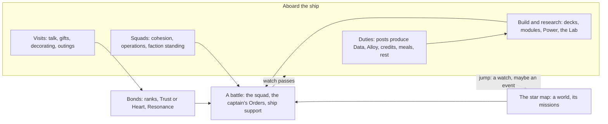

# Life aboard: the captain, the ship, the bonds and the duties

> **Status: 2026-11-13 (D20), for the owner's review.** The owner set five directions to take the game past the
> sandbox (quoted in §1). Three research passes ran in parallel ([research-life-aboard.md](research-life-aboard.md):
> ship building, crew duties, bonds and quarters), and this page designs the answer: a **captain** as the player's
> point of view, **bonds** with every Uma that feed the battles, **quarters** she lives in and the captain decorates
> and visits, **duties** aboard, and **the ship as a game of its own**: decks, modules, power and research. It also
> reshapes the story's spine toward **squads, factions and one big plot**. Its calls are **TC55–TC74**, new or amending
> the concept's ([concept.md](concept.md)); every one is a recommendation, adopted until the owner changes it. The story
> session's open brief for it is [story-brief-life-aboard.md](story-brief-life-aboard.md). Visual page:
> [previews/life-aboard.html](previews/life-aboard.html).

## The short answer

- **You are the Captain** (TC55). The player names the captain and picks their pronouns; the captain is never drawn:
  the camera is the captain, as Blue Archive's Sensei is never seen. The captain commands from the Bridge and never
  stands on the grid. In battle the captain gives **Orders**, a few once-a-battle moves that grow with the ship and
  with the crew's trust.
- **Bonds with every Uma** (TC56, TC57): ranks 1 to 10, raised by visits, gifts, talks, duties she enjoys and fighting
  under the captain's Orders. At rank 8 **she** says what she hopes for, and the player chooses **Trust** (friendship)
  or **Heart** (romance): open with everyone, never exclusive, never lost through neglect, and **equal in power**: the
  top of each path is the same strength with a different meaning, *the power of friendship* and *the power of love*.
- **Bonds fight** (TC58, TC59). Each bond rank adds a small, reactive perk in battle, and rank 10 unlocks her
  **Resonance**: once a battle, on one Uma, the captain calls her name. Between Umas, **partners** who fight side by side build a
  pair bond (XCOM 2's soldier bonds) that ends in a **duo technique**.
- **Quarters** (TC60, TC61). Every Uma gets a cabin on the Quarters deck, decorated slot by slot with furniture in six
  styles. Her **Comfort** helps her shake off Strain and makes the captain's visits count more. A **visit** is a short
  scene: talk, a gift, decorating together, or an invitation to one of the ship's spots.
- **The ship becomes a game** (TC62–TC66). Decks of module slots on one screen, rooms with three levels, a **Lab** that
  researches the ship, the rigs and new Orders. **Install everything, power a few:** before each sortie the player powers
  the battle systems this map needs within the reactor's pips. The ship fights through **ship support** Orders (an
  orbital strike, a sweep, a barrier, a drone), Valkyria Chronicles 4's model, with no separate ship-battle mode; a
  finale's **readiness** shows which systems matter; later, **boarding missions** play on your own decks.
- **Duties** (TC67, TC68). Each room has posts; an Uma's band in the post's stat sets how well she does it, by
  thresholds; her running style sets how she settles in. Posts produce once a **watch**, and a watch passes with each
  mission and each jump, never with real time. One ship-log card a stop, auto-assign in one tap, and nothing decays.
- **Squads and factions** (TC69–TC71). The crew forms named **squads** that grow **cohesion**; squads not deployed run
  **operations** on the star map; each faction has a **standing** with the ship. The story's spine becomes one big plot
  told through the factions and the ship's journey; a lead's Chapter 1 stays as her recruitment arc.
- **The order** (TC74): a new **Phase 4, life aboard,** on test content, while the story session writes the base
  elements; then the first worlds. Its packets, CY13–CY19, are written (D21).

## 1. The owner's five directions

In the owner's words (2026-11-13), to take the game "into the direction of an actual game" and out from the sandbox:

| # | Direction | Answered in |
|---|---|---|
| 1 | "a PoV character that would be the captain of the Ship supporting every individual Uma on their journeys … this game may not have that much of a focus on individual stories but instead on Squads and Factions and so on and a big overall plot, but I still want the PoV character to be able to develop some light dating sim relationship with all characters" | §2, §3, §7, §8 |
| 2 | "the Spaceship to become a huge part of the gameplay … a full research into ship building and improvements games … what key mechanics can be good for us" | §5, [research §1](research-life-aboard.md#1-ships-and-mobile-bases) |
| 3 | "living quarters in the Ship that can be decorated … the captain … to be able to visit them and build their relationships, better relationships can give better combat abilities … the 'power of friendship' and also the 'power of love'" | §3, §4, [research §3](research-life-aboard.md#3-bonds-romance-and-quarters) |
| 4 | "the Umas to have responsibilities in the ship and they can be assigned to perform tasks, also research game franchises that do this" | §6, [research §2](research-life-aboard.md#2-crew-duties) |
| 5 | "light story requirements for my Story authoring session … worldbuilding … story elements for the factions … do not restrict that session" | [story-brief-life-aboard.md](story-brief-life-aboard.md) |

**What carries over unchanged:** the battle and its rig (TC17–TC30), the crew as the Ranker's Umas by outfit (TC45),
the eight factions and freeing heroines (TC26, TC37, TC38), Strain (TC27), the star map with no fuel and no clock
(TC50), and everything Phases 1–3 built. Life aboard is added around the battle, not in place of it.

## 2. The captain (TC55)

**TC55, the captain is the player.**

| Question | The call | Why |
|---|---|---|
| Who | The ship's captain, who commands the squads, keeps the ship and looks after every Uma aboard | The owner's direction; the role Sakura Wars' captain and Blue Archive's Sensei play |
| Name and pronouns | Typed at a new game (default "Captain"); pronouns **they** by default, or she or he; changeable aboard. Spoken lines say "Captain" | Every Uma is open to every captain; nothing gates on either, and no scene branches on it |
| Seen | **Never drawn.** The camera is the captain: the Bridge chair from behind, a hand on a console at most. No portrait, no voice | No character art to make (TC12), no face to dislike, and the Sensei model is proven |
| Speaks | Short choices at key lines, two or three options in tone (warm, steady, wry), never a morality meter | Keeps scenes quick on a phone; the Call (TC35) holds the big choices |
| In battle | On the Bridge, never on the grid: gives **Orders** (TC59) | The squad fights; the captain supports, as the owner put it |
| Backstory | The story session's: why this captain, why this ship, what they lost or seek | Hooks only; the brief leaves it open |

The captain gives the game one constant face-to-face voice across worlds, so the story can be about squads, factions and
the plot while every Uma still has someone to talk to.

## 3. Bonds (TC56–TC59)

### 3.1 The captain and each Uma (TC56)

**TC56, bonds.** Every Uma aboard has a **bond** with the captain, from rank 1 to 10, shown as a ten-segment ring on her
profile and her cabin door.

| Rank | Unlocks | Gate |
|---|---|---|
| 1 | She's aboard: her cabin, her profile, small talk | — |
| 2 | Her first **bond scene** | — |
| 3 | Her perk I (TC58) | — |
| 4 | Her second bond scene; she can be **invited** out (§4.3) | The story's first act done |
| 5 | Her perk II | — |
| 6 | Her third bond scene | The story's second act |
| 7 | Her perk III | — |
| 8 | Her fourth bond scene, where **she** signals what she hopes for, and the player chooses **Trust** or **Heart** (below); her perk IV, Endure | The story's third act |
| 9 | Her perk V | — |
| 10 | Her last bond scene, her **Resonance** (TC58) and her epilogue card | The story's last act |

- **Rapport** fills each rank: a visit's talk (more when the topic is one she likes), a gift (more for a favourite), a
  duty she enjoys (a little a watch), a battle she fought in (a little, more when she was covered, joined a Crossfire or
  an Order helped her), a reply to her message after a battle (one tap), and choices in her bond scenes. The numbers are
  tuned so a favourite reaches rank 10 by the end of the story with modest attention.
- **Catch-up:** an Uma below the crew's median rank gains rapport twice as fast, so a late recruit is never a chore.
- **Gates** tie the upper ranks to the story's acts (Fire Emblem's support caps, Persona's story locks), so nothing can
  be rushed and every rank lands at a moment the story can use.
- **Never lost, never missed:** rapport never decays, a missed visit costs nothing, no Uma is jealous of another, and a
  rank's scene waits until the player wants it (its rank's reward isn't held behind it) and replays from the Log.
- **After a battle, she messages** (Blue Archive's MomoTalk, Star Rail's phone): a line about the fight, and a one-tap
  reply for a little rapport. Cheap contact for a crew of a hundred.

**The two paths at rank 8** (Persona's rank-9 choice, Fire Emblem's platonic S-supports, Dragon Age II's equal
rewards), without their pressure:

- **She makes the first move.** Her rank-8 scene is hers: she says what she hopes for, and only then does the player
  choose. It answers the captain's power over the crew: nobody is courted from above.
- **A global setting, Romance: Ask or Friends only,** set at a new game and changeable aboard. With Friends only, every
  rank-8 scene is written toward Trust.

| | **Trust** | **Heart** |
|---|---|---|
| What it is | Friendship: a partner in arms, a confidante | Romance, light and warm: dates, a confession at rank 10 |
| Who | Any Uma | Any Uma, for any captain |
| Exclusive? | No | No: Heart with several is allowed, and nobody minds |
| Power | Identical to Heart | Identical to Trust |
| Top perk | **Resolve**, the power of friendship | **Devotion**, the power of love |
| Changeable | Trust can become Heart later, in a later bond scene | Heart can step back to Trust, kindly, once |
| The end | An epilogue card with her | An epilogue card with her |

**At the end:** every Uma at rank 10 gets her own epilogue card (Fire Emblem's paired endings). An optional last
question, "who stands beside you", may name one of them or nobody, and locks nothing before it.

**Tone** (TC72): adults, as every Uma in this game is (the art category is the Combat Adult one); warm, teasing,
sincere, never explicit: confessions, dates, hands held, a kiss implied or faded out; no touch minigames, no bath or
peeping gags (Sakura Wars' and Fire Emblem Fates' most criticized scenes); mutual and consent-forward; no
gifts-for-affection grind, no jealousy, and an Uma's worth in battle never depends on romancing her.

### 3.2 Bond scenes (TC57)

**TC57, bond scenes are where personal stories live now.** Since the main line is the plot and the factions (TC71),
each Uma's personal story moves into her bond scenes: short scenes (one to two minutes) in her cabin or a ship spot, at
ranks 2, 4, 6, 8 and 10.

| Uma | Bond scenes | Written by |
|---|---|---|
| A lead (recruited through her own Chapter 1) | All five, in her voice | The story session |
| A crew Uma the story features | Three (ranks 2, 8, 10), the rest small talk | The story session |
| Any other crew Uma | Small talk from her tastes and tags; a scene set the story session can add later | The game, from tags (§4.4) |

**Between scenes she still talks:** systemic lines drawn from her cabin, her Strain, the last battle, her post and her
last gift, so a hundred Umas feel alive without five hundred written scenes. **A personal operation** (Mass Effect 2's
loyalty missions) can gate a lead's rank 4: an operation (TC70) or a mission about her, if the story writes one.

Bond scenes use the scene player as it is (TC36) plus two new steps: **a captain's choice** (two or three tones, with
rapport) and **the path choice** at rank 8. They replay from the Log.

### 3.3 Bonds in battle (TC58)

**TC58, every rank shows up on the grid, in small readable steps.** The perks are the same for every Uma, so no one has
to be romanced or courted to be useful:

| Rank | Perk | In the rules |
|---|---|---|
| 3 | **Ready:** she starts each battle with +1 Charge | Her Charge at the start |
| 5 | **Answer:** when an ally next to her suffers a Rig Break, she gains 1 Charge | A cue on Rig Break |
| 7 | **Sure:** her chance skills +5% | The skill chance |
| 8 | **Endure:** once a battle, a hit that would break her Core leaves it at 1 (Persona's Endure; Guts' Hold on for anyone) | Rig Break |
| 9 | **Steadfast:** her Cover costs no Charge once a battle | Cover's cost |
| 10 | **Resonance:** Resolve (Trust) or Devotion (Heart), below | A captain's Order on her |

Every perk is small, reactive or once a battle (Persona's Follow Up and Endure, Azur Lane's and Blue Archive's small
stat steps): her kit is whole without any of them, and no bond is required to win.

**Resonance** (the power of friendship and the power of love): the captain's Order **Call her name**, once a battle
and on one Uma only, however many are at rank 10 (so a squad of rank-10s doesn't stack). She takes her next turn at
once with full Charge, and her attack that turn draws a Crossfire from every Linked ally in reach (XCOM 2's Dual Strike,
Chrono Trigger's techs). It plays a short cut-in in her colour: **Resolve** reads as "I've got you", **Devotion** as
"for you". Same numbers, different meaning.

**Between Umas: partners** (TC58 too; XCOM 2: War of the Chosen's soldier bonds, Chrono Trigger's dual techs):
- Two Umas who fight in the same battle, or share a duty post, build **camaraderie**, faster after a shared moment (one
  covers the other from a Rig Break, a Medic reboots her). At a threshold the player can make them **partners**: one
  partner per Uma at a time, so the pairs stay readable. The bonds come out of play, not scripts.
- **Partner level 1:** when one attacks, the other joins as Crossfire without spending Charge, once a battle.
  **Level 2:** each covers the other for free, once a battle. **Level 3:** a **duo technique**, a combined attack both
  spend a turn on, its look from their two roles.
- The story session can name canonical pairs (old friends, rivals, sisters); the player can pair anyone.

### 3.4 The captain's Orders (TC59)

**TC59, the captain's Orders replace TC44's Overrides.** The same once-a-battle moves, now the captain's voice from the
Bridge, refilled each battle:

| Order | Effect | From |
|---|---|---|
| **Sure shot** | An attack can't miss | From the start |
| **Hold the line** | Freezes one enemy's clock for a turn | The Bridge, level 2 |
| **Reboot** | Reboots a broken rig anywhere | The Med Bay, level 2 |
| **Call her name** | Resonance on an Uma at rank 10 (TC58) | Her bond |
| **Ship support** | The ship's modules: an orbital strike, a shield drone, a sensor sweep, a supply drop (TC64) | The ship's modules |

The Bridge's level sets how many Orders a battle allows (two, three, then four); the bench's support call (TC27)
stays, as a resting Uma's.

## 4. Quarters (TC60, TC61)

### 4.1 Cabins (TC60)

**TC60, every Uma has a cabin.** The Quarters deck holds cabins: shared berths early, private cabins as the ship's
Quarters modules grow (TC62), so room is a reason to build. A cabin is a small diorama, landscape, with **six decor
slots** and a window:

| Slot | Takes |
|---|---|
| Bed | Beds and bunks |
| Desk | Desks, consoles, vanities |
| Wall | Posters, screens, shelves |
| Floor | Rugs, plants, a training mat |
| Light | Lamps, neon signs, string lights |
| Keepsake | One unique item: a trophy, a photo, a gift from the captain, something from her world |
| *Window* | Shows the world the ship orbits (not a slot) |

She appears in her **Quarters look** here, as its approved full-body image over the diorama, and at her post in her **pilot suit**, as its bust on the post's card. Neither look needs sprites ([character-sprites.md](character-sprites.md), LK1, D24).

Slots, not free placement: quick on a phone (Blue Archive's café and Azur Lane's dorm show free placement is a chore at
this size), and every item can be drawn once at one size.

### 4.2 Decor and Comfort (TC61)

**TC61, Comfort.** Every item has a **style** and a **comfort** of 1 to 3. Six styles: **Neon, Classic, Cozy, Sporty,
Tech, Wild.** Each Uma has a **favourite style**, a style she **dislikes**, a **favourite gift kind** and two **topics**
she loves talking about (tags, §4.4).

- **Comfort** = each item's comfort, +2 for each item in her favourite style, −1 for each in the one she dislikes, and
  +2 for a full **set** (six items of one line), shown as five lights on her cabin door. Six slots means only her best
  items count: clutter never pays (Genshin's flaw).
- **Her tastes are discovered,** not listed: her first gift, her first decorating choice and her talks reveal her
  favourite and disliked styles on her profile. A few Umas are contrarians, as Spiritfarer's Elena hates improvements.
- **Comfort 3 or more:** when she rests through a mission, she sheds 1 Strain even below 3 (TC27 otherwise clears it
  only when she sits out at 3). **Comfort 5:** resting clears all her Strain.
- **A visit** in a cabin at Comfort 4 or 5 earns half again as much rapport.
- **Shared spaces** (the Galley, the Observation Deck) give the whole crew a small rest bonus; her cabin adds hers.
- **Never required:** one-tap **theme kits** furnish a cabin in her favourite style from the stock, so a hundred cabins
  are never a chore, and no bond rank ever waits on decorating.
- **Requests:** now and then a visit ends with her asking for something (Spiritfarer's requests): a plant, a lamp, a
  poster from a world; granting it pays rapport and fills a slot.
- **Items** come from the Store, the worlds' markets, salvage, the Workshop (TC62), the Garden's plants, and bond scenes
  (keepsakes). They're ours, so Claude draws them in code as uma-art pixel items (uma-platform P126, P147); no character
  art is needed.

### 4.3 A visit (TC61)

Aboard, the captain can **visit** three Umas each time the ship returns from a mission or arrives at a world, about two
minutes in all:

| Choice | What happens |
|---|---|
| **Talk** | Three topics; one she loves gives full rapport and any other half (NIKKE's advise, with no fail state); a few lines in her voice (her tags, or her written small talk) |
| **Gift** | One item a visit; her favourite kind gives the most |
| **Decorate** | She picks an item from the ship's stock for a slot, and says why; Comfort changes on the spot |
| **Invite** (rank 4+) | An outing to a spot: the Observation Deck, the Galley, the Garden, the Sim Pod, or a world's market on shore leave; a short scene with a bonus rapport |
| **Her bond scene** | When one is ready, the visit opens with it |

She's in her cabin when she's off duty and not deployed; on duty she's at her post, and a visit there is a shorter talk.
A **badge** on her door says when she has something: a bond scene ready, a request, a message. A visit ends on a
result card: rapport gained, Strain shed, a request if she has one. About sixty to ninety seconds each.

### 4.4 Tastes and tags (TC61)

Each Uma needs: a favourite style, a disliked style, a favourite gift kind, two loved topics, a liked duty and, if the
story gives her one, a partner. **The story session tags them** for the Umas it features (private, in the casting);
**the game derives the rest** from what it knows: her running style, her role and her stats set defaults, so all 100
work from day one and the story only has to write the ones it cares about.

## 5. The ship (TC62–TC66)

### 5.1 Decks and modules (TC62)

**TC62, the ship is built.** The cutaway (CY10) becomes a hull of **decks**, each a row of **module slots**.

- **One screen:** the ship is a side cross-section of its decks, XCOM 2's Avenger and Suikoden IV's decks, where a tap
  opens a room. No walking hub (Three Houses' and Engage's most cited chore).
- The ship starts with **two decks of four slots**. A new deck comes at a story **refit** (a shipyard world) or by
  research, up to four decks of six. Rooms open as leads come aboard (TC49, Suikoden's castle) and are fitted with
  credits, **Alloy** (from salvage and dismantled parts) and **Data**, over one to three **watches** (TC67).
- A **module** is a room, one or two slots wide, with **levels 1 to 3**; each level visibly changes its art. Each room
  has duty **posts** (§6) and does more at each level. **No upkeep:** nothing costs credits to keep (BattleTech's and
  Starsector's bills would quietly bring back the clock TC50 rejected).
- **Power: install everything, power a few** (FTL, XCOM 2, Starfield, Valkyria Chronicles 4). The rooms aboard (cabins,
  the Galley, the Lab…) simply run. Engineering's **reactor** has a few **pips**, and the ship's **battle systems**
  (the Battery, Sensors, the Shield Projector, the Drone Bay, the Engines) cost one to three pips each. **Before each
  sortie** the player powers the systems this battle needs within the reactor's pips: sensors for a fogged map, the
  shield for a siege. The reactor grows by research. One number, chosen per battle.
- **No trap modules:** every room and system has a situation where it's the best pick (XCOM 2's Workshop and early
  Laboratory are the warning).

The rooms (the seven from TC42 stay; eight rooms and five battle systems join):

| Room | Slots | What it does | Posts |
|---|---|---|---|
| **Bridge** | 2 | The star map, travel, the Call; the number of Orders a battle | Pilot, Navigator |
| **Engineering** | 2 | The reactor's Power; build speed | 2 Engineers |
| **Hangar** | 2 | Loadouts, remodels; cheaper remodels with mechanics | 2 Mechanics |
| **Quarters** | 1–2 each | Cabins: berths at level 1, private cabins at 2 and 3 | — |
| **Log** | 1 | Files, Timeline, Anomalies | Archivist |
| **Store** | 1 | Parts, items, furniture; better stock with a trader | Trader |
| **Comms** | 1 | Side jobs, intel, operations, faction standing | Signals |
| **Sim Pod** | 1 | Practice; bench XP with a coach | Coach |
| **Lab** *(new)* | 2 | Research (TC63) | 2 Researchers |
| **Med Bay** *(new)* | 1 | Clears Strain; cheaper Core repairs; the Reboot Order at level 2 | Medic |
| **Galley** *(new)* | 1 | A cook's **meal**: a small buff for the next battle; a spot to invite | Cook |
| **Observation Deck** *(new)* | 1 | A spot for outings; sheds Strain for whoever rests there | — |
| **Workshop** *(new)* | 1 | Makes furniture and items from scrap | Artisan |
| **Garden** *(new)* | 1 | Plants for gifts, decor and the Galley | Gardener |
| **Guest Wing** *(new)* | 1 | Freed heroines' rooms; their bonds and their guest turns | — |

The **battle systems**, each one slot and one to three pips when powered for a sortie (TC64):

| System | Pips | In battle | Post |
|---|---|---|---|
| **Battery** | 2 | The **orbital strike** Order: a 3 × 3 area, telegraphed, landing on the next round | Gunner |
| **Sensors** | 1 | Before the battle, the enemy roster and their first moves; in battle, the **sweep** Order shows hidden units and the next enemy turns | Navigator |
| **Shield Projector** | 2 | A starting barrier on the squad's spawn; the **barrier** Order covers an area for a round | Engineer |
| **Drone Bay** | 2 | The **drone** Order: a shield drone covers one Uma for a turn, or a repair drone mends a part | Mechanic |
| **Engines** | 1 | A passive: the squad acts first in the first round, or picks its deployment side | Pilot |

### 5.2 Research (TC63)

**TC63, the Lab.** XCOM 2's research, small: one project at a time, each a few watches, paid in Data.

| Branch | Projects (first pass) |
|---|---|
| **Ship** | Reactor I–III, Hull (a deck, then wider decks), new modules, module level 3 |
| **Rigs** | Remodel ranks, new part kinds, maker lines (TC43) |
| **Tactics** | New Orders, partner level 3 (duo techniques), more ship support |
| **Quarters** | Private cabins, new furniture lines, the Guest Wing |

**Data** comes from battles, Comms' intel, freed heroines' logs and the Log's Files.

### 5.3 The ship in battle (TC64)

**TC64, the ship supports the squad without a second battle mode.** Ship battles stay deferred (TC16): a real-time or
second tactical mode would double the work and split the game. Valkyria Chronicles 4's **Ship Orders** (its land
cruiser's radar, cannon fire, repair and rescue calls, capped per battle and grown by research) are the closest model,
and XCOM 2's Avenger the second:
- **Ship support Orders** (TC59) from the powered battle systems (§5.1): the orbital strike, the sweep, the barrier, the
  drone; once a battle each, stronger at the system's level and with a matching Uma on its post. The **Hangar** adds a
  **reinforcement** Order at level 3: a resting Uma drops in. The bench's support call (TC27) stays separate.
- **Duty boosts:** a skilled pilot, a cook's meal, a medic in the Med Bay each show up as a small, named effect at the
  battle's start, listed on the deploy screen.
- **Readiness** (Mass Effect 2's finale, without its deaths): before a big battle, the star map shows which systems and
  rooms matter, and each one missing adds one harsh condition to the map (fog without Sensors, a hull breach hazard
  without the Shield Projector, no reinforcements without the Hangar's level 3). Shown in advance; never permadeath.

### 5.4 Boarding missions (TC65)

**TC65, later: missions on your own ship.** Some story or operation missions are **boardings**: the enemy comes aboard,
and the battle map is built from the player's own deck layout, each room a section with its own cover and props.
Defending the ship you built is the payoff of building it. A Phase 6 addition, once the maps can be generated.

### 5.5 Travel (TC66)

**TC66, a jump is a watch, and may bring an event.** Travel stays a tap with no fuel and no clock (TC50).
- Each jump passes a watch (TC67) and may draw one **event card** (FTL's beacons, Sunless Skies' storylets): a one-tap
  choice resolved by who's on duty (a good pilot avoids the ion storm), paying Alloy, Data, a Lead, an item or rapport.
  Never a forced fight; skippable; written by the story session as pools per region if it wants them, with a small
  generic pool from the game.
- **The ship opens the map** (Final Fantasy's airships, Skies of Arcadia): a region of space can need a drive tier, the
  storm shielding or the sensors to reach or reveal (derelicts, salvage caches, a hidden world). Capability, not fuel.
- **The hull shows its growth** on the star map: its sprite gains decks and systems as they're built.

## 6. Duties (TC67, TC68)

### 6.1 Posts and watches (TC67)

**TC67, duties tick by watches, not by the clock.** A **watch** passes when a mission ends (won or lost) and when the ship
jumps. Each post produces its output once a watch:

| Post | Output a watch | Best fit |
|---|---|---|
| Pilot (Bridge) | Better jump events; the Engines' passive | Speed |
| Navigator (Bridge) | Reveals one world location's enemies (TC52's Scout) | Wit |
| Engineer (Engineering) | Builds a watch faster; +1 pip for the next sortie at band 4 | Power, Wit |
| Mechanic (Hangar) | Remodels and Core repairs cheaper | Power |
| Archivist (Log) | Data; a redacted line now and then | Wit |
| Trader (Store) | Credits; a better stock | Guts, Wit |
| Signals (Comms) | Intel, an operation lead, faction standing | Wit |
| Coach (Sim Pod) | Bench XP for those resting | Her role rank |
| Researcher (Lab) | Data for the project | Wit |
| Medic (Med Bay) | Sheds Strain from one Uma | Stamina, the Medic role |
| Cook (Galley) | A meal for the next battle | Guts, Stamina |
| Artisan (Workshop) | A piece of furniture or an item | Power, Wit |
| Gardener (Garden) | Plants (gifts, decor, ingredients) | Stamina |
| Gunner (Battery) | The orbital strike stronger | Power, the Gunner role |

The battle systems' posts (Navigator on Sensors, Engineer on the Shield Projector, Mechanic on the Drone Bay, Pilot on
the Engines) are the same people as the rooms' posts: an Uma holds one post at a time.

**Aptitude, by thresholds, not sums** (Fallout Shelter's legible stat-keyed rooms, Star Traders' capped pools, so no
spreadsheets): in the post's stat, **band 3** does the job, **band 4 or 5** adds its extra effect, **band 2 or less**
works at half. A matching **role** adds one named perk, not a multiplier. Her liked duty adds a little rapport each
watch. The result shows before she's assigned.

**Running style sets how she settles in,** the Uma's own trait put to work:

| Running style | At a post |
|---|---|
| Front Runner | Full output from the first watch |
| Pace Chaser | Steady: full output, and never drops when she's deployed |
| Late Surger | A bonus after two watches in a row at the same post |
| End Closer | Output grows each watch at the same post, to a cap |

**Post mastery:** each watch at a post adds to her mastery there (Uma Musume's training facilities level with use; FTL's
crew learn by doing), up to three stars, each a small extra.

**Station chiefs** (Skies of Arcadia's crew perks): an Uma the story tags as a room's chief brings a unique perk to its
post. Optional story data; without it, nobody is a chief.

### 6.2 What it asks of the player (TC68)

**TC68, duties never become chores** (Arknights' and the gacha bases' lesson, inverted for a single-player game; every
automation those games added after launch is here from the start):
- **Duties persist** until changed. **Auto-assign** fills every post with the best fits among those not deployed, and
  suggests Umas resting at Strain 3 for the Med Bay and the Observation Deck; **presets** keep two arrangements.
- **One ship-log card** on arrival lists what every post made; it's applied at once. Nothing to collect, nothing
  expires, no notifications. The target: under fifteen seconds a stop, and most stops need no input.
- **Nothing decays:** an empty post produces nothing, and that's all. No morale meter on duty: Strain (TC27) stays the
  one fatigue, and duties don't add to it. An Uma resting at Strain 3 can still stand duty, so the bench has a purpose.
- **A soft cost to deploying:** an Uma deployed in a battle works her post at half for that watch (a Pace Chaser at
  full). Between no decision at all (Genshin's expeditions) and a hard lock that steals the squad (Girls' Frontline's
  logistics).
- **No real time,** no timers, no daily logins: watches advance only as the player plays.
- **No failure rolls** on duty, ever: output is deterministic.
- **Duty partners:** two Umas on the same room's posts build camaraderie (TC58), so friendships form off the grid too.

## 7. Squads, operations and factions (TC69–TC71)

### 7.1 Squads (TC69)

**TC69, the crew forms squads.** Up to four named **squads** of four (plus the guest slot), each with a **leader**, a
name and a banner colour; an Uma belongs to one at a time, or none. The player can still build an ad hoc squad.
- **Cohesion** rises each battle a squad fights together, to level 5: +1 Charge for the leader at level 1, Crossfire
  reach +1 at 3, one free Cover each at 5 (tuned by the simulator).
- **The story session names** the squads it wants canonical (a flagship squad, a faction-born squad of defectors, the
  rival squad if it joins, TC40); the player names the rest.

### 7.2 Operations (TC70)

**TC70, squads not deployed run operations.** On the star map, Comms lists **operations**: secondary missions on worlds
already visited, each with a danger level, a length of one to three watches and a reward (credits, Alloy, Data, items,
faction standing, sometimes a crew Uma or a Lead).
- Send a squad; it resolves on its return with a short report: success by the squad's power against the danger, with
  its cohesion and its partners helping.
- **Never catastrophic:** a failed operation pays less and adds Strain; nobody is lost.
- This is where "squads and factions" plays out at scale (Mass Effect's war assets, XCOM's covert operations), without
  more battles to play by hand.

### 7.3 Faction standing (TC71)

**TC71, factions, and the story's spine.**
- Each faction has a **standing** with the ship, from hostile to allied, moved by the story, by operations and by which
  heroines are freed. Standing opens operations, Store stock and guests.
- **Readiness** (Mass Effect 3's war assets, as one visible meter): faction standing, operations won and the ship's
  systems add up to the fleet's readiness for the finale, shown on the Bridge, so everything the crew did on the way
  arrives at the end.
- **The story's spine is one big plot told through the factions and the ship's journey.** This amends TC8 and TC51:
  the leads' **Chapter 1s stay** (Phase 3 built them) as recruitment arcs, shorter if the story wants; later personal
  chapters give way to **bond scenes** (TC57) and **squad missions**; the main line is the plot's. How the factions
  move, ally, betray and turn is the story session's ([the open brief](story-brief-life-aboard.md)).

## 8. The session, the save and the art (TC72, TC73)

**TC72 (amends TC36), the session:** a scene of three minutes at most; a battle of about ten; **aboard up to five**:
duties (auto-assign, half a minute), a build or a research pick, up to three visits, an operation sent. All of it
optional between battles.

**TC72 also sets the tone of the dating layer:** adults, warm and never explicit, mutual, no jealousy, no punishment
for not romancing, Heart open to every captain with every Uma, and the same battle power for Trust and Heart (§3.1).

**TC73, the save and the art:**
- **The save grows** in steps, one version a packet as each part lands: the captain (name, pronouns); bonds (rank,
  rapport, path, scenes seen); partners and camaraderie; cabins and the item stock; the ship (decks, modules, levels,
  Power, the project in the Lab); posts; the watch count; squads and cohesion; operations under way; faction standing.
  Every step keeps the production-save rules.
- **Art, by kind** (uma-platform P126, P147): furniture, ship modules, the cabin dioramas and room marks are ours, so
  Claude draws them in code (pixel art and kit art in a uma-platform session, published as uma-art). The Umas use the
  busts, faces and chibis they already have. **The captain is never drawn** (TC55), so no new character art is needed.

## 9. The plan (TC74)

**TC74 (amends TC15), a new Phase 4: life aboard, on test content,** built while the story session writes the base
elements; the first worlds move to Phase 5.

| Phase | What | Exit check |
|---|---|---|
| 0–3 | Done: the foundation, the combat tested three ways, the app on test content | Phase 2's and 3's exits wait on the owner's plays |
| **4** | **Life aboard, on test content** (packets below) | Several stops of ship life play end to end on the stand-in: the captain's bonds rise, a cabin is decorated, duties produce, a module is built, a squad runs an operation, and the battle feels each of them |
| 5 | The first worlds: the story session's first world and its arcs, on the new spine | The opening and the first pickup play end to end |
| 6 | Progression and the ship's later systems: levels, roles, licences, remodels, side jobs, the Call, talents, boarding missions | The first two worlds play end to end and need the progression to win |
| 7 | Worlds as content waves | Each world plays end to end |

Phase 4's packets, written on the owner's go (D21), in [the handoff](../handoff/README.md#phase-4-life-aboard-on-test-content):

| Id | Packet | Builds |
|---|---|---|
| CY13 | **The captain and bonds** | The new game's captain (name, pronouns), bond ranks and rapport, the bond ring, the bond scene format (captain's choices, the path choice), stand-in bond scenes, the save's next version |
| CY14 | **Cabins and decor** | The Quarters deck's cabins, six slots, six styles, Comfort, a first furniture set drawn in code (a uma-platform art request), visits: talk, gift, decorate, invite |
| CY15 | **The ship as a build** | Decks and module slots, Power, building and upgrading over watches, the new rooms' first versions, the Lab and its first projects |
| CY16 | **Duties and watches** | Posts, aptitude, outputs, auto-assign and presets, the watch counter, jump events (a generic pool) |
| CY17 | **Bonds and the ship in battle** | Rules version 3: bond perks, partners and duo techniques, the captain's Orders, ship support, meals; the simulator's balance pass |
| CY18 | **Squads and operations** | Squads and cohesion, operations and their reports, faction standing |
| CY19 | **The life-aboard loop** | A headless test and a play-through of several stops on the stand-in; Phase 4's exit |

## 10. The calls

| # | Call | Section |
|---|---|---|
| TC55 | *(new D20)* The player is the ship's captain: named, pronouns picked, never drawn; commands from the Bridge; short tone choices | [2](#2-the-captain-tc55) |
| TC56 | *(new D20)* Bonds 1–10 with every Uma from visits, gifts, talks, messages, liked duties and battles; catch-up below the median; upper ranks gated by the story's acts; no decay, nothing missable; at rank 8 she speaks first, then Trust or Heart, open with all, non-exclusive, equal in power; a Romance setting; an epilogue card at rank 10 | [3.1](#31-the-captain-and-each-uma-tc56) |
| TC57 | *(new D20)* Bond scenes at ranks 2, 4, 6, 8, 10 carry the personal stories; leads get all five, featured crew three, the rest small talk from tags; systemic lines between scenes | [3.2](#32-bond-scenes-tc57) |
| TC58 | *(new D20)* Bonds in battle: small, reactive perks at ranks 3, 5, 7, 8 (Endure) and 9; Resonance at 10, one Uma a battle (Resolve or Devotion, same numbers); partners between Umas from play, one each, three levels ending in a duo technique | [3.3](#33-bonds-in-battle-tc58) |
| TC59 | *(new D20, amends TC44)* The captain's Orders replace Overrides: once-a-battle moves from the Bridge, more with its level; Call her name; ship support | [3.4](#34-the-captains-orders-tc59) |
| TC60 | *(new D20)* Every Uma has a cabin on the Quarters deck: six decor slots and a window, berths first, private cabins as the deck grows | [4.1](#41-cabins-tc60) |
| TC61 | *(new D20)* Six styles, comfort per item, sets, her tastes discovered; Comfort sheds Strain and boosts visits; theme kits; requests; visits of a minute or so: talk, gift, decorate, invite; tastes tagged by the story or derived | [4.2](#42-decor-and-comfort-tc61) |
| TC62 | *(new D20, amends TC42 and TC49)* The ship is built on one screen: decks of module slots, rooms with three levels and posts, no upkeep; install everything, power a few battle systems per sortie; eight new rooms and five battle systems | [5.1](#51-decks-and-modules-tc62) |
| TC63 | *(new D20)* The Lab: one project at a time in four branches (Ship, Rigs, Tactics, Quarters), paid in Data | [5.2](#52-research-tc63) |
| TC64 | *(new D20)* The ship in battle through ship support Orders (Valkyria Chronicles 4's model) and duty boosts; readiness before a finale; ship battles stay deferred | [5.3](#53-the-ship-in-battle-tc64) |
| TC65 | *(new D20)* Boarding missions on the player's own decks, in Phase 6 | [5.4](#54-boarding-missions-tc65) |
| TC66 | *(new D20, amends TC50)* A jump passes a watch and may draw one event card, resolved by who's on duty; regions open by the ship's capability; still no fuel or clock | [5.5](#55-travel-tc66) |
| TC67 | *(new D20)* Duties: posts produce once a watch (a mission or a jump, never real time); aptitude by band thresholds; running style sets how she settles in; post mastery; station chiefs | [6.1](#61-posts-and-watches-tc67) |
| TC68 | *(new D20)* Duties never become chores: persistent posts, auto-assign and presets, one ship-log card, no decay, no duty fatigue, no failure rolls; a deployed Uma works her post at half | [6.2](#62-what-it-asks-of-the-player-tc68) |
| TC69 | *(new D20)* Squads: up to four named squads with a leader and banner; cohesion to level 5 | [7.1](#71-squads-tc69) |
| TC70 | *(new D20)* Operations: squads not deployed run secondary missions over watches, never catastrophic | [7.2](#72-operations-tc70) |
| TC71 | *(new D20, amends TC8 and TC51)* Faction standing; the spine is one big plot through the factions and the ship's journey; Chapter 1s stay as recruitment arcs; personal stories move to bond scenes | [7.3](#73-faction-standing-tc71) |
| TC72 | *(new D20, amends TC36)* Aboard up to five minutes, all optional; the dating layer's tone: adults, warm, never explicit, mutual, no jealousy, equal power | [8](#8-the-session-the-save-and-the-art-tc72-tc73) |
| TC73 | *(new D20)* The save grows a version a packet; furniture, modules and cabins drawn in code; the captain never drawn | [8](#8-the-session-the-save-and-the-art-tc72-tc73) |
| TC74 | *(new D20, amends TC15)* A new Phase 4, life aboard, on test content (CY13–CY19); the first worlds move to Phase 5 | [9](#9-the-plan-tc74) |
