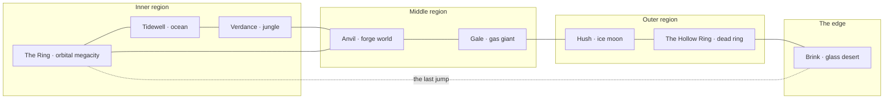

# Uma Cyberpunk: the world

> **Status: 2026-11-13, the world v2 (D28): the story's base elements, for the owner's read.** The owner asked to start
> the story with full worldbuilding, around six notes: an interplanetary adventure exploring cities on planets with
> different environments; ship travel and time with the captain at base camp; ship maintenance and each character's
> aptitudes; ship-to-ship combat; team combat on the ground with cybernetic weapons; and boarding enemy ships. This page
> answers them, and the second story brief's prompts (SB13: the big plot, the factions in depth, the ship, the captain,
> the squads, life aboard, the relationships), on top of the first pass (D3, D4), whose truth it keeps.
>
> - **Calls:** WD1–WD24 from the first pass, each marked kept, amended or superseded, and **WD25–WD48**, new. Each is a
>   recommendation, adopted until the owner changes it.
> - **Nameless (WD22):** no Uma, no heroine, nothing from a franchise beyond its title. Places, ships, factions and squads
>   have our own names. Who leads which world, which heroine leads which faction, and every line are the story's
>   private files, written next, after this read.
> - **Read it** here, on [its page](previews/world.html), or world by world in the Story Sandbox (`pnpm stories`), where
>   each world has a verdict box.
> - **What the game is asked for** is in §14 and the handoff's story requests: ship battles, boarding enemy ships,
>   maintenance and walkable cities are new to the game.

## The short answer

- **The Circuit:** the Ring and seven worlds, each a different environment with one city to walk, joined by the Lanes
  (WD25, WD27). The worlds are an orbital megacity, an ocean, a jungle, a forge world, a gas giant, an ice moon, a dead
  orbital ring and a glass desert at the edge of the dark (WD28).
- **The Tithe is the spine:** the Ring glows on power its Authority siphons from every other world in the Circuit. Each
  world the ship visits shows what's being drained from it: tides, growth, heat, storms, light (WD1).
- **The Blackout** hunts between the worlds and eats memory. The Authority's board bargains with it (WD2).
- **The ship is the Homestretch:** the first ship that ever went through a Gate, scrapped in the Ring's Docks and stolen
  back in the first chapter. It's the crew's home, base camp and stronghold (WD30).
- **The Steward,** the ship's mind, lost most of its memory to the Blackout. **Repairing the ship brings it back,** so
  maintenance is also how the mystery unfolds (WD31, WD33).
- **The captain is "unwritten":** the one person the Blackout can't read. The ship flies for them, and the crew learns to
  trust them (WD36).
- **The Umas are the Gatechildren:** twenty years ago the Homestretch came back through the first Gate carrying them as
  children. The Authority scattered them across the Circuit and scrapped the ship. Each grew up on a different world,
  which is why the ship finds its leads one world at a time (WD37).
- **Bonds are the weapon the Blackout can't answer:** a memory two people share is held twice, and it can't be eaten
  whole. The power of friendship and the power of love are the same power, literally (WD41).
- **Three ways to fight:** in Frames on the ground (WD42, WD43), from the posts in the Lanes (WD44), and in the corridors
  of a boarded ship (WD45). Heroines are freed, never killed; a beaten ship strikes, drifts or flees, never explodes with
  its crew.
- **Five acts across the eight worlds,** one layer of the truth each, ending back at the Ring's Gate Heart (WD47).

## 1. The owner's six notes, and where each lives

| The owner's note | In the world | In the game today | What's asked of the game |
|---|---|---|---|
| **An interplanetary adventure: city exploration on several planets with different environments** | Eight worlds, each one environment and one city with districts to walk (§3) | Each world is a node map with scenes (TC50) | Request 4: a walkable city per world, in the Street look |
| **Ship travel, and time with the captain at base camp** | The Homestretch as home; the captain; life aboard (§4–§7) | Built: the captain, the watch, bonds, cabins (CY13, CY14) | None new |
| **Ship maintenance and each character's aptitudes** | Wear and repair as care; the Steward's memory; who's good at which post (§4.3) | Aptitudes built as duties at posts (CY16); "no upkeep" (TC62) | Request 3: maintenance after battles and jumps, never decay with time |
| **Ship-to-ship combat** | War in the Lanes; every faction's ships (§9.3) | Deferred (TC64) | Request 1: ship battles |
| **Team combat on the ground with cybernetic weapons** | Frames around cores; five roles (§9.1, §9.2) | Built: the grid battle, rigs and roles (CY4–CY8) | None new |
| **Boarding enemy ships, with cybernetic weapons** | Boarding frees a fleet, seizes cores, rescues prisoners (§9.4) | Only defending our own decks, in Phase 6 (TC65) | Request 2: boarding enemy ships |

## 2. The Circuit (WD25–WD27)

**WD25, the Circuit.** One star system: the Ring and seven worlds, joined by **the Lanes**, the routes ships jump along.
The Lanes run in four **regions**, each opened by the ship's capability (TC66): the Homestretch can't reach the edge
until it has been rebuilt for it.

**WD26, two kinds of Gate.**
- **Siphon Gates** sit inside the Circuit, one at each world. They're the Tithe: rings of light with a gap in them, each
  in its world's colour, humming while they drain. Every one feeds the Gate Heart in the Ring.
- **Outer Gates** open to other universes. The eight factions came through them: expeditions, mercenaries, the lost and
  the bound.
- **The factions' home universes stay beyond the outer Gates and off the star map** (SB3). The worlds are ours, and the
  factions come to them.
- The first outer Gate the Authority ever opened is the one the Homestretch went through, twenty years ago (WD37).

**WD27, what every world has:**
- **one environment,** distinct from every other;
- **one city to walk,** with districts, contacts, shops and investigation leads, explored in the Street look;
- **one Tithe wound:** what the siphon is draining, visible in the streets;
- **wild places** beyond the city for ground missions;
- **space around it** where ships fight;
- **one or two factions** that are new there, so a world teaches at most two new mechanics (SB3);
- **one lead:** an Uma who grew up there, whose recruitment arc brings her aboard (private casting);
- **something for the ship:** a room or an upgrade, and a decor kit for the cabins (WD29).

## 3. The eight worlds (WD28, WD29)

| # | World | Environment | The city | The Tithe takes | New factions (mechanics) | Region | Act |
|---|---|---|---|---|---|---|---|
| 1 | **The Ring** | Orbital megacity around a planet nobody visits; rain and neon | The Ring itself, in six layers | Nothing: it's where the stolen power goes | Steel Muster (cover and volley), Neon Commission (stagger) | Inner | I |
| 2 | **Tidewell** | A world ocean, no land but reefs | **The Moorings:** a floating harbour of locks, stilts and lighthouses | Its tides: the moons' pull is siphoned, and the sea is stilling | Tideline Armada (artillery) | Inner | II |
| 3 | **Verdance** | Jungle in a deep gorge, glowing at night | **The Terraces:** temple-greenhouses and canopy bridges down the gorge walls | Its growth: the forest greys from the top down | Sevenfold Envoys (reactions) | Inner | II |
| 4 | **Anvil** | Volcanic: lava rivers, ash sky, calderas | **The Slipways:** a free port of foundries and shipyards in a caldera | Its heat: the forges are cooling and the city rations warmth | None new: a breather, the ship's world | Middle | II |
| 5 | **Gale** | Gas giant: storm bands, no ground | **Highfall:** platforms riding the storm currents, joined by cable lifts | Its storms: the bands slow, and the platforms sink | Starward Contractors (typed shields and time) | Middle | III |
| 6 | **Hush** | Ice moon under a black sky, sound-quiet | **The Vaults:** geothermal halls under the ice, where nobody speaks loud | Nothing left: Hush was drained first, long ago | Lantern Wardens and the Tolling (Remnants and overload) | Outer | IV |
| 7 | **The Hollow Ring** | A dead orbital ring around a dead planet | The Ring's ghost: dark Districts, drowned Spires, ads still flickering | It's what the Ring becomes when the bargain comes due | Iron Vigil and the Transfigured (infection) | Outer | IV |
| 8 | **Brink** | Glass desert at the edge, where the dark begins in the sky | **The Last Oasis:** a caravan city under the Bastion's convent walls | Its sun: the light is thinning, the sand turning to glass | Ember Bastion and the Crowned (phases) | Edge | V |

The Steel Muster, the Authority's android foot soldiers, are on every world, so the regular-enemy board pays off when
they defect (WD47).

### 3.1 The Ring (world 1, Act I)

- **Look:** a megacity on an orbital ring, stacked in six layers (WD4, kept as this world's city): the **Spires** (the
  Authority's white towers), the **Districts** (neon streets, holo-ads, rain), the **Markets** (night markets and back
  rooms), the **Underlevels** (the dark under the city), the **Docks** (where ships leave for the Lanes) and the **Gate
  Heart** (where every siphon meets).
- **To walk:** the Districts, the Markets, the Underlevels and the Docks. The Spires and the Gate Heart stay closed until
  the finale.
- **The Tithe:** the Ring is its destination. It's the brightest place in the Circuit because every other world is
  getting darker.
- **Fights:** the Muster and the Commission in the streets; in orbit, the Authority's patrol cutters hunting a stolen
  ship (the first ship battle, a breakout).
- **The arc:** the first lead's recruitment arc. She, the captain and a handful of crew find the Homestretch in the
  scrapyard Docks and steal it out from under the Authority. Lens: **a heist**.
- **For the ship:** the Bridge and the first squad.

### 3.2 Tidewell (world 2, Act II)

- **Look:** an ocean world with no land, only reefs and storm-white lighthouses. Its city, **the Moorings**, floats on
  locks, pontoons and stilts in tiers: the Lock Market, the Lantern Piers, the Drydocks, and a Sunken Quarter under glass.
- **The Tithe:** its moons' pull is siphoned off, so the tides are stopping. The sea goes still and stale, the locks
  stand dry, and the harbour that lived on the tides is starving.
- **Fights:** the Tideline Armada's two blocs. One blockades the Moorings; the other holds a treaty with the Authority.
  Most of the world's battles are at sea and in orbit, against the blockade.
- **Boarding:** the blockade's flagship, where the free bloc's admiral is held to the treaty. Boarding her ship wins the
  free bloc over.
- **The arc:** a lead who grew up running the locks. Lens: **a smuggling run**.
- **For the ship:** the Galley, and a seaside decor kit.

### 3.3 Verdance (world 3, Act II)

- **Look:** a jungle in a gorge so deep it has its own weather, glowing blue-green at night. The city, **the Terraces**,
  is cut down the gorge walls: temple-greenhouses, canopy bridges, the Root Galleries underneath, and the Seed Vault at
  the bottom.
- **The Tithe:** its growth. The forest is greying from the top of the gorge down, leaves turning to glassy ash.
- **Fights:** the Sevenfold Envoys, an honour guard from a world of seven elements, searching the gorge for a lost
  companion. The Blackout speaks to them in their patron's voice (an Anchor). Their shrine terraces are battle maps
  where elements react.
- **The arc:** a lead raised in the Terraces. Lens: **a missing-persons search**: the Envoys' lost companion, and the
  lead's own lost family.
- **For the ship:** the Garden, grown from Verdance cuttings, and a greenhouse decor kit.

### 3.4 Anvil (world 4, the turn of Act II)

- **Look:** a volcanic world of lava rivers under an ash sky. Its city, **the Slipways**, fills a caldera: foundries,
  shipyards, Frame-smiths, and the Cooling Quarter where people who can't afford heat crowd together.
- **The Tithe:** its heat. The forges are cooling, and the city rations warmth by the hour.
- **A breather, and the ship's world.** No new faction: Anvil is a free port where the Neon Commission trades and the
  Muster keeps a depot. It's where the Homestretch is refitted, where Frames are made, and where the Lab buys Data.
- **The ship's history surfaces:** the Homestretch was built in these yards. The yard's old records, and the first of the
  Steward's memories restored here, are the first seeds of Act V (WD31).
- **Fights:** raids on the slipways, including the first time someone boards the Homestretch (TC65), and a rival
  ship's crew.
- **The arc:** a lead who grew up a Frame-smith's apprentice. Lens: **a corporate thriller**.
- **For the ship:** Engineering, and an industrial decor kit.

### 3.5 Gale (world 5, Act III)

- **Look:** a gas giant with no ground. **Highfall** is a city of platforms riding the storm currents, tied together by
  cable lifts: the Weather Exchange, the Underdecks, the Storm Shrine, the Tether Docks.
- **The Tithe:** its storms. The bands are slowing; without the currents, the platforms sink a little lower every year.
- **Fights:** the Starward Contractors, agents from other stars hired to guard Gale's siphon. They fight with typed
  shields and bend the timeline. The heaviest ship battles of the game happen here, in lightning and cloud.
- **Boarding:** a Contractor frigate, to steal the contract itself and rewrite it.
- **The arc:** a lead raised on the platforms. Lens: **a noir case**.
- **The layer:** the Contractors' scanners read the crew's Frames, and the Homestretch's own heart, as siphon cores
  (WD3).
- **For the ship:** the Sensor deck, and a sky decor kit.

### 3.6 Hush (world 6, Act IV)

- **Look:** an ice moon under a black sky, where sound carries strangely and draws the static. Its city, **the Vaults**,
  is a run of geothermal halls under the ice. People speak softly there. Above them: the Bell Tower, the ice harbour and
  a frozen market.
- **The Tithe:** nothing left to take. Hush was the first world drained, generations ago. It's what every world in the
  Circuit becomes.
- **Fights:** the Lantern Wardens, survivors of a world that already ended, sheltering here, and their cult, the Tolling,
  who ring the Bell Tower to call the Blackout in.
- **Boarding:** ghost ships frozen into the moon's ice rings.
- **The arc:** a lead raised in the Vaults. Lens: **a pirate broadcast**.
- **For the ship:** the Infirmary, and a hushed, snowlit decor kit.

### 3.7 The Hollow Ring (world 7, Act IV)

- **Look:** the Ring's sister, dead. A derelict orbital city around a dead planet: dark Districts, drowned Spires, ad
  screens still flickering for nobody. It's what the Ring becomes when the Authority's bargain comes due.
- **Fights:** the Iron Vigil, the crew's dark mirror (orbital soldiers in combat bodies), and the Transfigured, Vigil
  soldiers the Blackout has spread through like an infection.
- **Boarding is the main way in.** The Hollow Ring is a derelict, taken section by section through airlocks, with
  helmets sealed.
- **The arc:** a lead who grew up in a salvage crew working the ring's edge. Lens: **survival**.
- **For the ship:** the Lab's last branch, and a salvage decor kit.

### 3.8 Brink (world 8, Act V)

- **Look:** a glass desert at the edge of the Circuit, where the dark begins in the sky. **The Last Oasis** is a caravan
  city sheltering under the walls of the Ember Bastion's convents: the Caravanserai, the Glass Fields, the Convents and
  the Edge.
- **The Tithe:** its sun, the hardest-drained of all. The light is thinning, and the sand is turning to glass.
- **Fights:** the Ember Bastion, a sisterhood that has held the line against corruption all its life, and the Crowned,
  its strongest, whom the Blackout crowned as its generals.
- **Boarding:** a Crowned's flagship.
- **The arc:** the last lead, raised in a convent. Lens: **a pilgrimage**.
- **For the ship:** the readiness for the last jump.

**WD29, each world gives the ship something:** a room or an upgrade (the Bridge, Galley, Garden, Engineering, Sensor
deck, Infirmary and the Lab's last branch), a decor kit for the cabins (TC61), and a lead. The game's room plan (TC62)
can take these as the rooms' story; any can move.

## 4. The ship: the Homestretch (WD30–WD35)

### 4.1 What it is (WD30, WD35)

- **WD30:** the ship is the **Homestretch**, a long-hulled Gate-ship. Twenty years ago it was the first ship sent
  through an outer Gate. It came back carrying children and none of its crew. The Authority scrapped it in the Ring's
  Docks and buried the record. In Act I it's stolen back, and it becomes the crew's home, base camp and stronghold. Its
  name is the last stretch of a race, before the finish.
- **WD35, why it travels:**
  - to gather the scattered Gatechildren, one world at a time;
  - to stop the Tithe;
  - and, though nobody aboard knows it at first, to go home: the Homestretch remembers the way back through the first
    Gate, to a world with a sunlit track.

### 4.2 The Steward, and the rooms (WD31, WD32)

- **WD31, the Steward:** the ship's mind. It's warm, dry-humoured, protective, and full of holes, because the Blackout
  ate most of it in the twenty years in the scrapyard.
  - **Repairing the ship restores it:** every module brought back to level, and some repairs after battles, return a
    fragment of its memory, as a Log File (TC34).
  - The fragments are the seeds of the last layer: the voyage through the first Gate, the crew that didn't come back,
    the children in the hold.
  - The Steward never knows more than it has recovered, so it can be wrong, and it's one of the Anomalies (WD18).
- **WD32, the rooms and what they mean:**

| Room | What it is aboard | Opened by (WD29) |
|---|---|---|
| **The Bridge** | Where the captain gives Orders and the star map lives | The Ring |
| **The Quarters deck** | Every Uma's cabin (TC60); berths first, private cabins as the deck grows | The Ring |
| **The Hangar** | Frames racked and refitted; the squads suit up here | The Ring |
| **The Galley** | The heart of life aboard: the after-jump meal, music, arguments | Tidewell |
| **The Garden** | Verdance cuttings under grow-lights; the quiet room | Verdance |
| **Engineering** | Where the ship is kept flying, and the Steward is rebuilt | Anvil |
| **The Sensor deck** | Reading the Lanes, the storms and the dark | Gale |
| **The Infirmary** | Strain, rest, and the medic's watch | Hush |
| **The Lab** | Research in four branches (TC63) | Anvil, its last branch at the Hollow Ring |
| **The Guest Wing** | Freed heroines, guests and envoys (TC47) | The first freed heroine |
| **The Observation deck and the Track** | A ring corridor around the observation dome, built long ago. The Umas run laps on it and can't say why (WD40) | The Ring |

### 4.3 Maintenance and aptitudes (WD33, WD34)

- **WD33, maintenance is care, not a chore.** The Homestretch is twenty years scrapped and patched together.
  - **It wears from what it does:** jumps through damaged Lanes, ship battles, and being boarded. Each leaves damage on
    the modules that took it.
  - **The crew repairs it at their posts** over watches: a mission or a jump, never real time (TC67).
  - **It never decays while it sits.** There's no upkeep, no breakdown from neglect and no failure roll (TC68 kept).
  - **A damaged module still works,** just weaker in battle, until it's repaired.
  - **Repair restores the Steward** (WD31).
  - Taking time aboard to repair after a hard battle is a beat of life aboard, not a tax.
- **WD34, every Uma has aptitudes.** Her stats and running style make her better at some posts than others (TC67's band
  thresholds), and she has a post she loves (a liked duty).
  - **The ship's stations:** the helm, the guns, the shields, engines, sensors, the Hangar's deck crew, the Infirmary,
    the Galley and the Garden.
  - **In a ship battle** (WD44), the crew at those posts is the ship's strength.
  - **In repair** (WD33), the right Uma at the right post fixes it faster.
  - Which Uma is good at what is the casting's, privately; the game derives it from her stats until then.

## 5. The captain (WD36)

**WD36, the captain is "unwritten":** the one person aboard the Blackout can't read.
- The Steward won't fly for anyone it can't trust its memory with, and the captain is the only one whose past the
  Blackout has never touched. That's why the ship answers to them, though they've never commanded anything.
- **Who the captain was before is the player's to imagine.** The game never shows their face, never fixes their past,
  and uses the pronouns the player picks (SB15).
- **The crew's view changes:**
  - **at first:** a stranger the ship chose. Some Umas resent it; some are curious.
  - **in time:** the one person who remembers everything for them. When the Blackout takes a memory from an Uma, the
    captain still has it, and gives it back in a bond scene.
- **The captain gives Orders from the Bridge** (TC59) and is at the heart of every bond (WD41). They never fight on the
  board.

## 6. The crew (WD37–WD39)

### 6.1 The Gatechildren (WD37)

**WD37** amends WD8:
- **Where they came from:** twenty years ago, the Homestretch came back through the first outer Gate with a hold full of
  sleeping children: the Umas, from a world with a sunlit track.
- **What the Authority did:** feared what it had found, so it scattered them across the Circuit's worlds as foundlings,
  one or two to a world, and scrapped the ship.
- **What the Blackout did:** trimmed their memories down to a dream of running under a sun they've never seen.
- **Now:** they're adults, grown on different worlds into different lives, and they don't know about each other. That's
  why the Homestretch finds its leads one world at a time, *Octopath Traveler*'s way.
- **What they share:** the dream, a pull toward the ship they can't explain, and a way of running they never learned.
- The crew is Umas only (SB3).

### 6.2 The squads (WD38)

**WD38, up to four squads** (TC69), each with a banner and a way of fighting. Who leads each is the casting's,
privately. They're named the way the Umas joke, in words from a sport none of them remembers playing.

| Squad | Banner | Their way | Where they shine |
|---|---|---|---|
| **Gatebreak** | A starting gate burst open | First in: break the line, hold the breach | Assaults and boarding |
| **Long Shot** | A single star at long range | Patient and precise: gunners and overwatch | Holding ground, ship gunnery |
| **Photo Finish** | Two noses at a line | Showy closers who win it at the end | Strikers, duels, finales |
| **Dark Horse** | A shadowed horse's head | Quiet: infiltration, hacking, recon | City investigations, Jack-Outs, sabotage |

The banners are drawn in code (pixel art, uma-art).

### 6.3 The rival squad (WD39)

**WD39** amends WD6:
- **Who:** the Authority's licensed heroes, the **Laurel Guard**, famous on every billboard in the Ring. They're Umas from
  the NPC board (TC40), Gatechildren too, raised by the Authority itself.
- **Their ship:** the **Laurel**, a sleek hero ship that hunts the Homestretch across the Circuit.
- **Their cost:** they fly on overclocked cores that burn their pilots out.
- **Their captain:** knows the truth and believes the Ring's survival justifies it, so the rivalry is sincere.
- **Their arc:** they're the first ship battle you can't win (the Ring); allies of convenience at the Hollow Ring, against
  something worse; and in the finale, the squad that chooses.

## 7. Life aboard (WD40)

**WD40, what a day aboard is like:**
- **Watches, not hours.** Time aboard passes in watches: a mission, or a jump (TC67). After each, the crew comes off duty.
- **The after-jump meal.** Every jump ends in the Galley, whoever cooked. It's where squads argue, rivalries soften and
  news from the last world is told.
- **Laps on the Track.** Off duty, the Umas run the ring corridor around the observation dome. Nobody remembers who built
  it or why it's exactly that long. It's a seed of the last layer.
- **Shore leave.** At every world, the crew goes down into the city in street clothes: the markets, a meal, a show, a
  keepsake for a cabin. It's where city exploration and life aboard meet.
- **Cabins as memory.** Each Uma's cabin fills with things from the worlds she's been to: decor kits, keepsakes,
  cuttings from the Garden. Rooms are personal, and what she keeps says who she is (TC61).
- **The Guest Wing** fills as heroines are freed. Some stay; some go home through their Gate when the ship can open it.
- **The bell.** The Steward rings the watch with a sound none of the crew can place.

## 8. Bonds: the power of friendship and the power of love (WD41)

**WD41, bonds are the one thing the Blackout can't eat.**
- **The mechanism:** the Blackout feeds on memory, but a memory two people share is held twice, and it can't be taken
  whole. Every bond scene is a memory made together, and some give back what was taken.
- **Friendship and love are the same power.**
  - Trust and Heart give equal strength (TC56, TC58, SB15).
  - The story makes either one meaningful, and never makes love the "better" choice.
- **Resonance at rank 10:** two memories holding each other, strong enough to stand against a Crowned in the finale
  (TC58).
- **Partners between Umas** are the same thing between two Gatechildren: a shared childhood neither remembers, found
  again.
- **The tone (TC72, SB15):**
  - everyone is an adult;
  - it's warm and teasing, never explicit, mutual, and never jealous;
  - every Uma is open to every captain, never exclusively;
  - she speaks first at rank 8;
  - a player can keep it to friendship.
- **In the plot:** the Blackout's generals are those who lost everything they shared. The finale is won by a crew that
  remembers each other, with the captain holding what each of them forgot (WD24).

## 9. How the crew fights (WD42–WD45)

### 9.1 Frames (WD42)

**WD42, Frames are the crew's cybernetic weapons:** modular combat suits built around a **core**.
- **The parts** are the concept's: arms, legs, core and back unit.
  - The forearm **emitter** fires the core's charge.
  - The **projector** throws a shield.
  - Shoulder and forearm mounts take swappable weapon and defence modules.
- **Helmets:** a sealed **helmet** closes the Frame for vacuum, smoke and boarding.
- **Pilot suits:** the crew's full-body ship suits link the wearer to the ship's posts, so a pilot suit at the helm is
  part of the ship.
- **The art matches:** the approved looks show exactly these (Modular Frame 01, the shared Helmet 01, the
  ship-operating suit).
- **The cores are stolen** siphon prototypes, the crew's original sin (WD3), given up in the finale.
- **Suit-up** is the Frame snapping on, lit in her colour (TC39).
- **The five roles** (Vanguard, Striker, Gunner, Netrunner, Medic) are the five ways a Frame is fitted (TC5).

### 9.2 On the ground (WD43)

**WD43, ground battles are the grid tactics as built.** They're fought in two kinds of place:
- **City maps:** streets, markets, docks and rooftops, where investigation leads end;
- **Wild maps:** reefs, canopy, calderas, platforms, ice and glass.

Each world's maps carry its environment's terrain: Tidewell's locks flood, Verdance's shrines hold elements, Anvil's
lava vents, Gale's platforms tilt in the wind, Hush's ice cracks, Brink's glass cuts and reflects. Each environment's
terrain is the game's to choose; the world only says what's there.

### 9.3 In the Lanes: ship battles (WD44)

**WD44, the Lanes are contested, and ships fight in them.**

| Who | Their ships | Why they fight the Homestretch |
|---|---|---|
| **The Authority** | Patrol cutters; the **Laurel** | A stolen ship, and the truth it carries |
| **Steel Muster** | Troop carriers that drop squads | Ordered to |
| **Neon Commission** | Fast smuggler skiffs | A bounty, or a better offer |
| **Tideline Armada** | Carriers, destroyers, a flagship; artillery at range | The blockade |
| **Sevenfold Envoys** | One temple-ship, slow and elemental | They believe the ship hides their lost companion |
| **Starward Contractors** | Corvettes and frigates that bend the timeline | Their contract |
| **Lantern Wardens** | Ghostly lantern-ships that call wrecks back | The static near the Gates |
| **Iron Vigil** | Infected hulks that spread to what they touch | The infection |
| **Ember Bastion** | Guard-ships; a Crowned's flagship | They take the cores for the corruption's source |

- **The crew fights at their posts** in pilot suits (WD34): helm, guns, shields, engines, sensors, and the captain's
  Orders from the Bridge.
- **What's at stake:** passage, salvage, a prisoner, or a chance to board.
- **Nobody dies on screen:** a beaten ship strikes its colours, drifts, or limps away. It never explodes with its crew
  aboard (WD20).
- **Environments shape the fights:** Gale's lightning, the Hollow Ring's debris, Hush's ice rings, the dark at the edge.
- **The battle's rules are the game's** (request 1).

### 9.4 Boarding (WD45)

**WD45, boarding is how fleets are freed.**
- **Why board:** a Collar is broadcast from a ship's command core, so breaking that core aboard frees every Collared
  heroine in the fleet at once. Ships also hold siphon cores worth seizing, prisoners worth rescuing, and contracts worth
  stealing.
- **How it plays:** grid battles in the enemy's corridors, cargo holds and reactor rooms, helmets sealed, with the
  ship's own security as terrain: doors, turrets, vents and decompression.
- **The reverse:** enemies board the Homestretch too (TC65), first at Anvil's slipways.
- **What the game decides:** the board and the rules (request 2).

## 10. The truth, in layers (WD1–WD3, WD8)

The game is still a mystery the player assembles, *13 Sentinels*' way: each act opens on a flash-forward (WD17) and
peels back one layer.

| Layer | What the crew believes | What's true | Revealed |
|---|---|---|---|
| **0. The surface** | Gates are natural rifts; the Authority protects the Circuit; the Laurel Guard are heroes | — | Act I opens here |
| **1. The frame** | — | The Authority framed the first lead for a Gate it opened on purpose, because she saw it happen | Act I, the Ring |
| **2. The Tithe** | — | The siphon Gates drain every world in the Circuit to light the Ring; the factions are here to stop it, or are paid or bound to guard it | Act II, Tidewell and Verdance |
| **3. The cores** | — | The crew's Frames, and the Homestretch's heart, run on stolen siphon cores. Every battle won drains a little more | Act III, Gale |
| **4. The Blackout** | — | The siphons let in the Blackout. The Authority's board bargains with it. Hush is what a drained world becomes; the Hollow Ring is what the Ring becomes | Act IV, Hush and the Hollow Ring |
| **5. The crew** | — | The Umas are the Gatechildren, carried through the first Gate on this very ship, from a world with a sunlit track | Act V, Brink and the Gate Heart |

- **WD1, amended:** the Tithe drains the Circuit's own worlds through their siphon Gates. Each world's wound shows it
  first-hand.
- **WD2, kept:** the Blackout, a hunger between worlds that eats and rewrites memory; those it takes completely are
  **Dimmed**, their colours drained to one sickly accent.
- **WD3, amended:** the stolen cores power the crew's Frames, and the Homestretch's heart is the first core of all.
- **WD8, amended into WD37:** the Gatechildren.

## 11. The factions, in depth (WD9–WD14, WD23, WD46)

The eight factions keep their names, Holds and mechanics from the first pass (WD10, WD11). Their mechanics are the
battle's and fixed. Each now has a world where it's met first, its ships (WD44), and a standing ladder (WD46).

**WD46, faction standing:** every faction can be moved:
- **hostile:** fights on sight;
- **wary:** talks, trades, and won't attack first;
- **allied:** lends ships, guests and operations.

What moves each faction is below. Standing is shown on the Bridge (TC71).

### 11.1 The Steel Muster (NIKKE)

| | |
|---|---|
| **Who** | Android squads pulled through an outer Gate, now the Authority's foot soldiers on every world |
| **What they want** | Their own command codes back, and a name of their own |
| **How they live** | In depots and troop carriers, by drill and roster; they keep each fallen unit's number |
| **Leaders** | A field commander who obeys, and a sergeant who has started to doubt |
| **What they think of the ship** | A target, and then a rumour: the ship that gives codes back |
| **Hold** | Collar |
| **Moving them** | Steal their codes back, squad by squad, by boarding their carriers (wary); the whole Muster defects in the finale (allied) |
| **Freeing a heroine means** | One more unit that answers to herself |
| **Mechanic** | Cover and volley |

### 11.2 The Neon Commission (Zenless Zone Zero)

| | |
|---|---|
| **Who** | Crews and agencies for hire, working the Ring's Underlevels and Anvil's free port |
| **What they want** | To get paid, and to get home with their crew whole |
| **How they live** | Job to job, in back rooms and safehouses, with loud loyalties and quick grudges |
| **Leaders** | A broker who sells to everyone, and a crew chief who keeps her word |
| **What they think of the ship** | A good client, a good bounty, or both |
| **Hold** | None |
| **Moving them** | Outbid the Authority, or beat their best and the job's off (wary); trade with them at Anvil (allied) |
| **Freeing a heroine means** | A job she won't take again; the first guests |
| **Mechanic** | Stagger |

### 11.3 The Tideline Armada (Azur Lane)

| | |
|---|---|
| **Who** | A fleet from a sea-world beyond its Gate, split in two blocs at Tidewell |
| **What they want** | The way home; one bloc thinks the treaty gets it, the other thinks the Ring stole it |
| **How they live** | Aboard: a navy's ceremony, flags and a long war's habits |
| **Leaders** | A treaty-bloc admiral held to the Authority's deal, and a blockade captain who won't bow |
| **What they think of the ship** | A smuggler at first; then the only ship that ran their blockade and didn't sink anyone |
| **Hold** | None |
| **Moving them** | Board the flagship and win the duel (the free bloc, allied); the treaty bloc turns when the Authority betrays it (wary, then allied) |
| **Freeing a heroine means** | A ship that sails for the Homestretch's flag |
| **Mechanic** | Artillery |

### 11.4 The Sevenfold Envoys (Genshin Impact)

| | |
|---|---|
| **Who** | An honour guard from a world of seven elements, searching Verdance for a lost companion |
| **What they want** | Their companion back, and their oath kept |
| **How they live** | In shrine terraces they've built in the gorge, by vow and rite |
| **Leaders** | A captain who hears the patron's voice, and a keeper who suspects it's false |
| **What they think of the ship** | That it hides their companion |
| **Hold** | Anchor: the Blackout speaks in their patron's voice |
| **Moving them** | Break the binding sigils on the shrines (wary); find what happened to the companion (allied) |
| **Freeing a heroine means** | An oath sworn again, to the right voice |
| **Mechanic** | Reactions |

### 11.5 The Starward Contractors (Honkai: Star Rail)

| | |
|---|---|
| **Who** | Agents from other stars, contracted by the Authority to guard Gale's siphon |
| **What they want** | A contract honoured, and the truth about what they're guarding |
| **How they live** | By the contract, aboard corvettes, among themselves, with dry courtesy |
| **Leaders** | A contract officer who reads every clause, and an agent who's read too much |
| **What they think of the ship** | A breach of contract with a name |
| **Hold** | None |
| **Moving them** | Board a frigate and steal the contract (wary); show them it guards a cancer (allied); some simply leave |
| **Freeing a heroine means** | A contract torn up |
| **Mechanic** | Typed shields and time |

### 11.6 The Lantern Wardens and the Tolling (Wuthering Waves)

| | |
|---|---|
| **Who** | Survivors of a world that already ended, sheltering in Hush's Vaults; and their cult, the Tolling |
| **What they want** | The Wardens: never to see it happen again. The Tolling: to let the Blackout finish what it started |
| **How they live** | Quietly, keeping lanterns lit for the names they lost; the Tolling ring the Bell Tower |
| **Leaders** | A Warden elder; the Tolling's bell-keeper |
| **What they think of the ship** | A ship of the drained, come to be drained again |
| **Hold** | Anchor: near the Gates the static overloads their powers |
| **Moving them** | Keep a Warden alive until her overload burns out, and calm her with a Jack-Out (wary); silence the bell (allied). The Tolling's leaders never turn |
| **Freeing a heroine means** | A lantern relit |
| **Mechanic** | Remnants and overload |

### 11.7 The Iron Vigil and the Transfigured (Punishing: Gray Raven)

| | |
|---|---|
| **Who** | Orbital soldiers in combat bodies, holding the Hollow Ring, and the Transfigured, their own fallen to the infection |
| **What they want** | To purge the infection and take back their ring |
| **How they live** | In sealed sectors, by quarantine and watch |
| **Leaders** | A commander who has lost half her unit, and a medic who keeps the rest alive |
| **What they think of the ship** | A crew that runs on the same kind of power as the thing that infected them: their dark mirror |
| **Hold** | Anchor: the infection |
| **Moving them** | Purge the infection at a core tile (wary); clear the Hollow Ring's heart together (allied) |
| **Freeing a heroine means** | A soldier back from the other side |
| **Mechanic** | Infection |

### 11.8 The Ember Bastion and the Crowned (Honkai Impact 3rd)

| | |
|---|---|
| **Who** | A sisterhood that has fought a corruption all its life, holding Brink's edge; and the Crowned, its strongest, made the Blackout's generals |
| **What they want** | To hold the line; to free their crowned sisters |
| **How they live** | In fortress-convents, by vigil and drill, with a hard humour |
| **Leaders** | An abbess who takes the crew's cores for the corruption's source, and a sister who has seen otherwise |
| **What they think of the ship** | That it carries the thing they've fought all their lives |
| **Hold** | Anchor for the Crowned; None for the rest |
| **Moving them** | Defeat a Crowned to purge her (wary); give up the cores in the finale (allied) |
| **Freeing a heroine means** | A sister come home, or one who goes home through her Gate: the saddest the game gets |
| **Mechanic** | Phases |

**Who's behind whom (WD13), and allies and rivals (WD23), stand as the first pass has them:**
- **The Blackout's hold:** it owns the Authority through its bargain. The Authority pays the Commission and the
  Contractors, commands the Muster and holds the Armada's treaty bloc.
- **The Blackout's direct reach:** it reaches the Envoys through a false voice, the Wardens and the Tolling through
  static, the Vigil through infection and the Bastion through crowns.
- **Freed heroines** open their File and a log from their side (WD12), and some live in the Guest Wing.
- **Each faction also fields original machines** (WD14), and now its ships (WD44).

## 12. The big plot: five acts across eight worlds (WD47)

**WD47** amends WD15:

| Act | Worlds | The plot | New mechanics | Tone | Layer | The crew's arc (WD16) |
|---|---|---|---|---|---|---|
| **I** | The Ring | Framed, the first lead finds the Homestretch in the scrapyard Docks; she, the captain and a few others steal it and break out past the Laurel | Cover and volley; stagger | Bright, urban, a heist | 1. The frame | The crew forms |
| **II** | Tidewell, Verdance, then Anvil | Running the Armada's blockade, the gorge's greying forest: the Tithe is everywhere. At Anvil the ship is rebuilt, and its first memory returns | Artillery; reactions | Bright adventure, then a breather | 2. The Tithe | One member walks out, and comes back |
| **III** | Gale | The Contractors read the crew's cores, and the ship's heart, as siphon cores: the crew runs on what they're fighting | Typed shields and time | Space opera | 3. The cores | The rival veterans: the Laurel Guard's burned-out predecessors |
| **IV** | Hush, then the Hollow Ring | A world already drained; the Ring's dead sister. The Blackout's bargain, seen for what it costs. The Laurel Guard fight beside the crew, once | Remnants and overload; infection | Sad, then grim | 4. The Blackout | The enemy in plain sight: a deceiver close to home |
| **V** | Brink, then the Gate Heart | At the edge, the Steward remembers the first Gate; the crew learns who they are. Back at the Ring, the Gate Heart | Phases | Tragic, then heroic | 5. The crew | The freed come back; redemption |

- **Faction standing runs through every act (WD46):** the Muster defects in Act V, the Armada's free bloc sails with the
  ship from Act II, and the Envoys, Contractors, Wardens, Vigil and Bastion turn in their own worlds.
- **The leads' recruitment arcs** are short, as the first brief advises (SB5): a lead joins at the crew's level. Later,
  their personal stories live in bond scenes (TC57).
- **Crossed paths:** a lead's world can call back an earlier one, as Tidewell's Armada sails again at Brink.
- **WD16, WD17, WD18, kept:** the arc shapes, flash-forwards and seeding.
- **WD18 gains** the ship's own interfaces as places for clues: the Steward's gaps, the Track's length, the bell's sound.
- **WD19, amended:** each world has its genre lens (§3), and every recruitment arc ends with the lead coming aboard.

## 13. Tone, names and the ending (WD20, WD21, WD24)

- **WD20, kept:**
  - a found family, candy-bright neon over a tragic story;
  - no gore, and nobody dies on screen;
  - an Uma is never maimed;
  - every Uma is an adult (SB15).
- **WD21, kept:** every name is ours. No term from *13 Sentinels*, *Star Guardian*, *Front Mission*, *Triangle Strategy*
  or any franchise. This page's names: the Circuit, the Lanes, the Ring, Tidewell and the Moorings, Verdance and the
  Terraces, Anvil and the Slipways, Gale and Highfall, Hush and the Vaults, the Hollow Ring, Brink and the Last Oasis, the
  Homestretch, the Steward, the Track, the Gatechildren, the Laurel and the Laurel Guard, Gatebreak, Long Shot, Photo
  Finish and Dark Horse.
- **WD24, amended, the ending:**
  - The crew shuts the siphons at the Gate Heart and gives up their cores.
  - The freed heroines lend their own power for the last battle, so the found family is literal.
  - The Ring dims but lives, and the Gates become doors that open both ways.
  - With its heart given up, the Homestretch makes one last jump on what the crew can give it: back through the first
    Gate, toward a sunlit track. The game ends before anyone sees it.

## 14. What the game is asked for (WD48)

**WD48:** five story requests, filed in [the handoff](../handoff/README.md#story-requests) for the game session. Each
is the owner's own note; the game decides the rules and when.

| # | Request | Why | Today |
|---|---|---|---|
| 1 | **Ship battles** in the Lanes: the Homestretch against faction ships, fought from the crew's posts and the captain's Orders | The owner's note; WD44 | Deferred (TC64) |
| 2 | **Boarding enemy ships:** grid battles in their corridors, helmets on; breaking a command core frees a fleet's Collared heroines | The owner's note; WD45 | Only defending our own decks, in Phase 6 (TC65) |
| 3 | **Maintenance:** ship battles, boarding and hard jumps damage modules; the crew repairs them at posts over watches, by aptitude; never decay with time; repairs can return the Steward's memories as Log Files | The owner's note; WD31, WD33 | No upkeep (TC62) |
| 4 | **A walkable city per world,** in the Street look: districts, contacts, shops and investigation leads, beyond the node map | The owner's note; WD27 | Node maps with scenes (TC50) |
| 5 | **The Track:** the ring corridor on the Observation deck, where off-duty Umas run laps; a place for bond scenes | WD40 | No such room |

## 15. The calls

**Kept, amended or superseded from the first pass:**

| Id | Now | Call |
|---|---|---|
| WD1 | Amended | The Tithe: the Ring siphons the Circuit's own worlds through their siphon Gates |
| WD2 | Kept | The Blackout: a hunger between worlds that eats and rewrites memory; the Authority's board bargains with it; the Dimmed |
| WD3 | Amended | The crew's Frames run on stolen siphon cores, and the Homestretch's heart is the first; given up in the finale |
| WD4 | Amended | The Ring's six layers are the first world's city |
| WD5 | Amended | The Lanes join the whole Circuit; Gates are siphon Gates or outer Gates (WD26) |
| WD6 | Amended | The rival squad is the Laurel Guard on the Laurel (WD39) |
| WD7 | Superseded | The Hideout is replaced by the Homestretch (WD30) |
| WD8 | Amended | The crew's secret becomes the Gatechildren (WD37) |
| WD9 | Kept | Three Holds, Anchor, Collar and None; a heroine is never killed |
| WD10 | Kept | Eight factions with original names |
| WD11 | Kept | One new mechanic each; now placed by world (§3) |
| WD12 | Kept | A freed heroine opens her File; some join as guests and live in the Guest Wing |
| WD13 | Kept | Who's behind whom |
| WD14 | Amended | Faction hardware, plus each faction's ships (WD44) |
| WD15 | Amended | Five acts across eight worlds (WD47) |
| WD16 | Kept | The crew's arc takes Star Guardian's four era shapes |
| WD17 | Kept | Each act opens on a flash-forward to its own climax |
| WD18 | Kept | Seeding and Anomalies, now also in the ship's interfaces |
| WD19 | Amended | One genre lens a world; every recruitment arc ends with the lead aboard |
| WD20 | Kept | Tone: found family, neon over tragedy, no gore, no one dies on screen, never maimed, adults |
| WD21 | Kept | Every name is ours |
| WD22 | Kept | This page names no character; casting, chapters and lines are private |
| WD23 | Kept | Allies and rivals among the factions |
| WD24 | Amended | The ending, with the Homestretch's last jump through the first Gate |

**New:**

| Id | Call |
|---|---|
| WD25 | The Circuit: the Ring and seven worlds, joined by the Lanes, in four regions opened by the ship's capability |
| WD26 | Two kinds of Gate: siphon Gates at each world feeding the Gate Heart; outer Gates to other universes, the factions' way in; their home universes stay off the map |
| WD27 | Every world has one environment, one city to walk, one Tithe wound, wild places, space to fight in, one or two new factions, one lead and a gift for the ship |
| WD28 | The eight worlds: the Ring, Tidewell, Verdance, Anvil, Gale, Hush, the Hollow Ring and Brink, as §3 has them |
| WD29 | Each world gives the ship a room or upgrade, a decor kit and a lead |
| WD30 | The ship is the Homestretch, the first Gate-ship, scrapped in the Ring's Docks and stolen back in Act I; home, base camp and stronghold |
| WD31 | The Steward, the ship's half-erased mind; repairs restore its memory as Log Files, the seeds of the last layer |
| WD32 | The rooms and what they mean, each opened by a world |
| WD33 | Maintenance is care, not a chore: wear from jumps, battles and boarding, repaired at posts over watches; no decay with time |
| WD34 | Every Uma has aptitudes for the ship's stations, which matter in ship battles and repair |
| WD35 | The ship travels to gather the Gatechildren, stop the Tithe and, unknowingly, go home |
| WD36 | The captain is unwritten: the one the Blackout can't read; never drawn, their past the player's; the crew's keeper of memory |
| WD37 | The Gatechildren: the Umas came through the first Gate as children on the Homestretch and were scattered across the Circuit; now adults |
| WD38 | Four squads with banners: Gatebreak, Long Shot, Photo Finish and Dark Horse; leaders private |
| WD39 | The rival squad, the Laurel Guard, on the Authority's hero ship, the Laurel |
| WD40 | Life aboard: watches, the after-jump meal, laps on the Track, shore leave, cabins as memory, the Guest Wing, the bell |
| WD41 | Bonds are the power the Blackout can't eat; friendship and love are equal; Resonance; partners; the tone |
| WD42 | Frames: modular cybernetic combat suits around a core; helmets for sealed fights; pilot suits link to the ship |
| WD43 | Ground battles on city and wild maps, each world's terrain from its environment |
| WD44 | Ship battles in the Lanes against every faction's ships, from the crew's posts; a beaten ship strikes, drifts or flees |
| WD45 | Boarding frees a fleet by breaking its command core, and seizes cores, prisoners and contracts; enemies board us too |
| WD46 | Faction standing from hostile to wary to allied, and what moves each faction |
| WD47 | Five acts across eight worlds, one layer each |
| WD48 | Five story requests for the game: ship battles, boarding, maintenance, walkable cities, the Track |
