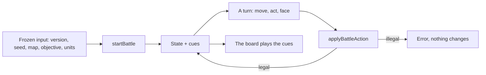
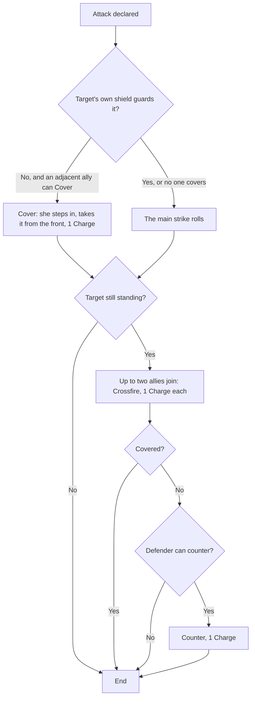

# The battle, core rules

> **Status: 2026-11-12, CY4 (D8).** The rules as `@cyber/battle` plays them, rules version 1. Terrain, Tech, the Back
> units' actions, chance skills and items arrive in CY5; the enemy AI and the simulator in CY6; the board in CY7. Every
> number below comes from `packages/battle/src/tuning.ts`, and the tables marked live are rendered from it.

## The short answer

- **A battle is a frozen input plus a list of actions.** The input holds the rules version, the seed, the map, the
  objective and every unit with her bands and her resolved rig. Replaying the actions on the input gives the same state
  every time, so the save keeps only those two (an autosave after every action is a few bytes).
- **Each unit acts when her own clock fills,** at a rate set by Speed. A turn is **move, then one action, then face.**
- **The rig takes the damage:** four parts (Core, two arms, Legs) with their own HP. A broken arm drops its weapon,
  broken Legs slow her, a broken Core is a **Rig Break**: she kneels and extracts, never dies.
- **Charge** is one small bar: spend it on your turn or keep it to counter, join an ally's attack (Crossfire) or take a
  hit for one (Cover) on theirs.
- **The forecast card** shows every number before a turn is sent, from the same functions the result uses.



## The map

A map is JSON, schema 1. Its heights stay digit rows, exactly uma-stage's room format, so the board builds them with no
translation.

```json
{
  "schemaVersion": 1,
  "id": "test-yard",
  "width": 10, "depth": 10,
  "heights": ["0000000000", "…"],
  "tiles": ["..........", "…"],
  "spawns": { "squad": [[1, 8], "…"], "enemy": [[7, 1], "…"] }
}
```

| Field | Rule |
|---|---|
| `width`, `depth` | 6–14 each |
| `heights` | One digit 0–3 a tile; row 0 is the back (north), x grows east |
| `tiles` | `.` floor, `#` solid (no standing, blocks sight), `=` grating, `c` cover; grating and cover play as floor until CY5 |
| `spawns.squad` | Exactly five tiles: four Umas and a guest |
| `spawns.enemy` | One to eight tiles |

No spawn sits on a solid tile or shares one. `parseMap` refuses anything else and names the path, such as
`map.heights[3][0]: expected a digit 0–3`.

**Directions** are N, E, S and W; S faces the camera.

## The units and their rigs

Each unit brings five **bands** (Speed, Stamina, Power, Guts and Wit, 1–5), a Charge cap (3, or 4 and 5 with licences
later), her link toggle, a leader flag, a spawn, a facing and her **resolved loadout**: each part's numbers, never a
catalogue id. A unit may carry a `ref` and a `label` for the app; the rules never read them.

**The loadout: eight slots and a Coat.**

| Slot | Carries |
|---|---|
| Core | Load; optional Capacity and HP bonus |
| Left arm, Right arm | Load; optional HP bonus |
| Legs | Load; optional HP bonus and a Move modifier |
| Back unit | Launcher, Bulwark, Thruster, Deck, Med or none; Load and optional Capacity; a Launcher carries a Long weapon and 1–9 ammo |
| Visor | Load; `aim` lets her pick a part at −25% hit |
| Left hand, Right hand | A weapon or a shield, or nothing |
| Coat | P, I or F: halves that damage type |

- **Load against Capacity:** every slot's Load added up must fit her Capacity (10 + 2 a Power band, plus the Core's and
  the Back unit's bonus). Over Capacity, the battle refuses her.
- **A light rig is a fast rig:** at 70% of Capacity or less, +1 Move.
- **A two-handed weapon** goes in the right hand with the left hand empty. **A Long weapon** fires only from a Launcher.

**What breaks when a part breaks:**

| Part | When it breaks |
|---|---|
| Core | **Rig Break:** she kneels, out of the fight |
| One arm | That hand's weapon or shield is off; a two-handed weapon fires at half accuracy |
| Both arms | No attack and no guard; she can still move and Wait |
| Legs | Move 1, no level changes, evasion 0 |
| A hit on a broken part | Goes to the Core |

## The timeline and Charge

- Every clock fills at its Speed band's rate; a turn comes at 1,000. A **round** is 100 ticks: one turn at Speed band 3.
  Rounds are what "hold for N rounds" counts.
- **Ties** go to the higher Speed band, then to the seeded roll. The timeline shows the next eight turns.
- **Charge** starts at 1 and gains 1 at the start of each of her turns, up to her cap.
- **Wait** means no action (moving is still allowed): +1 Charge more, and her clock restarts at 250 instead of 0, so her
  next turn comes sooner. The forecast shows the shift.
- **The link toggle** is a free action on her own turn: with it off she never joins Crossfire or gives Cover.

## A turn

One action: `{ kind: "turn", unit, to?, act, face }`, where `act` is an attack (a mount, a target and an optional aimed
part), `wait` or `none`. The app holds the two-tap move and its undo itself and sends the turn whole.

1. **Move** (optional): to any reachable tile.
2. **Act:** attack, Wait, or nothing.
3. **Face** one of the four ways.

An illegal turn (not her turn, an unreachable tile, a target out of reach, a part already broken) returns an error and
changes nothing.

### Movement

- Move points come from her Speed band, +1 for a light rig, plus the Legs' modifier; broken Legs move 1.
- A step climbs or drops one level at most; broken Legs stay level. Solid tiles can't be entered.
- **Zones of control:** entering a tile next to a standing enemy ends the move.
- A unit passes through her own side, never through the other, and never ends on an occupied tile.

### Reach and line of fire

| Band | Range | Height reach | Line of fire |
|---|---|---|---|
| Melee | 1 | Two levels up or down | Not needed |
| Short | The weapon's, within 1–3 | Two levels up or down | Needed |
| Long | The weapon's, within 3–6; +1 from two levels up | Any | Needed |

Range is counted in steps (no diagonals). **Line of fire** runs from her eye (0.8 of a level above her tile) to the
target's middle (0.5 above hers); a solid tile, or a tile higher than the line where it crosses, blocks it. Units never
block.

## Attacks

An attack fires one mount (right hand, left hand, or the Back unit's Launcher) at one standing enemy. The attacker turns
to face her target as she fires.

**Where it lands:** inside the target's front quarter is the **front**, inside her back quarter the **back**, anything
else, diagonals included, the **side**.

**Each hit rolls on its own** (Short weapons fire several):

1. **Hit %** = the weapon's accuracy + 3 a Wit band − the target's evasion (2 a Speed band, 0 with broken Legs), − 25
   when aimed, clamped to 5–95%.
2. **Crit:** the weapon's crit % (5 unless it says) for ×1.5 damage.
3. **The part:** aimed, or rolled on the band's weights; a hit on a broken part goes to the Core.
4. **Damage** = the weapon's power (+2 a Power band for Melee) × facing (side ×1.25, back ×1.5) × height (+10% a level
   above the target, −10% a level below) × Coat (×0.5 when it matches) × crit × (100% − the Guard), rounded down, at
   least 1. The arithmetic is exact integers, so a replay can't drift.
5. **The Guard:** a whole shield arm cuts a hit from the front or side (a tower shield 40%, a buckler 20%), never from
   behind.

**A Long weapon** uses one ammo a shot, and is never countered and never counters.

### The exchange, in order



- **Cover:** when the target's own shield doesn't guard the attack (she has none, or it comes from behind), the first
  adjacent ally in timeline order with a whole shield arm, her link on and 1 Charge steps in. She takes the main strike
  from the front, so her Guard applies. A covered attack draws no counter.
- **Crossfire:** up to two of the attacker's allies join with a free basic attack, 1 Charge each, in timeline order, if
  their link is on and either they stand on the target's far side with a Melee or Short weapon in reach (a **pincer**),
  or they have a Short or Long weapon in reach with a line of fire (a **link**). Enemies do it too.
- **Counters** are automatic: the defender answers with a Melee or Short weapon in reach of the attacker, for 1 Charge,
  when she's still standing, the attack came from her front or side, and it wasn't Long.

## Rig Break and Hold on

- At Core 0 her rig locks and she **kneels**: no turns, not a target. She stays **rebootable until the end of her next
  turn** (the Medic's reboot arrives in CY5); when that turn comes she **extracts**.
- **Hold on:** Guts at band 4 or more lets her survive one Core-breaking hit a battle at Core 1.

## Objectives

| Objective | Won when |
|---|---|
| Defeat all | Every enemy is down or out |
| Defeat the leader | The enemy leader is down or out |
| Reach a tile | A squad unit ends her move on it (the battle ends before her action) |
| Hold for N rounds | The clock passes N rounds |

Beating every enemy always wins. The battle is **lost** when every squad unit is down or out. It ends the moment either
happens, mid-turn included.

## The forecast

`forecast(state, turn)` answers before a turn is sent, without rolling anything: it calls the resolution's own
functions on the board as it would stand after the move.

| It shows | From |
|---|---|
| Hit %, crit %, hits, and one hit's damage (normal and crit) for the attack | The strike's numbers |
| Front, side or back, and the Guard | Facing |
| Each part's chance of being hit, and whether it **will** break (one normal hit) or **may** (a crit or several hits) | The band's weights, broken parts sent to the Core |
| Who covers, who joins (pincer or link) and who counters, each with their numbers | The same eligibility the resolution uses |
| The Charge each unit spends (a Wait shows as a gain) | The tuning table |
| The next eight turns after this one | The timeline |

A test checks that the forecast's hit % is within two points of the resolved hit rate over 2,000 seeds for each weapon
band, and that every resolved hit's damage is the forecast's number.

## Cues

The board and the cut-in play cues; they decide nothing. Each action returns its cues in order: `turnStarted`,
`charge` (with why: turn, wait, counter, crossfire, cover), `moved` (with the path), `faced`, `waited`, `linked`,
`attack` (main, crossfire or counter, with the facing), `cover`, `crossfire` (pincer or link), `counter`, `guard`, `hit`
(part, amount, crit, broke), `miss`, `partBroke`, `holdOn`, `rigBreak`, `extracted`, `objective` (progress) and `ended`.

## Determinism and versions

- Every roll is a seeded hash of `seed:turn:unit:purpose:n`, keyed by the battle's turn number. The package has no
  unseeded randomness and no clock; a test scans its sources.
- **The rules version is 1.** A battle refuses an unknown version; a later version keeps the old branches, so a saved
  battle still replays the way it was played.
- `battleStateHash(state)` hashes everything that changes. **Golden replays** (`packages/battle/src/golden/`) hold seven
  battles on two test maps: their inputs, actions, every cue and the final hash. Any change to a rule or a number fails
  the test and names the battle; `UPDATE_GOLDEN=1` rewrites them, and the commit says why.

## The tuning table

<!-- live:tuning -->
**The bands** (Guts: Hold on at band 4 or more):

| Band | Stat at 5★ | Speed: a turn every | Speed: Move | Speed: evasion | Stamina: Core / arm / Legs HP | Power: Capacity | Power: Melee bonus | Wit: accuracy |
|---|---|---|---|---|---|---|---|---|
| 1 | under 90 | 125 ticks | 3 | 2% | 40 / 20 / 26 | 12 | +2 | +3% |
| 2 | 90–109 | 112 ticks | 3 | 4% | 50 / 25 / 32 | 14 | +4 | +6% |
| 3 | 110–129 | 100 ticks | 4 | 6% | 60 / 30 / 38 | 16 | +6 | +9% |
| 4 | 130–149 | 91 ticks | 4 | 8% | 70 / 35 / 44 | 18 | +8 | +12% |
| 5 | 150+ | 84 ticks | 5 | 10% | 80 / 40 / 50 | 20 | +10 | +15% |

**The rest of the table:**

| Rule | Number |
|---|---|
| A round | 100 ticks (a turn fills at 1000) |
| Wait | +1 Charge, and her clock restarts at 250 instead of 0 |
| Charge | Starts at 1, +1 a turn, cap 3; a counter, a Crossfire and a Cover cost 1 each |
| Light rig | +1 Move at 70% of Capacity or less |
| Broken Legs | Move 1, no level changes, evasion 0 |
| A step | Climbs or drops 1 level at most |
| Hit % | Accuracy + Wit − evasion − 25 when aimed, clamped to 5–95%; a two-handed weapon with one arm broken fires at 50% accuracy |
| Crit | 5% unless the weapon says, ×1.5 damage |
| Facing | Side ×1.25, back ×1.5 (past shield and counter) |
| Height | ±10% damage a level; Melee and Short reach 2 levels up or down; Long +1 range from 2 levels up |
| Coat | ×0.5 against its damage type |
| Damage | At least 1 |
| Crossfire | 2 allies at most |
| Hold on | Survives at Core 1, once a battle |
| Board | 6–14 tiles a side, heights 0–3, 5 squad spawns, 8 enemies at most |

**Where hits land** (out of 100):

| Band | Core | Each arm | Legs |
|---|---|---|---|
| Melee | 60 | 15 | 10 |
| Short | 40 | 20 | 20 |
| Long | 50 | 15 | 20 |
<!-- /live -->
