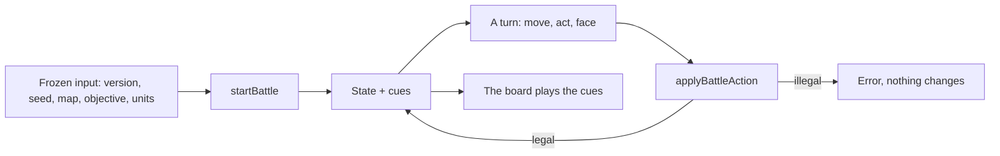
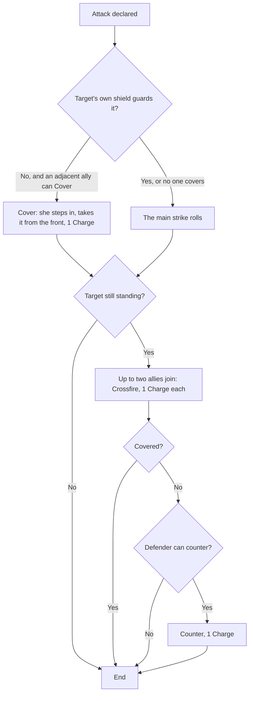

# The battle

> **Status: 2026-11-12, CY8 (D12).** The rules as `@cyber/battle` plays them, **rules version 2**: CY4's core and CY5's
> roles, Tech, chance skills, items, Stride, the bench call and three more objectives, with CY6's first balance pass
> (see [Balance](#balance)); how enemies choose is on [enemy-ai.md](enemy-ai.md). Terrain, props and terminals are
> on [terrain.md](terrain.md); the Holds and the Steel Muster on [factions.md](factions.md). The board arrives in CY7.
> Every number comes from `packages/battle/src/tuning.ts`, and the tables marked live are rendered from it.

## The short answer

- **A battle is a frozen input plus a list of actions.** The input holds the rules version, the seed, the map, the
  objective and every unit with her bands and her resolved rig. Replaying the actions on the input gives the same state
  every time, so the save keeps only those two (an autosave after every action is a few bytes).
- **Each unit acts when her own clock fills,** at a rate set by Speed. A turn is **move, then one action, then face.**
- **The rig takes the damage:** four parts (Core, two arms, Legs) with their own HP. A broken arm drops its weapon,
  broken Legs slow her, a broken Core is a **Rig Break**: she kneels and extracts, never dies.
- **Charge** is one small bar: spend it on your turn or keep it to counter, join an ally's attack (Crossfire) or take a
  hit for one (Cover) on theirs.
- **The forecast card** shows every number before a turn is sent, from the same functions the result uses.
- **Each role has its Back unit** (Bulwark, Thruster, Launcher, Deck, Med), and the Deck's **Tech** hacks heroines,
  hardware and terminals. Heroines are freed, never killed.



## The map

A map is JSON, schema 1. Its heights stay digit rows, exactly uma-stage's room format, so the board builds them with no
translation.

```json
{
  "schemaVersion": 1,
  "id": "test-yard",
  "width": 10, "depth": 10,
  "heights": ["0000000000", "…"],
  "tiles": ["..........", "…"],
  "spawns": { "squad": [[1, 8], "…"], "enemy": [[7, 1], "…"] }
}
```

| Field | Rule |
|---|---|
| `width`, `depth` | 6–14 each |
| `heights` | One digit 0–3 a tile; row 0 is the back (north), x grows east |
| `tiles` | `.` floor, `#` solid (no standing, blocks sight), `=` grating, `c` cover; grating and cover play as floor until CY5 |
| `spawns.squad` | Exactly five tiles: four Umas and a guest |
| `spawns.enemy` | One to eight tiles |

No spawn sits on a solid tile or shares one. `parseMap` refuses anything else and names the path, such as
`map.heights[3][0]: expected a digit 0–3`.

**Directions** are N, E, S and W; S faces the camera.

## The units and their rigs

Each unit brings five **bands** (Speed, Stamina, Power, Guts and Wit, 1–5), a Charge cap (3, or 4 and 5 with licences
later), her link toggle, a leader flag, a spawn, a facing and her **resolved loadout**: each part's numbers, never a
catalogue id. A unit may carry a `ref` and a `label` for the app; the rules never read them.

**The loadout: eight slots and a Coat.**

| Slot | Carries |
|---|---|
| Core | Load; optional Capacity and HP bonus |
| Left arm, Right arm | Load; optional HP bonus |
| Legs | Load; optional HP bonus and a Move modifier |
| Back unit | Launcher, Bulwark, Thruster, Deck, Med or none; Load and optional Capacity; a Launcher carries a Long weapon and 1–9 ammo |
| Visor | Load; `aim` lets her pick a part at −25% hit |
| Left hand, Right hand | A weapon or a shield, or nothing |
| Coat | P, I or F: halves that damage type |

- **Load against Capacity:** every slot's Load added up must fit her Capacity (10 + 2 a Power band, plus the Core's and
  the Back unit's bonus). Over Capacity, the battle refuses her.
- **A light rig is a fast rig:** at 70% of Capacity or less, +1 Move.
- **A two-handed weapon** goes in the right hand with the left hand empty. **A Long weapon** fires only from a Launcher.

**What breaks when a part breaks:**

| Part | When it breaks |
|---|---|
| Core | **Rig Break:** she kneels, out of the fight |
| One arm | That hand's weapon or shield is off; a two-handed weapon fires at half accuracy |
| Both arms | No attack and no guard; she can still move and Wait |
| Legs | Move 1, no level changes, evasion 0 |
| A hit on a broken part | Goes to the Core |

## The timeline and Charge

- Every clock fills at its Speed band's rate; a turn comes at 1,000. A **round** is 100 ticks: one turn at Speed band 3.
  Rounds are what "hold for N rounds" counts.
- **Ties** go to the higher Speed band, then to the seeded roll. The timeline shows the next eight turns.
- **Charge** starts at 1 and gains 1 at the start of each of her turns, up to her cap.
- **Wait** means no action (moving is still allowed): +1 Charge more, and her clock restarts at 250 instead of 0, so her
  next turn comes sooner. The forecast shows the shift.
- **The link toggle** is a free action on her own turn: with it off she never joins Crossfire or gives Cover.

## A turn

One action: `{ kind: "turn", unit, to?, act, face }`, where `act` is an attack (a mount, a target and an optional aimed
part), `wait` or `none`. The app holds the two-tap move and its undo itself and sends the turn whole.

1. **Move** (optional): to any reachable tile.
2. **Act:** attack, Wait, or nothing.
3. **Face** one of the four ways.

An illegal turn (not her turn, an unreachable tile, a target out of reach, a part already broken) returns an error and
changes nothing.

### Movement

- Move points come from her Speed band, +1 for a light rig, plus the Legs' modifier; broken Legs move 1.
- A step climbs or drops one level at most; broken Legs stay level. Solid tiles can't be entered.
- **Zones of control:** entering a tile next to a standing enemy ends the move.
- A unit passes through her own side, never through the other, and never ends on an occupied tile.

### Reach and line of fire

| Band | Range | Height reach | Line of fire |
|---|---|---|---|
| Melee | 1 | Two levels up or down | Not needed |
| Short | The weapon's, within 1–3 | Two levels up or down | Needed |
| Long | The weapon's, within 3–6; +1 from two levels up | Any | Needed |

Range is counted in steps (no diagonals). **Line of fire** runs from her eye (0.8 of a level above her tile) to the
target's middle (0.5 above hers); a solid tile, or a tile higher than the line where it crosses, blocks it. Units never
block.

## Attacks

An attack fires one mount (right hand, left hand, or the Back unit's Launcher) at one standing enemy. The attacker turns
to face her target as she fires.

**Where it lands:** inside the target's front quarter is the **front**, inside her back quarter the **back**, anything
else, diagonals included, the **side**.

**Each hit rolls on its own** (Short weapons fire several):

1. **Hit %** = the weapon's accuracy + 3 a Wit band − the target's evasion (2 a Speed band, 0 with broken Legs), − 25
   when aimed, clamped to 5–95%.
2. **Crit:** the weapon's crit % (5 unless it says) for ×1.4 damage.
3. **The part:** aimed, or rolled on the band's weights; a hit on a broken part goes to the Core.
4. **Damage** = the weapon's power (+2 a Power band for Melee) × facing (side ×1.25, back ×1.5) × height (+10% a level
   above the target, −10% a level below) × Coat (×0.5 when it matches) × crit × (100% − the Guard), rounded down, at
   least 1. The arithmetic is exact integers, so a replay can't drift.
5. **The Guard:** a whole shield arm cuts a hit from the front or side (a tower shield 40%, a buckler 20%), never from
   behind.

**A Long weapon** uses one ammo a shot, and is never countered and never counters.

### The exchange, in order



- **Cover:** when the target's own shield doesn't guard the attack (she has none, or it comes from behind), the first
  adjacent ally in timeline order with a whole shield arm, her link on and 1 Charge steps in. She takes the main strike
  from the front, so her Guard applies. A covered attack draws no counter.
- **Crossfire:** up to two of the attacker's allies join with a free basic attack of one round (CY6's balance pass), 1 Charge each, in timeline order, if
  their link is on and either they stand on the target's far side with a Melee or Short weapon in reach (a **pincer**),
  or they have a Short or Long weapon in reach with a line of fire (a **link**). Enemies do it too.
- **Counters** are automatic: the defender answers with a Melee or Short weapon in reach of the attacker, for 1 Charge,
  when she's still standing, the attack came from her front or side, it wasn't Long, and (rules version 2) she isn't a
  Steel Muster unit reloading.
- **Rules version 2 adds to the exchange:** a defender's **First** can counter before the attack; **Burst** adds rounds
  to the main strike; after it, **Double**, else **Switch**, else **Stun** (one chain at most); an **impact** hit on the
  Core can Stun (10%); an **F** hit sets the target's tile on Fire. Cover takes an aim at a Hold unaimed.
- **Things on the map** (v2): barrels, pipes and barriers can be attacked: no evasion, Guard or Coat, and no Cover,
  Crossfire or counter.

## Rig Break and Hold on

- At Core 0 her rig locks and she **kneels**: no turns, not a target. She stays **rebootable until the end of her next
  turn**: a Medic next to her can **Reboot** her (rules version 2); when that turn comes first, she **extracts**.
- **Hold on:** Guts at band 4 or more lets her survive one Core-breaking hit a battle at Core 1.

## Objectives

| Objective | Won when |
|---|---|
| Defeat all | Every enemy is down or out |
| Defeat the leader | The enemy leader is down or out |
| Reach a tile | A squad unit ends her move on it (the battle ends before her action) |
| Hold for N rounds | The clock passes N rounds |
| **Escort** (v2) | The named squad unit ends her move on the tile; **lost** if she's down or out |
| **Hack N terminals** (v2) | N different terminals have been hacked |
| **Free the leader** (v2) | The enemy leader, a heroine, is freed; **lost** if she's broken instead |

Beating every enemy always wins (except that a leader to free must be freed). The battle is **lost** when every squad unit is down or out. It ends the moment either
happens, mid-turn included.

## Roles and their Back units (rules version 2)

| Back unit | Role | What it does |
|---|---|---|
| **Bulwark** | Vanguard | **Barrier** (1 Charge): a one-tile wall on an adjacent tile: solid, blocks sight, 40 HP, lasts until broken |
| **Thruster** | Striker | Climbs **two levels a step**; **Dash** (1 Charge, part of the move): +2 Move and no zones of control this turn |
| **Launcher** | Gunner | Carries the Long weapon (rules version 1) and lets her **Aim** |
| **Deck** | Netrunner | **Tech** (below) and **hacking terminals** ([terrain.md](terrain.md#terminals)) |
| **Med** | Medic | **Mend** (1 Charge, adjacent or herself): +12 Core HP, or a broken arm or Legs back at 25%. **Reboot** (2 Charge, adjacent): a kneeling ally inside her window stands at 25% Core, limbs still broken |

A turn's action is one of: attack, Wait, nothing, Tech, hack, barrier, Mend, Reboot or an item.

## Tech (rules version 2)

The Deck's three hacks, never countered, each one roll of **Wit against Guts**: 50% + 5% a Wit band − 10% a target's
Guts band, clamped 5–95%. The forecast shows the %.

| Tech | Charge | Range | On a success |
|---|---|---|---|
| **Stun** | 2 | 2–4 | She loses her next turn |
| **Jam** | 1 | 2–4 | She loses 1 Charge |
| **Jack-Out** | 2 | Adjacent, a heroine below 30% Core | She's **freed** ([factions.md](factions.md#the-holds)) |

A landed Stun or Jam on a held heroine also does 10 damage to her Hold. A stunned unit's next turn is skipped and her
clock restarts.

## Chance skills (rules version 2)

A unit's input lists her chance skills with their base %; in play each gets +5% a Wit band, capped at 95%, and the
forecast shows them. Where they come from (parts and mastery) is Phase 5's.

| Skill | When it rolls | What it does |
|---|---|---|
| **Burst** | Before her main strike with a Short weapon | +2 rounds |
| **Double** | After her main Melee strike | A second strike with the same weapon |
| **Switch** | After her main strike, if Double didn't fire | The other hand fires too, if in reach |
| **Stun** | After a main strike that landed, if neither did | The target is stunned |
| **First** | When she'd counter, as the defender | Her counter lands before the attack |

**One chain per attack:** Burst, or one of Double, Switch and Stun, never two. Cover stops the chain.

## Items (rules version 2)

One squad stock of up to six, set in the input. Using one is her action and costs no Charge; she can use one with both
arms broken.

| Item | On | Does |
|---|---|---|
| **Repair kit** | Herself or an adjacent ally | +20 Core HP |
| **Patch** | Herself or an adjacent ally | A broken arm or Legs back at 25% |
| **Smoke charge** | A tile in range 3 | Smoke on it and its four neighbours |
| **Cell** | Herself or an adjacent ally | +1 Charge |

## Stride (rules version 2)

From her running style (TC46), set in the input:

| Stride | +Move |
|---|---|
| **Break** | +1 on her first turn |
| **Draft** | +1 when she starts her turn next to an ally |
| **Surge** | +1 on the turn after a Wait |
| **Kick** | +2 while her Core is at half or less |

## The bench support call (rules version 2)

The input lists the resting Umas' roles. Once a battle, on a squad unit's turn, the squad makes one call as a **free
action** (her turn goes on), with fixed numbers and no rolls:

| Role | The call |
|---|---|
| Vanguard | A barrier on any open tile |
| Striker | A strike on one tile: 15 to the Core of whoever stands there |
| Gunner | A mortar on a 3 × 3 area: 10 to the Core of everyone in it, either side |
| Netrunner | A scan: the app shows every enemy's loadout and next turn |
| Medic | A repair drop on a 3 × 3 area: +15 Core to each squad unit in it |

## The end of a battle (rules version 2)

The result lists each enemy as **freed**, **broken** or **standing**, with her **salvage**: her unbroken parts, freed
or broken alike. A guest joins only when freed, so breaking her parts against keeping them whole is a real choice.

## Rules version 3: life aboard in battle (CY17)

Rules version 3 (D28) brings the ship's life into the fight, all of it frozen into the battle's input at deploy:
- each Uma's bond rank and path, and her partner when both are in the squad;
- the captain's Orders the ship offers;
- the powered battle systems, with their levels and their post holders' bands;
- the cook's meal;
- the squad's cohesion and a finale's harsh conditions (CY18).

A version-2 battle replays exactly as before (a test plays one with these fields present and gets the same state).
Missions deploy at version 3; the sandbox's scenarios stay at version 2.

### Bond perks (TC58)

| Rank | Perk | In play |
|---|---|---|
| 3 | **Ready** | +1 Charge at the start |
| 5 | **Answer** | +1 Charge when an adjacent ally suffers a Rig Break |
| 7 | **Sure** | Her chance skills +5% |
| 8 | **Endure** | Once a battle a Core-breaking hit leaves 1: a second use after Guts' Hold on, never the same hit |
| 9 | **Steadfast** | One free Cover a battle (no Charge) |
| 10 | **Resonance** | The captain can call her name (an Order) |

### Orders (TC59)

A free action on a squad unit's turn, from the battle's slots: 2 at Bridge level 1, 3 at 2, 4 at 3, plus one with the Ship
Uplink project (to 4). The **Orders** button on the battle screen shows how many are left.

| Order | Offered | Does |
|---|---|---|
| **Sure shot** | Always | The unit's next attack this turn can't miss |
| **Call her name** | Always; a rank-10 Uma, once a battle | **Resonance**: she acts next with full Charge, and every Linked ally in reach joins her attack free; a banner in her colour says Resolve (Trust) or Devotion (Heart) |
| **Hold the line** | Bridge level 2 | An enemy loses her next turn |
| **Reboot** | Med Bay level 2, or the Field Repairs project | A kneeling ally stands at 25% Core, anywhere |
| **Orbital strike** | The Battery powered | Marks a 3 × 3 area this round; it lands at the start of the next round on every enemy in it (14, +6 a level, +2 a band of the gunner over 3) |
| **Sweep** | The Sensors powered | The enemy's next moves shown |
| **Barrier** | The Shield Projector powered | A barrier on an open tile |
| **Drone** | The Drone Bay powered | Mends a standing ally's most damaged part by 15 |
| **Reinforce** | Hangar level 3, someone resting | A resting Uma's drop, as the bench call, without using it |

### The powered systems' passives (TC64)

- **The Engines:** the squad starts with a head start on the clock, so it moves first in round 1.
- **The Shield Projector:** a shield on each squad unit at the start that absorbs 4 damage (+2 a level) before her parts.
- **The Sensors:** the enemy's roster on the deploy screen. This is shown, not a rule.

### Meals

The cook's meal (CY16) applies to the whole squad for one battle: noodles +5% hit, stew +10% Core HP, skewers +1 melee
damage, curry +1 Charge at the start, salad chance skills +5%, a feast +5% hit and +1 Charge.

### Partners (TC58)

| Level | Camaraderie | In play |
|---|---|---|
| 1 | 100 | Joins her partner's attacks free once a battle, linked or not |
| 2 | 250 | Also covers her partner free once a battle |
| 3 | 500 and the Coordinated Fire project | The **duo technique**: both partners strike the target from where they stand, a third harder, with their pair's effect; it takes this turn and the partner's next |

The fifteen pairs of roles each have a technique (`DUO_TECHS`). Each adds one effect:
- **Power:** the strikes as they are, a third harder;
- **Pierce:** past the guard, and +20% hit;
- **Stun:** the target loses her next turn;
- **Mend:** both partners +12 Core;
- **Charge:** both partners +1 Charge.

### Cohesion and a finale's conditions (CY18)

`cohesion: { level, leader, members }` is the squad fighting together (three or more of its members deployed); see
[squads](squads.md):

| Level | In play |
|---|---|
| 1 | The leader starts with +1 Charge |
| 3 | Each member's Crossfire reach +1 |
| 5 | Each member covers once free a battle (no Charge) |

`conditions` holds a finale's unmet readiness needs:

| Condition | In play |
|---|---|
| `fog` | Lights out for the first 3 rounds |
| `hazards` | Up to 4 tiles of lasting Fire across the map's middle row, every other tile |
| `no-reinforcements` | The bench support call is refused all battle |

### Ally Auto and the balance

**Ally Auto** takes a free Order before her turn: Reboot on a kneeling ally, or Sure shot when the attack she means to make
is under 40% to hit. Auto never calls Resonance.

**The balance pass** (`pnpm sim balance`) plays every scenario with a bare squad and a life-aboard one. Life aboard means:
- bond ranks 3, 7 and 10;
- the first two Umas as level-2 partners;
- the Sensors, the Shield Projector and the Battery powered;
- two Orders for Auto;
- a curry.

At 80 seeds a scenario, the bare squad is unchanged (version 2, frozen), the mean gain is **+23 points**, every scenario
gains, and none reaches 100%. The targets are about one battle in five more often and never every battle. At 200 seeds
(CY18) the mean gain is +20.6, and **cohesion 5** on top of life aboard adds −0.4 points: within noise, inside its target
of −2 to +8.

Two findings changed the rules on the way:
- The Shield Projector's first form, barriers before the spawns, blocked the squad's own path and lost battles. It became
  the absorbing shield.
- The Engines' head start decides some maps alone (+35 points on muster-underlevels), whatever its size. So the
  life-aboard profile leaves them off, and the rule stays as the packet words it.

## The battle screen

The battle as the sandbox (CY8) and the missions (CY10) show it: DOM over the [board](board.md), in `apps/web/src/battle/`.

| Piece | Where | What it does |
|---|---|---|
| **The timeline** | Across the top | The next eight turns as chips in each side's colour, an Uma's with her face, the rest with initials; tap one to inspect her. With a forecast open, the turns after the planned one are ghosted underneath (TC3) |
| **Two-tap move** | On the board | Her reach painted blue (safe) and magenta (inside an enemy's reach); the first tap on a tile shows her path in yellow, the second walks her there. The move stays undoable until the turn is sent |
| **The commands arc** | Bottom right | Moving: **Act here**, **Wait**, **Dash** (a Thruster's), **Link on/off**, a **Call** for each bench role. Acting: **Attack**, **Aim at Hold** (a heroine in reach), **More** (Tech, hacks, barriers, Mend, Reboot, items), **Wait**, **Done**, **Undo**. Facing: four arrows preset toward the last target, then **Confirm** |
| **Targets** | On the board | What she can strike from where she stands, in red; tap one for the forecast card |
| **The forecast card** | Bottom right | The attack (or who covers it), each Crossfire and the counter, each with hit %, hits, damage and crit, the Guard, side or back, the likely parts and those that will or may break; Tech %, chance skills, the Charge each unit spends, the volley's marks. **Confirm** goes on to the facing, **Back** to the arc |
| **Reach** | Top left | Paints every enemy's reach for the next turn |
| **The terrain card** | A long press | The tile's height, ground, state and rounds left, whether it's Live, what it does and what could change it |
| **Paper dolls** | Above a hit unit | The damage and her four parts, coloured by what's left, for a second and a half |
| **The cut-in** | Across the middle | Full the first time each weapon is seen and always for a leader, Quick after, or Off (**Cut-in** cycles auto, quick, off): the enemy on the left facing right, the Uma on the right facing left, the band, and the numbers as they land. An Uma shows her bust from master data; stand-ins and enemies stay cards until the full-body renders and the heroines |
| **Enemy turns** | — | At double speed; **Skip** jumps to the next player turn |
| **Setup, Saver** | Top left | Back to the sandbox's setup; the battery saver |

A kneeling unit is dimmed with a grey ring; an extracted or freed one leaves the board; a turned turret takes her new
side's colour; Wet, Oil, Fire, Smoke and Live tiles are tinted under the overlays.

## The forecast

`forecast(state, turn)` answers before a turn is sent, without rolling anything: it calls the resolution's own
functions on the board as it would stand after the move.

| It shows | From |
|---|---|
| Hit %, crit %, hits, and one hit's damage (normal and crit) for the attack | The strike's numbers |
| Front, side or back, and the Guard | Facing |
| Each part's chance of being hit, and whether it **will** break (one normal hit) or **may** (a crit or several hits) | The band's weights, broken parts sent to the Core |
| Who covers, who joins (pincer or link) and who counters, each with their numbers | The same eligibility the resolution uses |
| Each chance skill's %, the attacker's and the defender's First (v2) | The same chance the roll uses |
| A Tech action's % (v2) | Wit against Guts |
| The Hold's chance of being hit and whether it frees her, when aimed at (v2) | The strike's numbers |
| The Steel Muster's marked tiles and when they're hit (v2) | The volley |
| The Charge each unit spends (a gain shows negative) | The tuning table |
| The next eight turns after this one | The timeline |

A test checks that the forecast's hit % is within two points of the resolved hit rate over 2,000 seeds for each weapon
band, and that every resolved hit's damage is the forecast's number.

## Cues

The board and the cut-in play cues; they decide nothing. Each action returns its cues in order: `turnStarted`,
`charge` (with why: turn, wait, counter, crossfire, cover), `moved` (with the path), `faced`, `waited`, `linked`,
`attack` (main, crossfire or counter, with the facing), `cover`, `crossfire` (pincer or link), `counter`, `guard`, `hit`
(part, amount, crit, broke), `miss`, `partBroke`, `holdOn`, `rigBreak`, `extracted`, `objective` (progress) and `ended`.

## Determinism and versions

- Every roll is a seeded hash of `seed:turn:unit:purpose:n`, keyed by the battle's turn number. The package has no
  unseeded randomness and no clock; a test scans its sources.
- **Rules versions:** **1** is CY4's core; **2** adds CY5's rules. A battle refuses an unknown version, and a version-1
  battle plays exactly as CY4's did: its fields are refused in version 1, and the new state appears only in version 2.
  Version 2's always-on rules are the impact Stun, Fire from F hits, cover tiles and grating; with none of those in play
  and every new field empty, version 2 plays exactly as version 1 (a test).
- `battleStateHash(state)` hashes everything that changes. **Golden replays** (`packages/battle/src/golden/`) hold seven
  version-1 battles on two test maps and nine version-2 battles on the `test-works` map (Fire across an Oil slick,
  current across Wet and grating, a lift mid-battle, a heroine freed by her Anchor and one by a Jack-Out, a reboot inside
  and outside the window, a volley dodged and one that lands): their inputs, actions, every cue and the final hash, and
  for each version-2 battle the cue that proves its rule. Any change to a rule or a number fails the test and names the
  battle; `UPDATE_GOLDEN=1` rewrites them, and the commit says why.

## Balance

Combat is tested three ways (BP5): the tests and golden replays, the sandbox (CY8), and the **simulator**, which plays
the scenarios in `scenarios/` AI against AI over many seeds (`pnpm sim all --seeds 500`, a report in the ignored
`sim/out/`). A balance pass edits `tuning.ts` and reruns.

**The first pass (CY6, D10):** Core 30 + 10 → 22 + 6 a Stamina band, arms 15 + 5 → 10 + 4, Legs 20 + 6 → 14 + 5; crit
×1.5 → ×1.4; Mend +20 → +12 Core; a Crossfire joiner fires one round. With the AI's own fixes, the report at 500 seeds a
scenario:

| Scenario | Squad wins | Player turns | Stalemates | Top weapon band | Counters, Crossfires, Covers a battle |
|---|---|---|---|---|---|
| The mirror (even) | 50.6% | 27.5 | 3 of 500 | Short 67% | 8, 15, 1.3 |
| Four against the Steel Muster | 49.0% | 29.0 | 0 | Short 79% | 5, 36, 2.6 |
| Melee against ranged | 74.8% | 17.9 | 0 | Melee 55% | 4, 8, 0 |
| The high ground | 61.8% | 24.7 | 1 | Short 59% | 6, 16, 1 |
| The chain | 81.0% | 26.9 | 0 | Short 80% | 8, 17, 2 |
| A heroine to free | 85.0% | 21.6 | 0 | Short 55% | 6, 12, 0.7 |
| The arena (even, one against one) | 50.6% | 5.3 | 0 | Melee | 2, 0, 0 |

**The targets** (the build plan's §5), met or missed:

| Target | Result | Why it's missed, where it is |
|---|---|---|
| An even scenario wins 45–55% | Met (mirror 50.6%, arena 50.6%) | — |
| 8–14 player turns | **Missed:** 18–29 four against four | Rig Break, Hold on, Mend and Reboot keep a four-against-four fight to six to eight rounds; twice the lethality would break the next target. The 40 seconds a turn is a guess until the sandbox (CY8) measures the pace |
| No full-HP Core broken in one hit at equal bands | Met on level ground; **9 of 500** on the high ground | A Long shot from two levels up, from behind, with a crit: equal bands, unequal ground. Accepted as the high ground's edge |
| No weapon band above 40% of a mixed squad's damage | **Missed:** Short 55–80% | Most stand-in rigs carry a Short weapon, and Crossfire's links favour Short and Long. Revisited with real role mixes |
| A counter, a Crossfire and a Cover a battle | Met where shields exist | Scenarios without shields can't Cover |
| Over half the Rig Breaks after a part | Met (51–61%) except the arena (38%) | One against one, the Core takes the Melee weights |
| Little Charge left | **Missed:** 5–6 a battle | Units sit at their cap with only reactions to spend on; chance skills and signatures (Phase 5) are the sink |
| No stalemates | 4 in 3,500 | The AI's caution fades over 20 rounds |

## The tuning table

### Rules version 1

<!-- live:tuning -->
**The bands** (Guts: Hold on at band 4 or more):

| Band | Stat at 5★ | Speed: a turn every | Speed: Move | Speed: evasion | Stamina: Core / arm / Legs HP | Power: Capacity | Power: Melee bonus | Wit: accuracy |
|---|---|---|---|---|---|---|---|---|
| 1 | under 90 | 125 ticks | 3 | 2% | 28 / 14 / 19 | 12 | +2 | +3% |
| 2 | 90–109 | 112 ticks | 3 | 4% | 34 / 18 / 24 | 14 | +4 | +6% |
| 3 | 110–129 | 100 ticks | 4 | 6% | 40 / 22 / 29 | 16 | +6 | +9% |
| 4 | 130–149 | 91 ticks | 4 | 8% | 46 / 26 / 34 | 18 | +8 | +12% |
| 5 | 150+ | 84 ticks | 5 | 10% | 52 / 30 / 39 | 20 | +10 | +15% |

**The rest of the table:**

| Rule | Number |
|---|---|
| A round | 100 ticks (a turn fills at 1000) |
| Wait | +1 Charge, and her clock restarts at 250 instead of 0 |
| Charge | Starts at 1, +1 a turn, cap 3; a counter, a Crossfire and a Cover cost 1 each |
| Light rig | +1 Move at 70% of Capacity or less |
| Broken Legs | Move 1, no level changes, evasion 0 |
| A step | Climbs or drops 1 level at most |
| Hit % | Accuracy + Wit − evasion − 25 when aimed, clamped to 5–95%; a two-handed weapon with one arm broken fires at 50% accuracy |
| Crit | 5% unless the weapon says, ×1.4 damage |
| Facing | Side ×1.25, back ×1.5 (past shield and counter) |
| Height | ±10% damage a level; Melee and Short reach 2 levels up or down; Long +1 range from 2 levels up |
| Coat | ×0.5 against its damage type |
| Damage | At least 1 |
| Crossfire | 2 allies at most |
| Hold on | Survives at Core 1, once a battle |
| Board | 6–14 tiles a side, heights 0–3, 5 squad spawns, 8 enemies at most |

**Where hits land** (out of 100):

| Band | Core | Each arm | Legs |
|---|---|---|---|
| Melee | 60 | 15 | 10 |
| Short | 40 | 20 | 20 |
| Long | 50 | 15 | 20 |
<!-- /live -->

### Rules version 2

<!-- live:tuning2 -->
| Rule | Number |
|---|---|
| Fire | 8 F damage to the Legs on ending a turn there; burns out after 3 rounds |
| Live | 6 damage to the Core on entering or ending a turn there, past any Coat |
| Smoke | Blocks sight; −30% to ranged hits into or out of it; clears after 2 rounds |
| Cover tile | −20% to Short and Long hits from the front and sides |
| Lights out | −15% to ranged hits; turrets idle; 2 rounds |
| Tech | Range 2–4 (Jack-Out 1); 50% + 5% a Wit band − 10% a Guts band, clamped 5–95% |
| Tech Charge | Stun 2, Jam 1, Jack-Out 2 (below 30% Core); a landed Stun or Jam does 10 to a Hold |
| Hacking | Range 1–4, 1 Charge, no roll |
| Impact Stun | 10% on an impact hit to the Core |
| A Hold | 30 HP unless the unit says |
| Bulwark | Barrier: 1 Charge, 40 HP |
| Thruster | 2 levels a step; Dash: 1 Charge, +2 Move, no zones of control |
| Med | Mend: 1 Charge, +12 Core or a limb at 25%; Reboot: 2 Charge, stands at 25% Core |
| Chance skills | Base + 5% a Wit band, capped at 95%; Burst adds 2 rounds |
| Items | 6 at most; repair +20 Core; patch mends a limb at 25%; smoke in range 3; cell +1 Charge |
| Stride | Break +1, Draft +1, Surge +1, Kick +2 Move |
| Bench call | Strike 15 to the Core on one tile; mortar 10 to every Core in 3 × 3; repair drop +15 Core in 3 × 3 |
| Steel Muster | The volley fills at 6 attacks; pinning fire −10% hit |
<!-- /live -->
