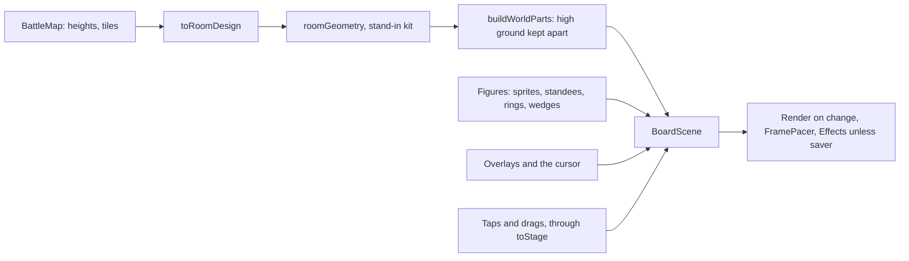

# The board

> **Status: 2026-11-12, CY7 (D11).** The battle board as `apps/web/src/board/` draws it, on uma-stage 0.3.0's parts, and
> its test bench at `/board`. The sandbox (CY8) plays battles on it. The kit is uma-stage's stand-in forest under a night
> grade until the first world's kit (Phase 4).

## The short answer

- **The map's heights become terrain** exactly as written: digit rows 0–3 are uma-stage's own format, passed straight to
  `roomGeometry` (never through `parseRoomDesign`, which stops at level 2). Solid tiles are walls.
- **Umas are sprites, enemies and guests are standees,** each on a **base ring** in her side's colour with a **facing
  wedge** pointing the way she faces.
- **The overlays** paint tile tops in TC29's colours. A tap picks a tile; a drag pans; the camera never turns or zooms.
- **It draws only when something changes,** and the battery saver drops it to 30 fps with no post effects.

## What it shows

| Piece | How it looks |
|---|---|
| **Terrain** | The map's tiles at their heights (0–3), risers between levels, walls for solid tiles, from the stand-in biome kit |
| **The light** | A night grade: a blue-violet sky light, a cool key light from the top front-left, the sprites tinted toward it, a dark navy behind the board; the four live lights go to the kit's lamps nearest the view's middle |
| **An Uma** | Her sprite (stand-in sets now; master data's chibi sets in Phase 4), walking with her four facings |
| **An enemy, a guest** | A standee: a face card on a base (stand-in faces now) |
| **The base ring** | A flat ring under each unit: **cyan** the squad, **green** a guest, **red** an enemy |
| **The facing wedge** | A small arrowhead on the ring, pointing the way she faces (N to the back, S toward the camera) |

## The overlays

One merged mesh over the tile tops, rebuilt when the set changes:

| Colour | Means |
|---|---|
| **Blue** | She can reach it, and no enemy can strike it next turn |
| **Magenta** | She can reach it, inside an enemy's reach |
| **Red** | An enemy she could strike from a tile she can reach |
| **Yellow** | An area (a mortar, a smoke charge), from CY8 |
| **A white outline** | The cursor: the tile last tapped |

## Taps and the pan

- **A tap** picks the tile under the finger: a unit's tile when the tap lands on her (her card is about a thumb wide),
  else the nearest tile top. A tap on a raised tile's front face picks the tile it belongs to only if its top is under
  the finger, as the stage's picking does everywhere.
- **A drag** pans on both axes, clamped to the board's edges; the camera snaps to the pixel grid, so the art stays crisp.
- **No rotation and no zoom:** the camera is uma-stage's, pitched 35°, 128 texels a tile. A tile is about 24 pt deep on
  a 3× phone held sideways, just under the 44 pt rule, which is why the sandbox moves in two taps (TC29).
- **On an upright phone** the stage is turned (uma-stage's `TurnedStage`), and touches go through `toStage`.

## The fade

High ground (level 2 and up) is built apart from the rest. While a tile of it stands in front of the unit in focus (the
one selected, acting or targeted), it eases to 35% opacity over 150 ms, at once with reduced motion; a unit's own tile
never fades for her.

## The loop and the saver

- **Render on change:** a tap, a pan, a walk, a fade or a resize wakes the loop; it sleeps three frames after the last
  change. A hidden page draws nothing.
- **The battery saver** (on by default on phones, `initialSaver()`): 30 fps through `FramePacer`, and no tilt-shift or
  bloom. With it off, uma-stage's `Effects` draws both, unchanged until the first stage request ships.

## The test bench

`/board` (behind sign-in, loaded on demand with three.js and the stage) puts thirteen stand-ins on a 14 × 14 map with
heights 0–3 (`?map=flat-14` for the flat one): four Umas as sprites, a guest and eight enemies as standees. Tap a unit
for her reach, tap a blue or magenta tile to walk her there, drag to pan. **Back** returns Home; **Saver** toggles it.

`?debug` adds a readout (figures, sprites and live sets, draw calls, fps, the saver, the device size, faded tiles) and
`window.__board`: `step(ms)`, `pick(x, y)`, `figures`, `drawCalls`, `fps`, `saver`, `debug`, `setSaver(on)`, `tap(x, z)`
and `record(ms)`, which pans for `ms` while recording frames. The preview pane draws WebGL but runs no animation frames
while hidden, so checks call `step()` and read these.

## The five checks (CY7)

| # | Check | Result |
|---|---|---|
| 1 | A level-3 tile builds | **Passes:** `roomGeometry` builds risers to level 3 from a design made directly (a test). Heights 0–3 need no request |
| 2 | Picking with heights | **Passes:** on the 14 × 14 heights map, all 159 visible tile tops (of 177 on screen) pick back to themselves; a tile is about 24 pt deep at DPR 3 (a test) |
| 3 | Thirteen figures | **Passes:** 13 figures, 4 sprite sets live (the cap is 8); 41 draw calls with the saver on, about 101 with tilt-shift and bloom |
| 4 | Frame rate | **Desktop, labelled so** (a Mac's 120 Hz display, the preview pane, 1688 × 1188 device px at DPR 2), ten seconds panning: saver off 120 fps mean, 107.5 the 1% low; saver on 29.9 fps mean, 29.1 the 1% low. The owner's phone gives the real numbers |
| 5 | What heights hide | Tile tops more than half covered by nearer terrain, fade off: 9.2% on the heights map, 8.3% on the underlevels, 0% on flat maps (a test). The fade shows whatever is in focus |

## Requests to uma-stage

Filed one at a time, each only once the checks prove it ([BP3](../design/build-plan.md#3-the-hd-2d-board-on-uma-stage-bp3)):

| # | Request | State |
|---|---|---|
| 1 | [Tunable bloom and tilt-shift](../design/stage-requests/tunable-effects.md): bloom's threshold of 0.86 means no neon colour ever blooms (the squad's cyan is 0.587) | **Filed** to the uma-platform session |
| 2 | Glowing kit frames | Queued, after 1 ships |
| 3 | A tactics kit kind cached by kit id | Queued |
| 4 | A lighter saver tier | Queued |
| — | Heights 0–3 | **Not needed:** check 1 passes |
| — | A zoom for 2× phones | Only if the phone check asks |
