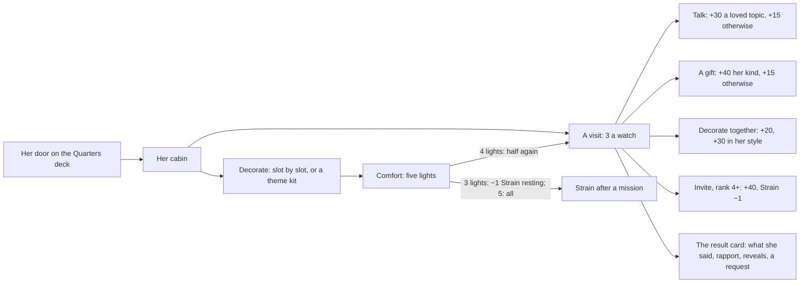

# Cabins, decor and visits

> **Status: 2026-11-13, CY14 (D25).** Every Uma has a cabin with six decor slots. Furniture comes in six styles, and her
> cabin's Comfort helps her shed Strain. She reveals her tastes over time, and the captain's **visit** (talk, a gift,
> decorating together, an invitation out) is the main way rapport rises between battles. The design is
> [life-aboard.md](../design/life-aboard.md) §4 (TC60, TC61). Berths and the Quarters module's levels come in CY15; the
> Store and the Workshop (more items) in CY15 and CY16.

## The short answer

- **The Quarters deck** has a door for each Uma aboard. Each door shows:
  - her face;
  - her bond rank;
  - her cabin's Comfort as five lights;
  - a badge when her bond scene waits (**!**) or she's asked for something (**?**);
  - whether she has a private cabin or a shared berth, by the Quarters module's level (CY15, [ship-build.md](ship-build.md#modules)).

  A door opens her **cabin**.
- **Her cabin** is a landscape room with six slots (Bed, Desk, Wall, Floor, Light, Keepsake) and a window tinted by the
  world the ship orbits. She stands in it in her **Quarters look**, the approved Uma Character Art image, and master
  data's bust stands in until it loads.
- **Decorating** is free and never a visit: tap a slot, pick an item from the stock, or empty it. A **theme kit**
  furnishes her favourite style from the stock in one tap. Comfort changes on the spot. Decorating never gates a rank.
- **Three visits a watch**, shared by the whole crew. A visit is one choice:
  - **Talk** about one of three topics;
  - give a **gift**;
  - **decorate together**: she picks a piece from the stock;
  - **invite** her out, from bond rank 4.

  Each ends on a card with what she said, the rapport, anything she revealed, and sometimes a **request**.
- **Her tastes** (a favourite style, a disliked style, a gift kind, two topics) come from the story when it writes them,
  else are derived from her running style, role and bands. They stay hidden until a visit reveals them.

## Comfort (TC61)

Comfort is the sum of her six items' comfort (1 to 3 each), with three adjustments:
- +2 for each piece in her favourite style;
- −1 for each in the style she dislikes;
- +2 for a **full set**: all five regular slots in one style.

It shows as five lights:

| Lights | Points | What it does |
|---|---|---|
| 1 | 6 | — |
| 2 | 10 | — |
| 3 | 14 | Resting through a mission, she sheds 1 Strain even below 3 |
| 4 | 18 | A visit earns half again as much rapport |
| 5 | 22 | Resting through a mission clears all her Strain |

Her favourite line in full is 21 or 22 points (four lights, or five), and a keepsake adds up to 3. Strain 3 always clears
on a rest (TC27), whatever the cabin.

## A visit (TC61)

| Choice | Rapport | Reveals | Notes |
|---|---|---|---|
| **Talk** | +30 on a topic she loves, +15 otherwise | That topic, if she loves it | Three topics, usually one she loves; her written small talk when the story has it, else a line from the game's pool |
| **A gift** | +40 her favourite kind, +15 otherwise | Her gift kind | One gift from the stock, used up |
| **Decorate together** | +20, +30 if the piece is in her style | Her favourite and disliked styles | She picks the piece that does the most for an empty slot, from the stock, and says why |
| **Invite** | +40 | — | From bond rank 4; the Observation Deck (more spots come with CY15's modules); sheds 1 Strain |

The rapport goes through the bonds' rules:
- half again at Comfort 4;
- doubled below the crew's median rank;
- the story's gates still hold.

**Her bond scene,** when one is ready, waits at the top of the visit panel and costs no visit.

**Requests:** about one visit in five ends with her asking for something for a slot (an empty one first). Granting it
from the Decorate panel fills the slot and pays +30. It isn't a visit.

Visits reset when the watch moves on: a mission's results closing, or a jump.

## Her tastes

| Taste | Derived from (when the story writes none) |
|---|---|
| Favourite style | Her best running style (Front Runner: Sporty, Pace Chaser: Classic, Late Surger: Tech, End Closer: Wild), nudged by the Medic role |
| Disliked style | The favourite's opposite (Neon and Classic, Cozy and Sporty, Tech and Wild) |
| Gift kind | Her role (Vanguard: gear, Striker: snacks, Gunner: music, Netrunner: books, Medic: plants); keepsakes for one Uma in six, by her id |
| Two topics | Her running style (racing, training, the stars, games) and her best band (speed: racing, stamina: nature, power: food, guts: the crew, wit: tech) |

An Uma with no known running style derives all four from her id. The same Uma always derives the same tastes.

The story writes them in `casting.json` as `tastes` by outfit id: `{ favourite, disliked, gift, topics: [a, b] }`.
Her small talk goes in her bond file as `talk: { <topic>: [lines] }`, up to four lines a topic, 160 characters each.

## Items and the stock

- **A new game owns** two of each regular slot in Classic and Cozy, and one gift of each kind.
- **A first win** of a mission brings one item, chosen by a fixed table over the mission's id, and the results screen
  shows it. The Store (CY15) and the Workshop (CY16) add more.
- **Placing** a piece takes it from the stock; removing it or replacing it puts it back.

<!-- live:items -->
**30 pieces of furniture, 6 keepsakes and 12 gifts:**

| Style | Bed | Desk | Wall | Floor | Light |
|---|---|---|---|---|---|
| Neon | Glow Pod Bed (2) | Holo Desk (2) | Neon Sign (2) | Light-Grid Mat (1) | Strip Lights (2) |
| Classic | Oak Bunk (3) | Writing Desk (2) | Framed Print (1) | Woven Rug (2) | Brass Lamp (1) |
| Cozy | Quilted Bed (3) | Tea Table (1) | Plush Shelf (2) | Fluffy Rug (3) | Paper Lantern (1) |
| Sporty | Training Cot (2) | Gear Bench (2) | Race Poster (1) | Stretch Mat (2) | Track Light (2) |
| Tech | Capsule Bunk (2) | Console Desk (3) | Wall Screen (2) | Grid Floor Panel (1) | Smart Lamp (1) |
| Wild | Rope Hammock (2) | Driftwood Desk (1) | Vine Wall (2) | Moss Rug (2) | Firefly Jar (3) |

**Keepsakes:** First Trophy (3), Crew Photo (3), Captain’s Charm (2), Hand-Drawn Star Map (2), Old Race Ribbon (2), Pocket Radio (1)

**Gifts:** Snacks: Steamed Buns, Fizz Candy · Music: Mix Tape, Spare Earbuds · Gear: Grip Gloves, Tune-Up Kit · Plants: Tiny Succulent, Seed Packet · Books: Paperback Novel, Pocket Atlas · Keepsakes: Enamel Pin, Postcard
<!-- /live -->

Each piece's comfort is in brackets.

**The art** is uma-art 2.29.0's pixel set (uma-platform P164, from the
[furniture request](../design/art-requests/cabin-furniture.md); D32):

- **Every item's icon** is a 64 px frame from `cabin-icons`, scaled crisp.
- **The diorama draws the 30 furniture pieces from `cabin-room`,** each placed by its `mount` and `foot` in the 640 × 360
  room:
  - a floor piece's foot centre lands on its slot's spot (the bed on the left, the desk on the right, the rug under her
    feet);
  - a wall piece's bottom edge lands on the wall's spot;
  - a ceiling light hangs from the room's top.
- **A keepsake** stands on a small shelf as its icon.
- **The code-drawn shapes** stay as the fallback for an id the atlas doesn't hold. A test keeps every piece inside the
  room, with floor pieces standing on the floor.

## The save (v6)

| Where | Holds |
|---|---|
| Each crew record's `cabin` | `slots` (an item id or null for each of the six), `revealed` (`gift`, `styles`, `topic:<topic>`), `request` (a slot or null) |
| `items` | Each owned item and how many (1–9999) |
| `visits` | `{ watch, used }`: the visits used in that watch |

A v5 save migrates on the device:
- every cabin empty, nothing revealed;
- the starter kit in the stock;
- no visits used;
- `account.updatedAt` untouched.

## Looks in the cabin

The cabin shows her **Quarters look** (D24, LK10): the approved full-body image from Uma Character Art's Cyberpunk
universe. cyber-api serves it to the signed-in owner at `/api/content/looks/…`:
- **in production,** from uma-platform's content bucket, read-only and only `art/universes/cyberpunk/` (D25);
- **locally,** from a mirror in the ignored `content/looks/`.

The game matches a look to an Uma by her character's English name from master data. Without one, master data's bust
stands in.

## Campaign evenings (CY48)

From **End day**, choose an available officer. A ready relationship milestone plays first; regular visits
rotate acquaintance, friend or partner conversations. A completed solo chat earns its authored rapport
once. Independent Captain relationships keep their own progress.

An established rank-10 Heart can receive a mutual invitation to stay. Choose to stay, leave, or take more
time. The choice is saved before its response. Staying opens the overnight conversation; **Leave tonight**
remains available there. Both outcomes use one evening and one upkeep, followed by the matching morning.
The morning adds no second charge. Leaving is followed by a personal call rather than an assumed stay.

Existing shared visits retain their release, posting and residence choices. Their later cabin evenings
require everyone to be available at the same actual location, with separate berths and individual consent.
An officer ashore is visited at home when docked there. Officers away on operations are unavailable.

Save v17 resumes the reserved conversation and committed outcome, including after a content update.
Earlier pending visits and mornings migrate without restarting their costs or relationship decisions.
[The authoring contract](../technical/campaign-content.md#reserved-cabin-evenings-cy48) defines the scene bindings.
