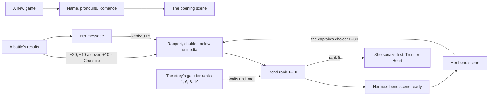

# The captain and bonds

> **Built behavior.** For the planned changes to relationships across all acts and independent clearance, see the [four-act campaign guide](campaign.md) and [roadmap](../handoff/four-act-roadmap.md).

> **Status: 2026-11-13, CY13 (D22).** The player as the ship's captain (TC55), the watch every life-aboard budget counts
> by, and a bond with every Uma from rank 1 to 10 (TC56, TC57): rapport from battles, messages and bond scenes, the
> story's gates, the catch-up, and the Trust or Heart choice at rank 8. Cabins and visits came with CY14 ([cabins.md](cabins.md)); the bonds' perks
> play in battle with rules version 3 since CY17 ([battle.md](battle.md#rules-version-3-life-aboard-in-battle-cy17)), where the captain calls a rank-10 Uma's name for Resonance, and partners fight as a pair. The design is [life-aboard.md](../design/life-aboard.md).

## The short answer

- **A new game names the captain** before anything plays: a name, pronouns (they by default) and the Romance setting.
  The captain is never drawn. Account changes all three later.
- **A watch** passes when a mission's results close and when the ship jumps. Never real time.
- **Every Uma aboard has a bond,** rank 1 to 10, shown as a ring on her profile and her roster tile. Rapport fills it:
  fighting, covering, joining a Crossfire, replying to her message after a battle, and the captain's choices in her bond
  scenes. Below the crew's median rank, rapport counts double.
- **Ranks 4, 6, 8 and 10 can wait on the story** (the casting's `bondGates`); rapport keeps filling, and the rank lands
  when the key is met.
- **Bond scenes** play from her profile once she reaches their rank, replay from the Log, and never go missing. At rank 8
  she says what she hopes for, then the player chooses **Trust** or **Heart**; under **Friends only** it's always Trust.
  Both are equal in battle.

## The captain (TC55)

| Field | Holds | Default |
|---|---|---|
| **Name** | 24 characters at most, trimmed | "Captain" |
| **Pronouns** | they, she or he | they |
| **Romance** | Ask (each Uma's rank-8 scene offers Trust or Heart) or Friends only (always Trust) | Ask |

A new game, or a save from before CY13, shows the captain screen once, on the ship, before the opening; **Take command**
saves it. Account's **Captain** panel changes any of the three.

**In scene text** the story writes `{captain}` and `{they}`, `{them}`, `{their}`, `{theirs}`, `{they're}` (or capitalised,
`{They}`…), and the scene player fills them from the save. The story check refuses any other placeholder.

## The watch

A counter on the save: +1 when a mission's results close (won or lost) and +1 on a jump from the Bridge. Messages are
per battle; CY14's visits (three a watch, [cabins.md](cabins.md#a-visit-tc61)), CY15's builds and CY16's duties count by it. No timers, no real time.

## Bonds (TC56)

| Rank | To reach it | Gate |
|---|---|---|
| 2 | 100 rapport | — |
| 3 | 150 | — |
| 4 | 200 | `bondGates["4"]` if named |
| 5 | 250 | — |
| 6 | 300 | `bondGates["6"]` |
| 7 | 350 | — |
| 8 | 400 | `bondGates["8"]` |
| 9 | 450 | — |
| 10 | 500 | `bondGates["10"]` |

**Rapport:**

| Source | Rapport |
|---|---|
| A battle she fought (at its results) | +20 |
| She covered an ally in it | +10, once a battle |
| She joined a Crossfire in it | +10, once a battle |
| A reply to her message after the battle | +15 |
| A captain's choice in her bond scene | 0–30, as the scene writes it |

- **The catch-up:** an Uma below the crew's median rank earns double, so a late recruit catches up.
- **Gates:** rapport keeps filling past a closed gate; the rank lands the moment the key is met (the ship checks on
  opening). The ring's next segment and the profile say which key it waits on.
- **Never lost:** rapport never decays. A replay from the Log changes nothing.
- **Only Umas aboard** take rapport; a lead fighting her own Chapter 1 starts at rank 1 when she comes aboard.

**Her message:** after each battle, every Uma aboard who fought writes one line (a generic pool until the story writes
hers), shown as **✉** on the ship. **Reply** pays +15 and reads it; a new battle replaces the unanswered ones.

## Bond scenes (TC57)

A bond scene is a story file's scene at rank 2, 4, 6, 8 or 10 ([story.md](story.md#the-files)). Once she reaches a
written rank, her roster tile shows **!** and her profile **Her rank N scene**; the lowest unplayed one comes first. It
plays in the scene player, with two steps of its own:

| Step | On screen |
|---|---|
| **captain** | The captain's two or three answers, each with its tone (♥ warm, ◆ steady, ~ wry); her last line stays above them |
| **path** | At rank 8: **Trust** (partners in arms) or **Heart** (a light romance), her line above, "both are equal in battle" below; under Friends only it doesn't appear |

**Her path** shows on her ring (◆ cyan, ♥ magenta) and names her rank-10 Resonance: **Resolve** for Trust, **Devotion**
for Heart. **Her epilogue card** (the bond file's `epilogue`) appears in the Log once she reaches rank 10.

## Her profile and the Log

- **The bond panel** on her profile: the ring, the rank and path, the rapport toward the next rank (or the key it waits
  on), the perks of each rank (lit as reached; played in battle since CY17), her partner and her camaraderie with each Uma aboard, and her ready scene.
- **The roster** shows each Uma's rank (♦) and a **!** when a scene is ready.
- **The Log's Bonds tab** lists the bond scenes each Uma has played, to replay, and her epilogue card at rank 10.

| Rank | Perk (played since CY17) |
|---|---|
| 3 | **Ready:** starts each battle with +1 Charge |
| 5 | **Answer:** 1 Charge when an ally next to her suffers a Rig Break |
| 7 | **Sure:** her chance skills +5% |
| 8 | **Endure:** once a battle, a hit that would break her Core leaves it at 1 |
| 9 | **Steadfast:** one free Cover a battle |
| 10 | **Resonance** (Resolve or Devotion): the captain calls her name |

## The save (v5)

| Field | Holds |
|---|---|
| `captain` | `{ name, pronouns, romance, named }` |
| `watch` | Watches passed |
| `inbox` | Umas whose message after the last battle has no reply yet |
| each crew record's `bond` | `{ rank, rapport, path, seen }`: the rank 1–10, rapport toward the next, `trust`, `heart` or null, the scene ranks played |

A v4 save opens as v5 on the device: a default captain to name (the screen asks once), watch 0, an empty inbox, every Uma
at rank 1, and `account.updatedAt` untouched.
