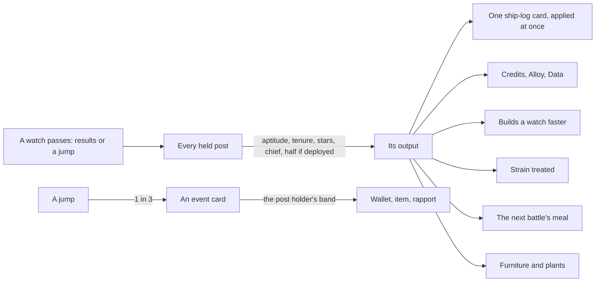

# Duties, the ship log and jump events

> **Status: 2026-11-13, CY16 (D27).** The crew hold posts in the ship's modules. Each post makes its output once a
> watch onto one ship-log card, applied at once. Aptitude, running style, mastery and station chiefs shape the output,
> auto-assign and presets keep it to seconds a stop, and a jump sometimes brings an event card. The design is
> [life-aboard.md](../design/life-aboard.md) §6 (TC67, TC68) and §5.5 (TC66).

## The short answer

- **Posts:** each running module has posts: a room one a level, a battle system one. An Uma holds one post at a time,
  until it's changed. The **Duties** button on the ship opens every post; a module's quick look lists its own.
- **Aptitude, by thresholds:** in the post's band (the better of two where it names two), band 2 or less works at half,
  band 3 does the job, band 4–5 adds the post's extra. A matching role adds the post's perk. It shows as a three-dot mark
  before she's assigned.
- **Running style as tenure:**
  - a Front Runner is full from the first watch;
  - a Pace Chaser is full and never halved when deployed;
  - a Late Surger gains half again from her third watch in a row;
  - an End Closer grows 10% a watch, to half again.

  **Mastery** stars at 3, 8 and 15 watches at a post add 10% each. A **station chief** (the casting's `chiefs`) adds a
  quarter at her room's post.
- **One ship-log card** a watch lists every post's output, already applied. A post held by an Uma deployed in the battle
  that ends the watch makes half (a Pace Chaser full), and the card says so. Deterministic: no failure rolls, nothing
  decays, no duty fatigue. An Uma resting at Strain 3 can stand duty.
- **No chores:** **Auto-assign** fills every post with the best fits (aptitude, then a matching role, then mastery, then
  her liked duty; the post fewest fit at their best goes first) and sends an Uma at Strain 3 to the Med Bay or the
  Observation Deck. **Two presets** keep arrangements.
- **A liked duty** (the post that asks for her best band) pays +5 rapport a watch. **Two Umas on one module's posts**
  build camaraderie (CY17's partners).
- **The cook** makes the next battle's meal, which goes into the battle's input as `meal` (played in CY17).
- **Jump events:** one jump in three draws a card, from the world's region pool or the game's generic twelve. Each choice
  may be checked by the holder of a named post (a pilot's Speed, a navigator's Wit) and pays from the wallet, items or
  rapport. **Skip** is always there.

## Posts

<!-- live:posts -->
**15 posts:**

| Post | Best band | Makes a watch | At band 4–5 | Role perk |
|---|---|---|---|---|
| Pilot | speed | Flies the jumps: charter fees, and she answers the jump events that ask for a pilot | A better choice in jump events | striker: Jump events lean her way |
| Navigator | wit | Charts the next jump: Data, and the events that ask for a navigator | Navigation data doubles | gunner: Reads a world’s threats sooner |
| Engineer | power or wit | Moves the builds on: a build a watch faster | A second build moves faster too | vanguard: Builds go a watch faster still |
| Mechanic | power | Strips salvage: Alloy | More Alloy from the scrap | vanguard: Salvages more |
| Archivist | wit | Works the records: Data | More Data from the records | netrunner: Decrypts more |
| Trader | guts or wit | Runs the Store: credits | Better margins | striker: Haggles harder |
| Signals | wit | Listens in: Data and intel | Clearer intercepts | netrunner: Picks up more traffic |
| Coach | guts or stamina | Drills the bench: XP for every Uma resting | Harder drills | medic: Drills the whole bench |
| Researcher | wit | Feeds the Lab: Data | More Data for the projects | netrunner: Finds shortcuts |
| Medic | stamina | Treats the most strained Uma: a point of Strain off | Treats one more | medic: Treats one more |
| Cook | guts or stamina | Cooks the next battle’s meal (played in CY17) | A richer dish | medic: Cooks for a crowd |
| Artisan | power or wit | Makes a piece of furniture every two watches | A piece every watch | netrunner: Works faster |
| Gardener | stamina | Grows a plant gift every two watches | A plant every watch | medic: Green fingers |
| Gunner | power | Crews the Battery: some Alloy from target practice | Keeps the Battery warm | gunner: The orbital strike hits harder (CY17) |
| Stargazer | wit or stamina | Rests at the window: sheds her own Strain | Calms another | — |
<!-- /live -->

Each module's posts, in order: the Bridge holds a Pilot, then a Navigator, then a second Pilot. Engineering, the Hangar,
the Log, the Store, Comms, the Sim Pod, the Lab, the Med Bay, the Galley, the Workshop, the Garden and the Observation
Deck hold one more of their post a level. Each battle system holds one: Battery a Gunner, Sensors a Navigator, the
Shield Projector an Engineer, the Drone Bay a Mechanic, the Engines a Pilot. The Quarters and the Guest Wing hold none.

**Outputs:** a numeric output is its amount × the factor, half again at band 4–5 and a quarter more with the role's
perk. A discrete one (Strain treated, a piece made, a build sped) lands every watch at full, every other watch at half,
and every watch at band 4–5.

## The ship-log card

Shown on the ship after a watch: each holder, her post, what it made, "(half: deployed)" where it applies, and the
wallet's gain. Everything is already applied; **Done** closes it. A jump's event card waits until the log is closed.

## Jump events (TC66)

A jump draws an event when a fixed hash over the watch and the world says so, one time in three. The world's `region`
names its pool (`events/<region>.json`); without one, the generic pool. A checked choice passes when the holder of its
post has the band (`at` or more), else pays its `fail`; no holder fails. Rewards may cost (negative credits, Alloy or
Data, never below zero) and rapport goes to the holder. The stand-in's sw1 is region `ring`, with three events.

## The story format

| Where | What |
|---|---|
| `casting.json` | `chiefs`: `{ "<outfit>": "<module>" }`, a module that holds posts |
| `worlds/<id>.json` | `region`: the pool its jumps draw from |
| `events/<region>.json` | `{ schemaVersion: 1, region, events: [{ id, title, text, choices: [{ text, check?: { post, band, at }, pass, fail?, passText, failText? }] }] }`; a reward is `{ credits?, alloy?, data?, item?, rapport?, lead? }` |

## The save (v8)

| Where | Holds |
|---|---|
| Each crew record's `post` | `{ module, index, since, mastery }`, or null |
| `dutyPresets` | Two at most: `{ name, posts: { "<outfit>": { module, index } } }` |
| `meal` | The cook's dish for the next battle, or null (eaten at deploy) |
| `camaraderie` | `{ "<a>-<b>": watches posted together }` |
| `log` | The last ship-log card: `{ watch, lines, gains, read }` |
| `event` | A jump's event waiting: `{ id, region }`, or null |

A v7 save migrates on the device: no posts, no presets, no meal, no camaraderie, no log, no event, `account.updatedAt`
untouched.
