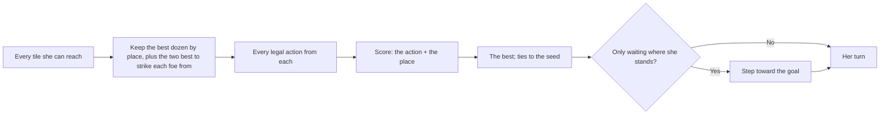

# How enemies choose

> **Status: 2026-11-12, CY6 (D10).** The enemy AI and ally Auto as `packages/battle/src/ai.ts` plays them: one scorer
> for both sides. The simulator plays both sides with it; the app may offer ally Auto later.

## The short answer

- **On her turn, an enemy scores every sensible turn** (where to stand, what to do there, which way to face) with the
  same numbers the forecast card shows, and takes the best.
- **She never idles** (TC30): with nothing worth doing, she closes on the nearest foe or the objective.
- **The same battle always plays the same way:** ties go to the seeded roll.
- **A decision takes well under a millisecond** on a laptop (the phone's budget is 50 ms; CI holds it to 5 ms).

## Where she stands

Each tile she could end on is worth:

| | Worth |
|---|---|
| **The threat there** | Less 0.15 × every foe's best expected damage on her, for each foe that could reach the tile next round |
| **A lethal spot** | Less 12 and more when the foes in reach could break her Core |
| **Being in reach** | Plus 0.35 × her best expected damage on a foe she could strike from there next turn |
| **Cover** | Plus 2 (plus 5 for the Steel Muster) on a cover tile |
| **Height** | Plus 0.8 a level above the foes' average, for a ranged unit |
| **Terrain** | Less Fire's damage on a burning tile; less twice Live's on a Live one |
| **The volley's marks** | Less 20 on a tile the Steel Muster has marked (the squad leaves them) |
| **Her Hold** | A heroine with an Anchor or Collar keeps out of reach of a Netrunner's Deck |
| **The goal** | Less 0.7 a step from it: the objective's tile, a terminal to hack, else the nearest foe; a ranged unit keeps near her best range instead |

Caution (the threat and the lethal spot) fades to nothing over 20 rounds, so a fight always closes.

## What she does

| Action | Worth |
|---|---|
| **An attack** | Its expected damage; plus the chance to break the target's Core × (20 + her threat); plus each limb's break chance × what it carries (a weapon arm 6, Legs 4, a shield arm 4); plus a share for a hurt target (focus fire); plus each ally who'd join; less 0.7 × the counter she'd draw, and more if it could break her |
| **The leader** | ×1.4 on the leader when the objective is to defeat her; when she's to be freed, breaking her is avoided and the squad aims at her Hold |
| **A barrel or pipe** | By who stands near: foes count for, allies against, more under fire |
| **Tech** | Its chance × the worth: Stun her threat × 1.5 + 3, Jam 3 if she has Charge, Jack-Out 35 |
| **A hack** | A turret 14, the lights 4 against ranged foes, a lift 2, a door 1.5; plus 25 toward a hack objective |
| **Mend, items** | Core HP back, more the more hurt she is; a limb 5 or 6; Reboot 30 |
| **A barrier** | Only under fire, and never beside another |
| **Wait** | 0.8 below her Charge cap, 0.2 at it |

**Charge:** an action that would leave her below 1 Charge costs 1.5, to keep a counter, unless it's worth more.

**The Steel Muster** prizes cover, and when the volley is coming and every other Muster gun is reloading, a Muster unit
holds her fire.

**Facing:** toward the most foes in her front quarter, the nearest breaking a tie.
