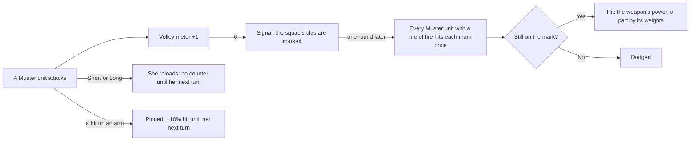

# The Holds and the factions

> **Status: 2026-11-12, CY5 (D9).** Rules version 2. How heroines are freed, never killed (TC26, WD9), and the first
> faction's mechanic, the Steel Muster's (WD11). Each world brings at most two new mechanics; the others arrive with
> their worlds. The world and the cast are the story session's ([the story brief](../design/story-brief.md)); this page
> holds the rules only.

## The short answer

- **A heroine is never killed.** She carries a Hold: an **Anchor**, a **Collar**, or **none**.
- **Freeing her** (breaking her Anchor or Collar, or a Jack-Out) takes her off the field and counts as beating her.
  **Rig Break** beats her without freeing her.
- **The Steel Muster** fights from cover, reloads after it fires, builds a shared volley it signals a round ahead, and
  pins arms.

## The Holds

A heroine unit has `hold: "anchor" | "collar" | "none"` in her input.

| | Anchor or Collar | None |
|---|---|---|
| On her rig | An extra part with its own HP (30 unless she says), hit only when **aimed** at or by **Tech** | Nothing extra |
| Freed by | Breaking it, or a **Jack-Out** | A **Jack-Out** |

- **Aiming at the Hold** needs her to be able to aim (a Visor with `aim`, or a Launcher), at −25% hit. Every hit of an
  aimed strike goes to the Hold. A covering ally takes the strike unaimed: there's no Hold on her to hit.
- **A landed Stun or Jam** also does 10 damage to the Hold.
- **Jack-Out** (2 Charge, adjacent, on a heroine below 30% Core): Wit against Guts.
- **Freed:** she leaves the field (`freed` cue, so the board swaps her palette back, TC41), counts as beaten for every
  objective, and **all her unbroken parts are salvage**.
- **Broken (Rig Break):** beaten, not freed; only her unbroken parts are salvage, and she won't join as a guest.

The battle's result lists each enemy as `freed`, `broken` or `standing`, with her salvage, so the app can open guests
and Files later. **Free the leader** is lost if the leader is broken instead.

## The Steel Muster

On when the input lists `factions: ["steel-muster"]`; its units carry `faction: "steel-muster"`.

| Mechanic | Rule |
|---|---|
| **Cover** | Its units favour cover tiles (the AI's part, CY6); the rules give cover its −20% for everyone |
| **Reload** | After a Muster unit fires a Short or Long weapon, she can't counter until her next turn |
| **The volley meter** | Shared: +1 for every Muster attack (main, Crossfire or counter), full at 6 |
| **The signal** | When it fills, the standing squad units' tiles are **marked**, to be hit one round later; the forecast shows the marks and when |
| **The volley** | When that time comes, every standing Muster unit with a Short or Long weapon and a line of fire hits each marked tile once: the weapon's power, on a part by its band's weights. Whoever left the mark dodges it. The meter then empties |
| **Pinning fire** | A Muster hit on an arm costs that unit −10% hit until her next turn (her counters and Crossfire in between) |

Without the flag, none of it applies, even to units marked `steel-muster`.
