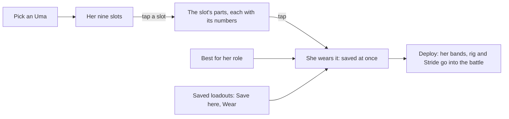

# The Hangar

> **Status: 2026-11-12, CY11 (D15).** Where each Uma's rig is built (TC17, TC18): eight slots and a Coat, the Capacity
> bar against the total Load, every part's numbers before a swap, three saved loadouts, and "best for her role". The
> rules are the battle package's; the Hangar reads Load, Capacity and Move from it and never recomputes them.

## The short answer

- **Eight slots and a Coat:** Core, Left arm, Right arm, Legs, Back unit, Visor, Left hand, Right hand, and the Coat.
- **Capacity** is 10 + 2 a Power band, plus the Core's and the Back unit's bonus. Over it, she can't deploy, and the
  deploy screen says why. At **70% load or less**, she gets +1 Move.
- **Before a swap,** every part shows what she'd have wearing it: part HP, Move, Capacity left, and hit and damage for
  a weapon.
- **"Best for her role"** in one tap: the best rig of the parts owned for her role and bands, never over Capacity,
  always with her role's Back unit.
- **Three saved loadouts** per Uma, named by the player.
- **The battle wears her rig:** deploy puts her bands, her rig as a loadout and her Stride into the mission's battle.



## The screen

| Part | Shows |
|---|---|
| **The crew strip** | Every Uma aboard and her role; ⚠ when her rig can't deploy |
| **The Capacity bar** | Load against Capacity; a tick at 70% (at or under: **+1 Move**, cyan); amber above it; red over Capacity, "she can't deploy" |
| **The slots** | Each slot's part and its Load; a tap opens the slot's parts on the right |
| **A slot's parts** | Each part's Load and note, and with it worn: HP (the change), Move (and the change), Capacity left, Guard, and a weapon's hit % × damage × hits; the part she wears is marked |
| **Her rig** (no slot open) | Each part's HP, Move, Guard, Capacity left, and each weapon's band, hit and damage; why she can't deploy, if she can't |
| **Best for her role** | Wears the best rig at once; while she has never built her own, she wears it anyway |
| **Saved loadouts** | Three rows: a name, **Save here** (her rig now, under the name typed), **Wear** |

**Hit** is her weapon's base accuracy plus 3% a Wit band, before her target's evasion and Cover; **damage** is a hit's,
with +2 a Power band for Melee, before facing, height and Coats ([battle.md](battle.md)).

**Hands:** a two-handed weapon goes in the right hand and empties the left; putting something in the left hand takes a
two-handed weapon out of the right. A Long weapon only fires from a Launcher Back unit; Tech comes from the Deck.

## Best for her role

Every rig of the parts owned with her role's Back unit (the Gunner has two) is scored for her role and bands, and the
best that fits her Capacity is worn; ties go to the first in the Hangar's order, so it's the same every time. The score
weighs part HP, Move (a light rig's +1 included), Guard, and her weapons' expected damage (hit × damage × hits), each
role leaning its own way:

| Role | Leans toward |
|---|---|
| Vanguard | HP, a shield, Short weapons |
| Striker | Move and Melee |
| Gunner | Short and Long weapons, an Aim visor |
| Netrunner, Medic | Move, then a light weapon |

Something always fits: Capacity is at least 12, and the lightest rig with any role's Back unit and a hand weapon weighs
12 at most. Each role's default Coat is the Weave coat (P) for Vanguards and Strikers, the Heat coat (F) for Gunners, the
Padded coat (I) for Netrunners and Medics; swap it for what a mission's enemies deal.

## The starter parts

Original names, the game's own, so they're in git (`packages/domain/src/crew/parts.ts`). Shops, salvage and remodels
(Phase 5) add rarer parts beside them, with their own counts.

<!-- live:parts -->
**32 starter parts**, standard issue aboard (every one, any number):

| Slot | Part | Load | Numbers | Note |
|---|---|---|---|---|
| Core | Frame core | 3 | — | The standard core |
| Core | Light core | 2 | — | Light; nothing extra |
| Core | Heavy harness | 5 | +4 Capacity, +10 Core HP |  |
| Core | Reactor core | 4 | +3 Capacity |  |
| Arm | Standard arm | 2 | — | The standard arm |
| Arm | Guard arm | 3 | +6 arm HP |  |
| Arm | Light arm | 1 | — | Light; nothing extra |
| Legs | Standard legs | 2 | — | The standard legs |
| Legs | Runner legs | 3 | +1 Move |  |
| Legs | Anchor greaves | 4 | −1 Move, +8 Legs HP |  |
| Legs | Light legs | 1 | — | Light; nothing extra |
| Back unit | Bulwark | 3 | Vanguard; +4 Capacity | Vanguard: deploys a one-tile barrier; +4 Capacity |
| Back unit | Thruster | 2 | Striker | Striker: dash, and jump a level higher |
| Back unit | Missile pod | 3 | Gunner; Long F 18 power, 70% base, range 3–6, 3 ammo | Gunner: Long F missiles, 3 ammo |
| Back unit | Mortar rack | 4 | Gunner; Long I 14 power, 80% base, range 3–6, 2 ammo | Gunner: Long I mortar, 2 ammo |
| Back unit | Deck | 2 | Netrunner | Netrunner: Stun, Jam, Jack-Out and terminals |
| Back unit | Med unit | 2 | Medic | Medic: mends, repairs and reboots |
| Visor | Basic visor | 1 | — | The standard visor |
| Visor | Aim visor | 2 | Aim | Aim: pick a part at −25% hit |
| Hand | Edge blade | 2 | Melee P, 12 power × 1, 85% base, range 1 | Melee P |
| Hand | Shock knuckles | 2 | Melee I, 10 power × 1, 90% base, range 1 | Melee I; can Stun on the Core |
| Hand | Pile driver | 3 | Melee P, 16 power × 1, 75% base, range 1 | Melee P, heavy |
| Hand | Great blade | 4 | Melee P, 18 power × 1, 80% base, range 1, two-handed | Melee P, two-handed |
| Hand | Machine pistol | 2 | Short P, 4 power × 4, 80% base, range 1–2 | Short P, 4 hits |
| Hand | Rifle | 3 | Short P, 6 power × 3, 75% base, range 1–3 | Short P, 3 hits, range 3 |
| Hand | Scattergun | 3 | Short I, 5 power × 4, 70% base, range 1–2 | Short I, 4 hits |
| Hand | Flamer | 3 | Short F, 4 power × 3, 80% base, range 1–2 | Short F; sets oil alight |
| Hand | Tower shield | 3 | Shield, Guard 40% | Guard 40% |
| Hand | Buckler | 1 | Shield, Guard 20% | Guard 20% |
| Coat | Weave coat | 0 | Halves P | Halves pierce |
| Coat | Padded coat | 0 | Halves I | Halves impact |
| Coat | Heat coat | 0 | Halves F | Halves fire |
<!-- /live -->

## Later campaign kits

The faction missions can issue an Arc axe or Pulse lance for two-handed melee, a two-handed Marksman rifle for a
single Short shot, and a three-shot Sniper rack for ranged precision. Each mission lists its main weapon and Back unit
choices at deployment.

## Deploy

The deploy screen ([missions.md](missions.md#the-steps)) shows each Uma's role, Load and Capacity, and refuses one who
can't go, with the reason: over Capacity or a two-handed weapon with a full left hand ("fix her rig in the Hangar"), or
resting at Strain 3. **Hangar** opens it with the mission waiting. Deploying puts into each squad slot her bands, her
rig as the battle package's loadout and her Stride; the Umas aboard and not deployed are the battle's bench, by role.

## The save

A rig names a starter part id for each slot; the Back unit, the hands and the Coat may be empty (`null`). The save
refuses a part that isn't of its slot's kind. A loadout is `{ name, rig }`, the name 24 characters at most.

```json
{ "core": "core-harness", "leftArm": "arm-guard", "rightArm": "arm-guard", "legs": "legs-runner", "back": "back-bulwark",
  "visor": "visor-basic", "leftHand": "hand-tower", "rightHand": "hand-scattergun", "coat": "coat-p" }
```
