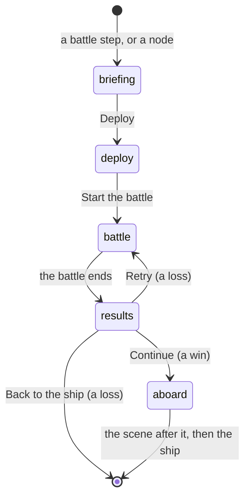

# The mission flow

> **Status: 2026-11-12, CY10 (D14).** From a mission's briefing to the scene aboard (TC32, TC42), each step held in the
> save so the app reopens wherever it was. The rules between the screens and the save are the **director**
> (`apps/web/src/mission/director.ts`), pure and tested headless.

## The short answer

- **Briefing → deploy → battle → results → aboard.** A scene's `battle` step starts it; winning plays the scene the
  story triggers after it, then the ship.
- **The battle is the sandbox's screen,** unchanged, on the battle the mission names (a scenario in `scenarios/`) with
  the squad's Umas in its slots.
- **Every step and every battle action is saved,** so after iOS closes the app it reopens at the briefing, the deploy
  screen, the battle (replayed to the same state), the results, or the scene aboard (from its start).

## The steps

| Step | Shows | Then |
|---|---|---|
| **Briefing** | The objective, the place and its danger, the enemies known (the leader's pool, the regulars by faction and job), the side objectives, the brief | **Deploy**, or back to the ship (the mission waits) |
| **Deploy** | Four squad slots and the guest slot, and the crew to pick from, each with her role, Load and Capacity: the chapter's leads are locked in (🔒); a flash-forward's whole squad is fixed (TC32). An Uma resting at Strain 3 or whose rig can't deploy is refused with the reason, and **Hangar** opens it with the mission waiting (CY11). Slots left empty keep the scenario's stand-ins | **Start the battle**: each Uma fights in her rig, with her bands and Stride ([hangar.md](hangar.md#deploy)) |
| **Battle** | The battle screen ([battle.md](battle.md#the-battle-screen)) on the mission's scenario, its seed the mission's | Its end goes to the results |
| **Results** | Won or lost; XP (a win 100 and 10 a foe, a loss 5 a foe), credits and salvage as plain numbers (the economy is Phase 5). Leaving the results, the squad takes the XP and 1 Strain, the crew aboard half the XP and a rest, shedding more in a comfortable cabin ([crew.md](crew.md#strain-tc27), [cabins.md](cabins.md#comfort-tc61)). A mission's first win also brings one item for the cabins, shown on the results (CY14) | A loss: **Retry** (the same squad and battle from its start) or back to the ship (the mission ends). A win: **Continue** |
| **Aboard** | The scene the story triggers after the mission, played by the scene player | Then the ship; the mission is done |

**A battle step is its scene's last step** (the story check refuses one in the middle): the scene is marked seen as the
mission starts, and what follows goes in a scene triggered `after` the mission.

## Resume

| Closed at | Reopens |
|---|---|
| A scene on a world's map | That scene from its start (it isn't seen until it ends) |
| The briefing, the deploy screen | The same screen |
| The battle | The battle, its actions replayed on its stored input to exactly the state it left; one that no longer replays offers to restart it |
| The results | The results |
| The scene aboard | That scene from its start |

## The save

`mission` holds the mission in progress: its `id`, `chapter`, `step`, the `squad` (outfit ids), its `battle` as CY8's
frozen input and the actions taken (checked as JSON; the battle package replays it), and at the results whether it was
`won`. Battle actions save as they're made and sync a few seconds later rather than one by one. A won mission joins
`worlds.missions`.
