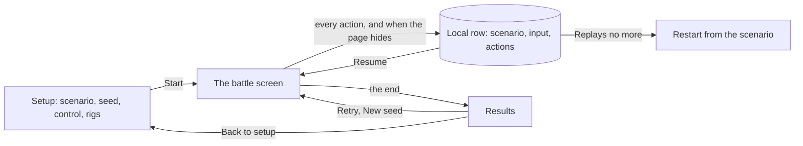

# The sandbox

> **Status: 2026-11-12, CY8 (D12).** The second of the three ways the combat is tested (TC54): any skirmish set up and
> played with the full battle screen, on the phone, at `/sandbox`. The battle screen itself is on
> [battle.md](battle.md#the-battle-screen).

## The short answer

- **Set up** a battle from a scenario (CY6's format): the scenarios in git, or ones saved on this phone. Pick the seed
  (typed or rolled), who plays each side (player or AI) and each squad slot's rig.
- **Play** it on the board with the full battle screen.
- **It autosaves** after every action, to a local row, and **Resume** picks it up after iOS closes the app.
- **The results** give the minutes and turns, which feed the simulator's pace.

## Setup

| Piece | What it does |
|---|---|
| **Scenario** | Every scenario in `scenarios/` (the test scenario first), then those saved on this phone |
| **Seed** | Typed, or **Roll** for a new one; the battle's seed is `<scenario>:<seed>` |
| **Squad, Enemy** | Who plays each side: **Player** or **AI** |
| **Squad slots** | Each slot's rig, from the stand-in rigs in git's scenarios (Vanguard, Striker, Gunner, Netrunner, Flamer, Medic) |
| **Start** | Begins the battle |
| **Copy, Paste** | The scenario as edited (seed and control included) to the clipboard as JSON, and back; Paste checks it with `parseScenario` |
| **Save** | Keeps the scenario as edited on this phone |

Scenarios in git name stand-ins only. A slot holding a real Uma by outfit id comes with the crew (CY11), when master
data's names load.

## Autosave and Resume

- After every committed action, and again when the page hides, the sandbox writes one row: the scenario, the frozen
  battle input, the actions, the rules version, when it started and when it changed.
- **The row is local,** in its own small database (`uma-cyberpunk-sandbox`), never the synced save: a sandbox battle is a
  test, not progress, so it bumps no save version, sends no sync traffic, and can't touch `account.updatedAt`.
- **Opening the sandbox with a row** offers **Resume** (the actions replayed on the stored input, landing on exactly the
  state they left) and **Restart** (the same scenario and seed from the start). If the actions no longer replay (the
  rules changed under them), it says so and offers Restart.
- CY10 moves mission battles into the save in the same shape.

## Results

Won or lost; player turns; the wall-clock minutes since the battle started; parts broken, counters, Crossfires and
Covers; how many enemies were beaten and freed. **Retry** plays the same seed again, **New seed** a fresh one, **Back to
setup** returns.

## The test scenario

**The sandbox: the Steel Muster and its Key** (`sandbox-muster`), on `underlevels-14`: 14 × 14, heights 0–3 with the
high ground at the back corners, cover tiles, a grating run, a Wet area beside it, an Oil slick under the enemy line, a
pipe beside a live cable, and a door on a terminal.

| Side | Units |
|---|---|
| Squad | Vanguard A, Striker A (Break Stride), Gunner A, Netrunner A; two repair kits and a smoke charge; a Medic on the bench |
| Enemy | The Key, the leader, on the high ground; five android troopers; all Steel Muster (cover, reload, the volley, pinning fire) |
| Objective | Defeat the leader |

Played AI against AI over 300 seeds it's even (the squad wins 47.7%, in 27 player turns); a player usually does better.

## `?debug`

`window.__sandbox` drives a battle headless: `state`, `act(action)`, `tap(x, z)` (a tap through the screen's own
handler), `step(ms)` and `auto()` (both sides on the AI, to the end; it resolves with the result).
