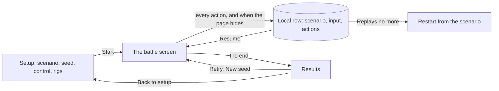

# The sandbox

> **Status: 2026-11-13, CY8 (D12), tier 1's Umas (D18).** The second of the three ways the combat is tested (TC54): any skirmish set up and
> played with the full battle screen, on the phone, at `/sandbox`. The battle screen itself is on
> [battle.md](battle.md#the-battle-screen).

## The short answer

- **Set up** a battle from a scenario (CY6's format): the scenarios in git, or ones saved on this phone. Pick the seed
  (typed or rolled), who plays each side (player or AI), and **who fills each squad slot: one of tier 1's Umas** (with
  her role), or the scenario's stand-in and its rig.
- **Tier 1's Umas** come from master data at run time: her name and face, her bands from her 5★ stats, her Stride, and
  the best rig for her role, as the crew fights (CY11). Five of the ten walk the board as **their authored chibis**; the
  others stand as **cards with their faces**. Enemies stay stand-ins until the heroines arrive (Phase 4).
- **Play** it on the board with the full battle screen.
- **It autosaves** after every action, to a local row, and **Resume** picks it up after iOS closes the app.
- **The results** give the minutes and turns, which feed the simulator's pace.

## Setup

| Piece | What it does |
|---|---|
| **Scenario** | Every scenario in `scenarios/` (the test scenario first), then those saved on this phone |
| **Seed** | Typed, or **Roll** for a new one; the battle's seed is `<scenario>:<seed>` |
| **Squad, Enemy** | Who plays each side: **Player** or **AI** |
| **Squad slots** | Each slot's **Uma** (tier 1's ten, by name; "card" marks one without a chibi) and her **role** (her style's by default, or any of the five), with a line under her: role, Stride, her five bands, Load against Capacity, Move, and whether she's a chibi or a face card. Or **Stand-in** and its rig, from the stand-in rigs in git's scenarios |
| **Tier 1 squad** | Back to the first visit's squad: four tier 1 Umas, those with chibis first, in ranking order |
| **Start** | Begins the battle |
| **Copy, Paste** | The scenario as edited (seed and control included) to the clipboard as JSON, and back; Paste checks it with `parseScenario` |
| **Save** | Keeps the scenario as edited on this phone |

## The squad: tier 1's Umas (D18)

The Ranker's tier 1 (uma-platform's Playable Umas T1, its first art batch) is ten outfits, kept in git by **id only**
(`apps/web/src/crew/tier1.ts`, as uma-quest keeps its batch 1); everything about them comes from master data's release
at run time:

| What | From |
|---|---|
| Her name and face | The release's outfits and characters, and `outfit-faces` |
| Her bands and Stride | Her 5★ stats and her best running style, through the crew's adapter ([crew.md](crew.md#the-bands-tc4)) |
| Her role | The one picked, else her running style's (Front Striker, Pace Vanguard, Late Gunner, End Netrunner) |
| Her rig | Best for her role and bands, never over Capacity ([hangar.md](hangar.md#best-for-her-role)) |
| How she looks on the board | Her **sprite set** from `outfit-sprites` when the release has one (the authored chibis: five of tier 1 today), else a **card with her face**; a stand-in sprite only if the release can't be read |

- **The picks are this phone's** (kept in its local storage), applied when a battle starts: the scenarios stay stand-in
  only, so Copy, Paste and Save move the same scenario whatever the squad.
- **The bench:** tier 1's Umas not in the squad wait aboard, so the bench support call offers each of their roles once.
- **Loading:** the picked squad's chibis and faces start downloading while the setup shows, so **Start** is quick; a
  first battle brings about 1.6 MB a chibi, then they're cached on the phone. "Bringing the squad aboard… 2 of 4" shows
  while any are still coming; whatever hasn't loaded in 25 s plays as a stand-in.
- **On the battle screen,** her face is on her timeline chip and her unit card, and her bust on her side of the cut-in.

A re-rank in the Ranker changes tier 1; the list is mirrored by hand. The story session's casting replaces it as the crew
when the first world lands.

## Autosave and Resume

- After every committed action, and again when the page hides, the sandbox writes one row: the scenario, the frozen
  battle input, the actions, the rules version, when it started and when it changed.
- **The row is local,** in its own small database (`uma-cyberpunk-sandbox`), never the synced save: a sandbox battle is a
  test, not progress, so it bumps no save version, sends no sync traffic, and can't touch `account.updatedAt`.
- **Opening the sandbox with a row** offers **Resume** (the actions replayed on the stored input, landing on exactly the
  state they left) and **Restart** (the same scenario and seed from the start). If the actions no longer replay (the
  rules changed under them), it says so and offers Restart.
- CY10 moves mission battles into the save in the same shape.

## Results

Won or lost; player turns; the wall-clock minutes since the battle started; parts broken, counters, Crossfires and
Covers; how many enemies were beaten and freed. **Retry** plays the same seed again, **New seed** a fresh one, **Back to
setup** returns.

## The test scenario

**The sandbox: the Steel Muster and its Key** (`sandbox-muster`), on `underlevels-14`: 14 × 14, heights 0–3 with the
high ground at the back corners, cover tiles, a grating run, a Wet area beside it, an Oil slick under the enemy line, a
pipe beside a live cable, and a door on a terminal.

| Side | Units |
|---|---|
| Squad | Vanguard A, Striker A (Break Stride), Gunner A, Netrunner A; two repair kits and a smoke charge; a Medic on the bench |
| Enemy | The Key, the leader, on the high ground; five android troopers; all Steel Muster (cover, reload, the volley, pinning fire) |
| Objective | Defeat the leader |

Played AI against AI over 300 seeds it's even (the squad wins 47.7%, in 27 player turns); a player usually does better.

## `?debug`

`window.__sandbox` drives a battle headless: `state`, `act(action)`, `tap(x, z)` (a tap through the screen's own
handler), `step(ms)` and `auto()` (both sides on the AI, to the end; it resolves with the result).
