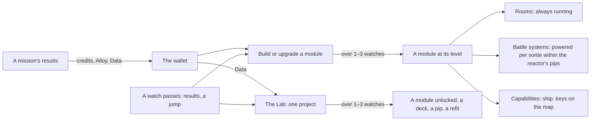

# The ship as a build

> **Built behavior.** For the planned changes to base improvements and expedition prep, see the [four-act campaign guide](campaign.md) and [roadmap](../handoff/four-act-roadmap.md).

> **Status: 2026-11-13, CY15 (D26).** The ship is built by the player: decks of module slots, rooms and battle systems with
> three levels each, building over watches, a wallet that missions pay into, the reactor's pips and the battle systems
> powered before each sortie, and the Lab's research. Duties at the rooms' posts come in CY16; the battle systems'
> effects in battle in CY17. The design is [life-aboard.md](../design/life-aboard.md) §5 (TC62, TC63, TC66).

## The short answer

- **The hull** is decks of slots: **two decks of five** at a new game, a third and a fourth from research (Hull I and
  II) or a story refit, to six decks; every deck widens to six slots with Hull III.
- **Modules** are rooms (always running) and battle systems (powered per sortie). Each takes one slot or two and has
  three levels. A new game has the Bridge, the Hangar, the Quarters, the Log and **Engineering** placed at level 1.
- **Building:** tap an empty slot, pick an unlocked module, pay, and it builds over its watches (one to three). One build
  at a time, two from Engineering level 3. A module's quick look offers the next level the same way. Level 3 waits on
  its family's research. **No upkeep, ever.**
- **Unlocks:** the Lab, the Galley, the Battery and the Sensors from the start; a lead's `opens` (her room is placed at
  once at level 1 if a slot is free); the rest by research.
- **The wallet:** a mission's results pay its credits, its salvage as Alloy, and Data (5 a battle, 10 a win).
- **Power:** Engineering's reactor has pips (3, 5, 7 by level, one more for each Reactor project). Before each sortie the
  deploy screen lists the installed battle systems; the player powers what fits the pips. The choice goes into the
  battle's input as `systems`, and rules version 3 (CY17) plays them.
- **The Lab:** one project at a time, paid in Data, taking watches; a level 2 Lab takes a watch off longer projects.
- **The map by capability:** a world's location can need `ship:<capability>` (the drive, the storm shielding, the
  sensors), and its locked node says so in words.

## The decks

The ship's screen is the cutaway of the decks. Each module is a panel in its slot, with:
- its name and its level as one to three bars;
- a lit edge: cyan for a room, magenta for a battle system;
- stripes and its watches left while building.

An empty slot is a dashed **+**. A tap on a module opens its quick look:
- what its level adds;
- the next level's cost, watches and what it adds, with **Upgrade**, or why not;
- **Enter** for a room with a page;
- **Research** for the Lab.

A tap on an empty slot opens the build sheet: every unlocked module not yet aboard, with its cost, watches and what it
adds, and **Build**, or why not. The header shows the wallet and the reactor's pips.

**Older saves** (v6 and before) open with their open rooms and Engineering placed on two decks of five in a fixed order,
at level 1, and the starter wallet: 500 credits, 20 Alloy, 20 Data.

## Modules

Costs are by family. Levels 1 and 2 are always open; level 3 needs the family's project:
- **core:** Core Refit;
- **rooms:** Room Refit;
- **quarters:** Private Cabins;
- **systems:** Systems Refit.

<!-- live:modules -->
**20 modules:**

| Module | Kind | Slots | Pips | Unlock | Level 1 | Level 2 | Level 3 |
|---|---|---|---|---|---|---|---|
| Bridge | Room (core) | 1 | — | Placed at a new game | The star map and travel (200 cr, 10 alloy; 2 w) | A second Bridge post (400 cr, 30 alloy, 10 data; 2 w) | A third post; jumps show their event first (900 cr, 60 alloy, 30 data; 3 w) |
| Hangar | Room (core) | 1 | — | Placed at a new game | Rigs and loadouts (200 cr, 10 alloy; 2 w) | A second mechanic post (400 cr, 30 alloy, 10 data; 2 w) | A third post (900 cr, 60 alloy, 30 data; 3 w) |
| Quarters | Room (quarters) | 1 | — | Placed at a new game | Shared berths: two Umas a cabin (200 cr, 10 alloy; 2 w) | Private cabins for the first twenty (500 cr, 30 alloy; 2 w) | Private cabins for everyone (1000 cr, 60 alloy, 20 data; 3 w) |
| Log | Room (core) | 1 | — | Placed at a new game | The Timeline, Files and Anomalies (200 cr, 10 alloy; 2 w) | A second analyst post (400 cr, 30 alloy, 10 data; 2 w) | A third post (900 cr, 60 alloy, 30 data; 3 w) |
| Engineering | Room (core) | 1 | — | Placed at a new game | The reactor: 3 pips; one build at a time (200 cr, 10 alloy; 2 w) | The reactor: 5 pips (400 cr, 30 alloy, 10 data; 2 w) | The reactor: 7 pips; two builds at a time (900 cr, 60 alloy, 30 data; 3 w) |
| Store | Room (rooms) | 1 | — | A lead’s `opens` | Parts and items to buy (200 cr, 10 alloy; 2 w) | More stock (400 cr, 25 alloy, 10 data; 2 w) | Rare stock (800 cr, 50 alloy, 30 data; 3 w) |
| Comms | Room (rooms) | 1 | — | A lead’s `opens` | Calls and operations (200 cr, 10 alloy; 2 w) | A second operator post (400 cr, 25 alloy, 10 data; 2 w) | A third post (800 cr, 50 alloy, 30 data; 3 w) |
| Sim Pod | Room (rooms) | 1 | — | A lead’s `opens` | Practice battles (200 cr, 10 alloy; 2 w) | Harder drills (400 cr, 25 alloy, 10 data; 2 w) | Drills against past bosses (800 cr, 50 alloy, 30 data; 3 w) |
| Lab | Room (rooms) | 1 | — | From the start | Research, one project at a time (200 cr, 10 alloy; 2 w) | Projects a watch faster (2+ watches) (400 cr, 25 alloy, 10 data; 2 w) | A second researcher post (800 cr, 50 alloy, 30 data; 3 w) |
| Galley | Room (rooms) | 1 | — | From the start | Meals before a sortie (CY17) (200 cr, 10 alloy; 2 w) | A second cook post (400 cr, 25 alloy, 10 data; 2 w) | Two meals to choose from (800 cr, 50 alloy, 30 data; 3 w) |
| Med Bay | Room (rooms) | 1 | — | Research: Med Bay | Strain heals a point faster (200 cr, 10 alloy; 2 w) | A second medic post (400 cr, 25 alloy, 10 data; 2 w) | A third post (800 cr, 50 alloy, 30 data; 3 w) |
| Observation Deck | Room (rooms) | 1 | — | Research: Observation Deck | Invitations out (visits) (200 cr, 10 alloy; 2 w) | A second spot to visit (400 cr, 25 alloy, 10 data; 2 w) | A third spot (800 cr, 50 alloy, 30 data; 3 w) |
| Workshop | Room (rooms) | 1 | — | Research: Workshop | Parts and furniture made aboard (CY16) (200 cr, 10 alloy; 2 w) | A second maker post (400 cr, 25 alloy, 10 data; 2 w) | A third post (800 cr, 50 alloy, 30 data; 3 w) |
| Garden | Room (rooms) | 2 | — | Research: Garden | Plants and calm: invitations (200 cr, 10 alloy; 2 w) | Fresh food for meals (400 cr, 25 alloy, 10 data; 2 w) | A third gardener post (800 cr, 50 alloy, 30 data; 3 w) |
| Guest Wing | Room (rooms) | 2 | — | Research: Guest Wing | Room for a freed heroine as a guest (200 cr, 10 alloy; 2 w) | Two guests (400 cr, 25 alloy, 10 data; 2 w) | Three guests (800 cr, 50 alloy, 30 data; 3 w) |
| Battery | Battle system (systems) | 1 | 1 | From the start | Ship fire support in battle (CY17) (300 cr, 20 alloy, 10 data; 2 w) | Harder hits (600 cr, 40 alloy, 20 data; 2 w) | Two shots a battle (1000 cr, 70 alloy, 40 data; 3 w) |
| Sensors | Battle system (systems) | 1 | 1 | From the start | The map revealed at the start (CY17) (300 cr, 20 alloy, 10 data; 2 w) | Enemy intents shown (600 cr, 40 alloy, 20 data; 2 w) | Ambushes warned (1000 cr, 70 alloy, 40 data; 3 w) |
| Shield Projector | Battle system (systems) | 1 | 2 | Research: Shield Projector | A shield on the squad at the start (CY17); storm shielding (300 cr, 20 alloy, 10 data; 2 w) | Stronger shields (600 cr, 40 alloy, 20 data; 2 w) | Shields twice a battle (1000 cr, 70 alloy, 40 data; 3 w) |
| Drone Bay | Battle system (systems) | 2 | 2 | Research: Drone Bay | A spotter drone in battle (CY17) (300 cr, 20 alloy, 10 data; 2 w) | Two drones (600 cr, 40 alloy, 20 data; 2 w) | Repair drones (1000 cr, 70 alloy, 40 data; 3 w) |
| Engines | Battle system (systems) | 1 | 1 | Research: Long-Range Engines | A drive that reaches farther worlds; a reposition in battle (300 cr, 20 alloy, 10 data; 2 w) | The level 2 drive (600 cr, 40 alloy, 20 data; 2 w) | The level 3 drive (1000 cr, 70 alloy, 40 data; 3 w) |
<!-- /live -->

The Quarters' level sets the cabins (CY14): shared berths at level 1, private cabins for the first twenty at level 2, and
for everyone at level 3. Each door on the Quarters deck says which. Each Uma keeps her own six slots either way: a
shared berth is a label, not shared furniture, so one Uma's Comfort never rests on another's tastes. Berths never block a
visit.

## Research

<!-- live:projects -->
**21 projects:**

| Branch | Project | Data | Watches | Needs | Does |
|---|---|---|---|---|---|
| Ship | Reactor I | 30 | 1 | — | +1 reactor pip |
| Ship | Reactor II | 60 | 2 | Reactor I | +1 reactor pip |
| Ship | Reactor III | 90 | 3 | Reactor II | +1 reactor pip |
| Ship | Hull I | 40 | 2 | — | A third deck |
| Ship | Hull II | 80 | 3 | Hull I | A fourth deck |
| Ship | Hull III | 120 | 3 | Hull II | Every deck widens to six slots |
| Ship | Core Refit | 60 | 2 | — | Level 3 for the Bridge, Hangar, Log and Engineering |
| Ship | Room Refit | 60 | 2 | — | Level 3 for the other rooms |
| Rigs | Shield Projector | 40 | 2 | — | Unlocks the Shield Projector (storm shielding) |
| Rigs | Drone Bay | 50 | 2 | — | Unlocks the Drone Bay |
| Rigs | Long-Range Engines | 50 | 2 | — | Unlocks the Engines (farther worlds) |
| Rigs | Systems Refit | 80 | 3 | — | Level 3 for the battle systems |
| Tactics | Coordinated Fire | 40 | 2 | — | Partners can reach level 3 and their duo technique |
| Tactics | Field Repairs | 50 | 2 | Coordinated Fire | The Reboot Order without a level 2 Med Bay |
| Tactics | Ship Uplink | 70 | 3 | Field Repairs | One more Order a battle, to four |
| Quarters | Private Cabins | 50 | 2 | — | Quarters level 3: a cabin for everyone |
| Quarters | Med Bay | 30 | 1 | — | Unlocks the Med Bay |
| Quarters | Observation Deck | 30 | 1 | — | Unlocks the Observation Deck |
| Quarters | Workshop | 40 | 2 | — | Unlocks the Workshop |
| Quarters | Garden | 40 | 2 | Observation Deck | Unlocks the Garden |
| Quarters | Guest Wing | 60 | 2 | — | Unlocks the Guest Wing |
<!-- /live -->

## Power before a sortie

The deploy screen's **Ship systems** panel lists the installed battle systems with their pips against the reactor's. A
toggle that would go over is refused, and the choice is kept for the next sortie. The powered systems go into the
battle's frozen input as `systems`. CY15 records and shows them; rules version 3 (CY17) plays them.

## The map by capability (TC66)

A world's or a location's `needs` may name `ship:drive-1`, `ship:drive-2`, `ship:drive-3` (the Engines' levels),
`ship:storm` (the Shield Projector) or `ship:sensors` (the Sensors). A capability holds while its module runs at that
level; it needs no power. The locked node says "Needs the storm shielding". The stand-in's sw2 has such a place, the
storm ridge.

## The story's refit

A scene's `refit` step (`{ "refit": true }`) adds a deck, to six. The stand-in's Lead B chapter ends with one.

## The save (v7)

| Where | Holds |
|---|---|
| `ship.decks`, `ship.width` | The decks (1–6) and slots a deck (5, or 6 from Hull III) |
| `ship.modules` | Each placed module: `{ id, deck, slot, level, building }`; level 0 only while its first build runs; `building` is `{ level, left }` |
| `ship.unlocked` | The modules the player may place |
| `ship.powered` | The battle systems last powered for a sortie |
| `ship.research` | `{ done, current }`, the project under way with its watches left |
| `wallet` | `{ credits, alloy, data }` |

A v6 save migrates on the device with `account.updatedAt` untouched.

## Campaign locations and work (CY51)

The combined campaign’s **Ship and port** entries open the current Bridge, Cargo, Hangar, Engineering and local civilian facilities. The picture, state badge and live ledger follow the same save. A funded project shows nights remaining; only completed work is operational. Engineering lists installed levels and every active ship build.

Cargo exports leave local reserve and the next upkeep untouched. Ship Alloy pays for refits/projects; **Send Alloy to Hangar** supplies recipes separately. Building a part puts it in stock; fitting it changes the selected aboard crew member’s actual boarding rig. Optional handovers can be read once without paying another cost or passing another night. **Look around** revisits the room without starting a visit or changing consent.

Rooms without an installed module or actual custody/residence are not offered. Some room and state illustrations use declared temporary reuse while CY52 authoring continues. See the [location inventory](../technical/campaign-management.md) for exact availability and save behavior.
