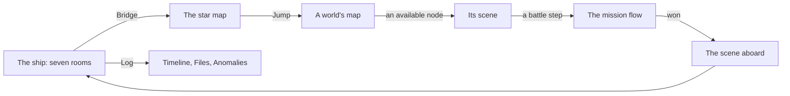

# The ship and the worlds

> **Status: 2026-11-12, CY10 (D14).** The hub every session starts and ends in (TC9, TC49), the Bridge's star map and a
> world's map (TC50), with their locks and keys (TC34). Played on the stand-in story until the story session's first
> world lands. The mission flow is on [missions.md](missions.md).

## The short answer

- **The ship is the home screen:** a side cutaway of its decks, one hotspot a room. Four rooms are open from the start;
  three open when the lead whose story names them comes aboard.
- **The Bridge** shows the **star map** (the worlds known; a tap, a jump card, travel, no fuel and no clock), then the
  current **world's map**: each location locked, available or cleared, with its danger and, when locked, its key.
- **A Continue card** on the ship says what's waiting, and the app reopens where the player was.

## The rooms

| Room | Opens | Its page now |
|---|---|---|
| **Bridge** | From the start | The star map, then the current world's map |
| **Hangar** | From the start | Each Uma's rig: slots, Capacity, the swap preview, saved loadouts, best for her role ([hangar.md](hangar.md)) |
| **Quarters** | From the start | The crew's roster, each Uma's profile, who rests next mission ([crew.md](crew.md#the-quarters)) |
| **Log** | From the start | The **Timeline** of scenes seen (each replayable), the **Files** (filled lines shown, the rest redacted), the **Anomalies** (open or closed) |
| **Store** | When its lead comes aboard | Parts and remodels (Phase 5) |
| **Comms** | When its lead comes aboard | Calls and messages (Phase 5) |
| **Sim Pod** | When its lead comes aboard | Practice battles (Phase 5) |

Which lead opens which room is the story's (`casting.json`'s `opens`); the list and its order are the game's
(`packages/domain/src/ship/rooms.ts`). A tap on a room opens its **quick look**: an open room's summary and **Enter**,
or a locked room's key ("Opens when … comes aboard"). The **Menu** on the ship holds Account and the test benches (the
sandbox, the board bench, the story test).

## The star map

The worlds the crew knows, and those a finished chapter has opened (a location whose keys are now met), at their place
from the world's file. The current world is cyan, known ones green, newly reachable ones amber. A tap shows a **jump
card** with the world's look; **Jump** travels there at once. A new game knows the first lead's world and stands on it.

## A world's map

The current world's locations as nodes, joined by their links:

| State | Means | Colour |
|---|---|---|
| **Locked** | A key in its `needs` isn't met: a chapter to finish, a mission to win or a Log File to find; a tap names it | Grey, with a lock |
| **Available** | A scene or a mission still waits there | Cyan |
| **Cleared** | Nothing waits there now. A world never closes | Green |

Each node shows its **danger** in diamonds. A tap on an available node plays the scene due there (a `talk` scene, then
an `arrive` one), or starts a mission there not yet won.

**What's due:** a chapter's scenes play in order, so only the first unseen scene of each chapter can play, and only once
the chapter's own `needs` are met. A scene triggered `after` a mission plays when that mission is won.

## The Continue card

On the ship, top right: **Continue** a mission in progress (and the step it's at), else **Next**: the place the next
scene waits on the current world. When the app opens with a mission in progress, it goes straight back to it.

## The save (v3)

| Field | Holds |
|---|---|
| `crew` | Outfit ids aboard, in join order (a `join` step adds one; `aboard` adds the lead and opens her rooms); each a full record from v4 ([crew.md](crew.md#the-save-v4)) |
| `ship.rooms` | The rooms open |
| `worlds` | `current`, each `known` world's `cleared` locations, and the `missions` won |
| `story` | CY9's flags, Leads, Files, Anomalies and scenes seen, unchanged |
| `mission` | The mission in progress ([missions.md](missions.md)) |

A v2 save opens as v3 on the device: the account and story as they were (`account.updatedAt` untouched), no crew, no
known world, no mission, and the four rooms open from the start. Any change on the ship is the player's own, so it moves
`account.updatedAt` and syncs.
