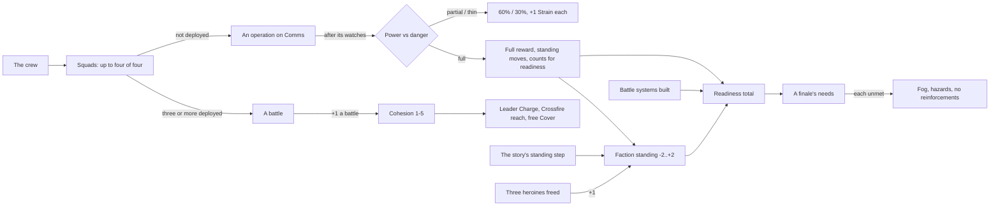

# Squads, operations, standing and readiness

> **Built behavior.** For the planned changes to the expedition roster and temporary assignments, see the [four-act campaign guide](campaign.md) and [roadmap](../handoff/four-act-roadmap.md).

> **Status: 2026-11-13, CY18 (D31).** The crew forms named squads that grow cohesion by fighting together. A squad not
> deployed runs an operation and comes back after its watches with a deterministic outcome. Each faction has a standing
> with the ship, and a finale measures the ship's readiness: each unmet need makes its battle harder, never anyone lost.
> The design is [life-aboard.md](../design/life-aboard.md) §7 (TC69, TC70, TC71) and §5.3 (TC64).

## The short answer

- **Squads (TC69):** up to four, each with a name, a banner, a leader and one to four members. An Uma is in one squad
  at a time, or none. The **Quarters deck** shows a row a squad: rename it, move Umas between squads (or to a new one),
  and star a leader. The **deploy screen** picks a squad in one tap, or any four by hand.
- **Newcomers:** the casting's canonical `squads` form when a newcomer completes them aboard. Anyone else joins the first
  squad with room, else a new squad while there are fewer than four.
- **Cohesion:** +1 for each battle a squad fights with three or more of its members, won or lost. It reaches level 1–5
  at 2, 5, 9, 14 and 20 battles. In battle:
  - level 1 gives the leader +1 Charge at the start;
  - level 3 gives every member +1 Crossfire reach;
  - level 5 gives every member one free Cover a battle.

  It counts for more in operations (+3 power a level).
- **Operations (TC70):** **Comms** offers two to four at a time on the worlds visited: the story's own and a generic
  table's. Send a squad and it's back after the operation's watches. A mission's end or a jump passes a watch.

  The outcome is deterministic, and Comms shows it before you send. The squad's power (levels, bond ranks, cohesion,
  partner pairs) is weighed against 12 × danger for **full** and 8 × danger for **partial**; less is **thin**:
  - partial pays 60% and thin 30%, and each costs a point of Strain;
  - standing moves only on a full success;
  - nobody is ever lost.

  Members away can't deploy, and they hold their posts at half. **Recall** brings a squad back at once with thin
  rewards. Each return writes a report on the ship-log card.
- **Faction standing (TC71):** each faction the story names stands from −2 (Hostile) to +2 (Allied). It starts at the
  story's value, or −1 (Wary) when the story doesn't give one. It moves three ways:
  - by the story's `standing` step;
  - by operations that name the faction;
  - by +1 once three of the faction's heroines are freed.

  A `standing:<faction>:<level>` key opens a location, a chapter or an operation. The Log's **Factions** tab and the
  Bridge show every standing.
- **Readiness (TC64):** one total on the Bridge's meter:
  - 2 for each level a faction stands above Hostile;
  - 3 for each operation won in full (each counts once);
  - 4 for each battle system built.

  A story mission marked `finale` names its needs (a system built, a faction's standing, the total), each with the
  harsh condition its absence adds: **fog** (lights out for three rounds), **hazards** (a hull breach: four tiles of
  Fire across the middle row) or **no reinforcements** (the bench call is gone). The briefing lists them. Never
  permadeath.

## Squads

| Rule | Detail |
|---|---|
| Size | Four squads at most; one to four members each; the leader is a member |
| One squad each | An Uma is in one squad or none; moving her into another takes her out of hers |
| A new game | One squad of the crew aboard, if anyone is (a v9 save migrates the same way) |
| A newcomer | The casting's canonical squads form first, when she completes one aboard (never from a squad away on an operation, and never later: the Quarters arrange it then); else she joins the first squad with room that isn't away; else a new squad ("Second Squad", the next banner) while there are fewer than four; else none |
| Renaming | 1 to 24 characters, on the Quarters deck |
| A leader leaving | The next member leads; an empty squad disbands |
| Away | A squad on an operation can't be changed until it's back |

**The deploy screen** shows a button for each squad that isn't away. A tap fills the slots with the chapter's leads
first, then the squad's members who can deploy (not resting, not away), up to four. The default squad starts the same
way: the leads, their squads' members, then the rest of the crew.

## Cohesion

| Level | Battles together | In battle (rules version 3) |
|---|---|---|
| 1 | 2 | The leader starts with +1 Charge |
| 2 | 5 | — (+3 power in operations each level) |
| 3 | 9 | Members' Crossfire reach +1 |
| 4 | 14 | — |
| 5 | 20 | Each member covers once free a battle (no Charge) |

A battle counts for a squad when three or more of its members are deployed, won or lost. The battle input carries
`cohesion: { level, leader, members }` for the squad with the most members deployed. When its leader stays aboard, its
first member deployed leads.

**The simulator** (`pnpm sim balance`, 200 seeds a scenario) plays life aboard with cohesion 5 against life aboard
without it: −0.4 points on average, within noise and inside the target (−2 to +8). Cohesion's weight is in operations.

## Operations

**What's on offer:** the worlds visited, the current one first. Each world gives:

- the story's operations in its file whose `needs` are met and that haven't been won in full;
- then the generic table, two to four by a hash of the world's id.

The first four not already running are on offer. Generic operations can be run again, but each counts once for
readiness. A story operation won in full is done.

| Generic operation | Watches | Full reward | Standing |
|---|---|---|---|
| Escort a convoy | 2 | 120 cr, 10 alloy, 5 data | — |
| Salvage a wreck | 2 | 40 cr, 30 alloy | — |
| Recon the outskirts | 1 | 30 cr, 20 data | — |
| Raid a supply cache | 3 | 160 cr, 25 alloy, 10 data | The world's first faction −1 |

Danger is the world's lowest location danger (the raid one more).

**Power:** each member adds her level + 2 × her bond rank. The squad adds 3 × its cohesion level, and 4 for each
partner pair inside it.

**Outcome:** full at 12 × danger or more, partial at 8 × danger, else thin. Comms shows what the chosen squad would bring
back before you send it.

**Sending:** a squad can't go while it's away already, while a member is resting at Strain 3, or while a member is in
the mission under way. While it's away:

- its members can't deploy (the deploy screen says "away until watch N: recall her squad from Comms");
- a chapter's lead who's away holds the mission until she's back or recalled;
- they hold their posts at half, as a deployed Uma does; the ship-log card says "(half: away)".

**The return:** at the watch it's due, the squad comes back. The pay goes into the wallet (and into the card's wallet
line), and Strain lands on each member (+1 for partial or thin, never past 3). A full success moves the faction's standing and counts the operation.
A report joins that watch's ship-log card ("Vanguard is back from patrol the ring…: a full success. +80 credits, +5
alloy, +5 data, dock-union +1.").

**Recall:** at once, thin rewards, with its report on the current card.

There's no free "wait" button. Watches pass at a mission's end and at a jump, as before (D31).

## Faction standing

| Value | Name |
|---|---|
| −2 | Hostile |
| −1 | Wary (the default start) |
| 0 | Neutral |
| +1 | Friendly |
| +2 | Allied |

The factions are every faction named by a world's `factions` and the heroines' `faction`. A faction's standing now is
its start (the casting's `standing`, else −1) moved by every step and operation, plus 1 once three of its heroines are
freed. That bonus is worked out from the missions won, whose boss pool holds her board. It always stays within −2 to
+2.

The save keeps a faction's value only once it has moved; the start stays the story's. Standing keys
(`standing:<faction>:<level>`) open what they guard when the faction is at that level or higher. Their lock reads
"Needs dock-union at Friendly".

## Readiness and finales

**The total:** 2 × (standing + 2) for every faction, + 3 × operations won in full, + 4 × battle systems built (level 1
or more).

**The meter**, on the Bridge's star map and world map, folds to one chip ("Readiness 6 · 2 unmet"). Open, it lists:

- the formula;
- the next finale (the first story mission marked `finale` not won yet), with each need ✓ or ✗;
- every faction's standing as a five-step bar.

**A finale's needs:** `{ system, else }` is met when that battle system is built. `{ standing, at, else }` is met when
the faction is at that level or higher, and `{ total, else }` when readiness reaches the number. The briefing lists them;
at deploy, each unmet need adds its `else` to the battle input's `conditions`:

| Condition | In battle |
|---|---|
| `fog` | Lights out for the first 3 rounds |
| `hazards` | A hull breach: up to 4 tiles of lasting Fire across the middle row |
| `no-reinforcements` | The bench support call is gone |

## The stand-in

The invented stand-in story shows every piece:

- **The Vanguard:** a canonical squad of Lead A, Crew C and Crew D, formed once all three are aboard.
- **A second faction:** sw1 adds `dock-union`, starting Neutral, beside `steel-muster`, which starts Hostile.
- **Two story operations on sw1:**
  - "Patrol the ring for the dock union": danger 1, 2 watches, dock-union +1;
  - "Cut the muster's supply lines": danger 2, 3 watches, steel-muster −1, after Chapter 1.
- **A standing step:** Chapter 1's debrief moves dock-union +1.
- **A third story operation (CY19):** sw3's relay, for the union (+1), once the Engines' drive reaches sw3.
- **A finale, Chapter 2 on sw2's storm ridge:** it needs the storm shielding to reach. It has two readiness needs: the
  Sensors built (else fog) and dock-union at Friendly (else hazards).

## The story format

| Where | What |
|---|---|
| `casting.json` | `squads`: `[{ id, name, banner, leader, members }]`, canonical squads; `standing`: `{ "<faction>": −2..2 }`, each faction's start |
| `worlds/<id>.json` | `operations`: `[{ id, title, faction?, danger 1–9, watches 1–3, reward: { credits, alloy, data, standing −1..1 }, needs? }]` |
| A step | `{ "standing": { "faction": "<faction>", "by": −4..4 } }` |
| A key in `needs` | `standing:<faction>:<−2..2>` |
| A mission | `finale: true` and `readiness`: up to four `{ system, else }`, `{ standing, at, else }` or `{ total, else }`; `else` is `fog`, `hazards` or `no-reinforcements` |

The check flags:

- squad members not in the cast;
- unknown factions (in `standing`, operations, steps and readiness);
- unknown systems;
- operation ids used twice, and standing moved without a faction;
- readiness on a mission that isn't a finale.

## The save (v10)

| Where | Holds |
|---|---|
| `squads` | `[{ id, name, banner, leader, members, cohesion }]`: cohesion is battles fought together |
| `operations` | Squads away: `[{ id, squad, back }]`, `back` the watch it returns |
| `operationsWon` | Operation ids won in full, each once |
| `standing` | `{ "<faction>": −2..2 }`, only factions that have moved |
| `log.reports` | The operations back this watch: `[{ op, title, squad, outcome, text }]` |

A v9 save migrates on the device. The crew aboard (four at most) becomes one squad, with no operations, nothing won and
no standing moved. `account.updatedAt` is untouched.

## The numbers

<!-- live:squads -->
| Number | Value |
|---|---|
| Squads, members | 4 squads of 4 at most |
| Cohesion levels 1–5 | 2, 5, 9, 14, 20 battles together (three or more members deployed) |
| Operations on offer | 2 to 4 |
| Power | level × 1 + bond rank × 2 each; cohesion level × 3; 4 a partner pair |
| Outcome | full at 12 × danger, partial at 8 × danger, else thin |
| Pay | partial 60%, thin 30%; +1 Strain each for either |
| Standing | -2 to +2, start -1 unless the story says; +1 at 3 heroines freed |
| Readiness | 2 a standing level above Hostile, 3 an operation won in full, 4 a battle system built |
<!-- /live -->
