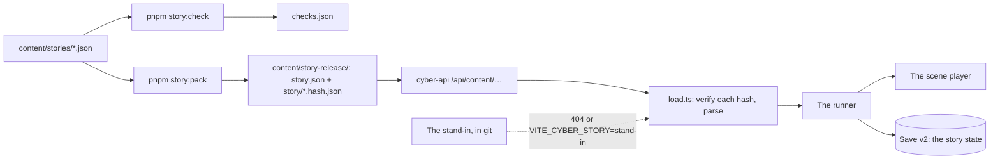

# The story: its format, its check and the player

> **Status: 2026-11-12, CY9 (D13), CY12 (D16).** Where the story session's files plug in (TC53): the format and its strict parser in
> `packages/domain/src/story/`, `pnpm story:check` and `pnpm story:pack`, the delivery, the runner and the scene player.
> The story itself is the story session's, written from [the story brief](../design/story-brief.md) in the ignored
> `content/stories/`; this page holds the format only.

## The short answer

- **The story is files** in `content/stories/`: `casting.json`, `worlds/*.json`, `chapters/*.json`, `log/*.json` and
  `calls/*.json`. Notes and reviews there aren't parsed.
- **`pnpm story:check`** parses them with the game's own parser, runs the cross-file rules, prints errors, todos and
  notes, and writes `checks.json` in Uma Story's shape.
- **`pnpm story:pack`** turns a clean story into hash-named files the API serves; the game falls back to an invented
  **stand-in** story when none is served (production until Phase 4's bucket).
- **The scene player** shows a scene as busts and a text box; the story's changes go into the synced save (v2).
- **The owner reviews the story in the Cyberpunk Story Sandbox** (`pnpm stories`, :4322; D17,
  [story-sandbox.md](../design/story-sandbox.md)), which reads the same files with this same parser and check.

## The files

| File | Holds |
|---|---|
| `casting.json` | `leads` (each `{ outfit, world, opens?, talent? }`), `crewOrder` (outfit ids: the order the squad's interjection slots prefer), `roles` (each Uma's authored role by outfit id, CY11: untagged, she takes her running style's, [crew.md](crew.md#her-role-tc5)), `heroines` (`{ board, faction, hold }`, the Hold `anchor`, `collar` or `none`), `minor` (slugs); `labels` for the stand-in only |
| `worlds/<id>.json` | `id`, `look`, `mood`, `factions`, `locations` (each `{ id, danger, needs, links, x?, y? }`: the world map's nodes), and the world's place on the star map (`x`, `y`) |
| `chapters/<id>.json` | `id`, `world`, `leads` (one, or two for crossed paths), `number` (1 is her Chapter 1), `danger`, `needs`, `scenes`, `missions`, `debrief` |
| `log/<id>.json` | A Log File: its `lines`, each `{ text, redacted }` |
| `calls/<id>.json` | A Call: the `question`, the `voters` (`{ outfit, argument }`) and the `branches` (`{ id, text, then }`) |

Every file has `schemaVersion: 1` and may carry a `layer` (placeholder, skeleton, bible, scripted, published); a file's
`id` is its file name. **Ids:** an Uma is her outfit id, a heroine her board id, everything else a lowercase slug that
never changes once used. Names, busts and portraits come from master data at run time.

**A scene** is `{ id, place, trigger, cast, steps }`: `place` is a location on the chapter's world; `trigger` is one of
`{ arrive: place }`, `{ talk: place }` or `{ after: mission }`; `cast` lists `{ outfit }`, `{ heroine }` or `{ minor }`.

**A mission** is `{ id, place, objective: { kind }, brief, enemies, fixedSquad?, side?, scenario? }`: the objective one
of defeat-all, defeat-leader, free-leader, reach, hold, escort or hack; `enemies` a list of `{ slot: "boss", pool }` and
`{ slot: "regular", job, count, faction }`; `scenario` the battle the game built for it (a file in `scenarios/`).

## The steps

| Step | Written as | Does |
|---|---|---|
| line | `{ "line": { "speaker": 1001, "text": "…" } }` | A spoken line, 160 characters at most |
| slot | `{ "slot": { "lines": { "1002": "…" }, "fallback": "…" } }` | An interjection slot (TC51): the first lead in the squad's order who has a line says it, else the fallback is narrated |
| narrate | `{ "narrate": "…" }` | Narration, 240 characters at most |
| thought | `{ "thought": { "speaker": 1001, "text": "…" } }` | A thought, shown in brackets |
| emote | `{ "emote": { "actor": 1001, "emote": "smile" } }` | A beat |
| wait | `{ "wait": 400 }` | A pause, in ms |
| choice | `{ "choice": [{ "text": "…", "lead": "…", "then": [] }] }` | One-tap options (four at most); an option with a `lead` gains it, marked as a Lead |
| flag | `{ "flag": "slug" }` or `{ "flag": { "flag": "slug", "set": false } }` | Sets or clears a story flag |
| lead | `{ "lead": "slug" }` | Gains a Lead |
| file | `{ "file": { "file": "slug", "line": 0 } }` | Fills in a Log File's line |
| anomaly | `{ "anomaly": { "anomaly": "slug", "open": true } }` | Opens or closes an Anomaly |
| join | `{ "join": 1003 }` | A crew Uma comes aboard (the crew is CY10's) |
| aboard | `{ "aboard": 1001 }` | The lead comes aboard: Chapter 1's last step |
| call | `{ "call": "slug" }` | Holds a Call and plays the branch picked |
| battle | `{ "battle": "mission-slug" }` | Plays a mission of the same chapter |

## The check

`pnpm story:check [--dir <folder>]` reads `content/stories/` (with none there yet, the stand-in, and it says so):

| Level | Rules |
|---|---|
| **Error** | Every file parses: its shape, unknown keys refused, each error naming its file and path, such as `chapters/w1-ch1.json scenes[0].steps[3].slot.lines["1002"]: expected text of 160 characters at most`. Every id resolves (places on the chapter's world, triggers, missions in the chapter, Files and their lines, Calls, leads in the casting, worlds); a Chapter 1 ends with one `aboard`, her last scene's last step, and only a Chapter 1 has one; a `battle` step is its scene's last step (CY10: what follows goes in a scene triggered `after` the mission); every key in `needs` names a real chapter, mission or File; a `slot` keys only leads |
| **Todo** | A scene likely over three minutes (four seconds a line and a second every fifteen characters; TC36); a lead in fewer than two crossed paths; a Chapter 1 with more than two battles (TC51) |
| **Note** | Counts per world, lead and layer |

It writes `checks.json` beside a real story (`{ schemaVersion, book: "cyberpunk", checkedAt, files: { path: sha256 },
findings, layers, counts }`, Uma Story's shape, uma-platform P141) and exits non-zero on any error. A file's layer, when
it doesn't say, is inferred: a chapter with scripted steps is `scripted`, one with only missions `skeleton`; a world with
a look or mood is a `bible`.

## Delivery

- **`pnpm story:pack`** refuses a story with errors, then writes each file as `story/<name>.<hash8>.json` and an index
  `story.json` (each file's source, path, SHA-256 and size) to the ignored `content/story-release/`.
- **The API** serves it at `/api/content/…` through uma-server's `PrivatePackModule`, behind the owner guard: the index
  revalidated on every read, the hash-named files cached for good, nothing else. Locally from `STORY_DIR`; the private
  bucket `STORY_BUCKET` and its cost table are Phase 4's.
- **The web's one seam** (`apps/web/src/story/load.ts`) reads the index through uma-kit's content client, verifies each
  file by its hash and parses the lot. On a 404 (no release locally; production now), or with
  `VITE_CYBER_STORY=stand-in`, it plays **the stand-in**: two invented worlds (`sw1`, `sw2`) and two leads' Chapter 1s,
  each with a battle, an interjection slot, a crew Uma who joins and a debrief, two Log Files and a Call, using every
  step kind, with invented ids (Umas 9000001–9000004, the heroine `stand-in-1`) and plain labels ([the loop](#the-chapter-1-loop-cy12)).

## The player

- **A scene** plays over a dark backdrop with the place's id at the top: the speaker's **bust** (a stand-in card in her
  colour now; master data's busts by outfit id when the album is wired, CY11) and the **text box** with her name. A tap
  moves on.
- **Choices** are one-tap buttons, a Lead marked as one. **A Call** shows the question, each voter's argument and the
  branches. **A battle** step shows the mission and **Deploy** (CY10 plays it).
- **Auto** moves on by the line's length (0.9 s and 45 ms a character); **Skip** passes lines to the next choice or the
  end, keeping every change; **Log** shows the scene so far.
- **The test route** `/story` lists the loaded story's first chapter and plays it scene by scene, then its debrief; a
  scene seen is marked. The game itself plays scenes from the ship's flow ([ship.md](ship.md), [missions.md](missions.md)).

## The Chapter 1 loop (CY12)

The Octopath structure (TC51): each lead's Chapter 1 plays on her home world, and finishing it brings her aboard; the
ship then travels on to the next. The stand-in proves it twice, end to end, and a headless test plays it all through the
director on fixed seeds with auto-played battles (`apps/web/src/mission/loop.test.ts`).

| Step | What happens | The rule |
|---|---|---|
| **A new game** | The ship goes straight to the Bridge and plays the first lead's first scene | Nothing seen and no mission: the opening (TC36). The stand-in reaches its first battle in about 45 s of reading (the check's estimate), under two minutes |
| **Her Chapter 1** | Its scenes in order, then its battle, with her locked in the squad | A chapter's scenes play in order ([ship.md](ship.md#a-worlds-map)); the battle step ends its scene |
| **A crew Uma joins** | `join` in a chapter's scene: Crew C in Lead A's, Crew D in Lead B's | Both kinds of arrival (TC45) |
| **She comes aboard** | `aboard`, the last step of her chapter's last scene, usually the scene after its battle | She joins **at the squad's level**: the crew's average XP, or the XP of the battle she just fought, whichever is higher, so never level 1 after a fight. A `join` follows the same rule. Her room opens (`casting.json`'s `opens`) |
| **Her debrief** | Plays on the ship as soon as her chapter's last scene ends; then it's in the Log's Timeline with the scenes, replayable | A chapter is finished when all its scenes are seen; its debrief is due once |
| **The next world** | The Continue card says "jump to …"; the Bridge's star map shows the world her chapter opened | A world appears once a location on it has every key met |

**Interjection slots** (TC51): a `slot` plays the line of the first lead in the squad who has one, by the casting's
`crewOrder`, else its fallback. **Who counts as the squad:** in the scene after a battle, the squad that fought it; in a
scene on the map or a debrief, the crew aboard. So in Lead B's chapter, Lead A speaks at the gate once she's aboard, and
after the battle only if she was deployed (the test plays both).

**Chapter 1s never run back to back** in the real game (TC51); the stand-in is too small to show it and doesn't try.

## The story state (save v2)

The save's `story` holds `flags`, `leads`, each Log File's filled `files` lines, each Anomaly open or closed in
`anomalies`, and the scenes `seen`, kept sorted. A step's change is the player's own, so it moves `account.updatedAt`
and syncs. **A v1 save opens as v2** with an empty story and its `account.updatedAt` untouched; the server backs up the
v1 document on the version change ([the app as built](architecture.md#the-save)).
