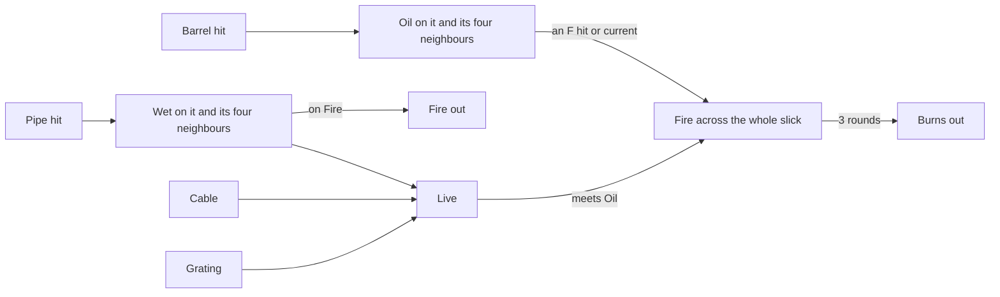

# Terrain, props and terminals

> **Built behavior.** For the planned changes to layout, entry, cover and objective placement at expedition size, see the [four-act campaign guide](campaign.md) and [roadmap](../handoff/four-act-roadmap.md).

> **Status: 2026-11-12, CY5 (D9).** Rules version 2. How the board itself changes in a battle: the five tile states,
> the props that make them, cover and grating, the terminals, and the terrain card. The numbers are in
> [battle.md's tuning table](battle.md#rules-version-2), rendered from `packages/battle/src/tuning.ts`.

## The short answer

- **A tile can be in one state:** Wet, Oil, Fire or Smoke. **Live** is worked out, never stored: every cable's tile,
  and current spreading at once across connected Wet tiles and grating.
- **States spread at once:** Fire across a connected Oil slick, current across Wet and grating, and current meeting Oil
  sets it alight. Wet puts Fire out and can't catch.
- **Props** make states: a barrel bursts into Oil, a pipe into Wet, a cable is Live. **Terminals** move the map: doors,
  turrets, lifts and the lights.
- **A long press** on any tile gives its terrain card.

## The five states

| State | What it does | Made by | Lasts |
|---|---|---|---|
| **Wet** | Carries current; puts out Fire; Fire can't take it | A burst pipe | Until it changes |
| **Oil** | Fire spreads at once across the connected slick | A burst barrel | Until it burns |
| **Fire** | 8 F damage to the Legs of whoever ends a turn there (a Fire Coat halves it; broken Legs send it to the Core) | An F hit on a unit, an F hit on a barrel, current on Oil | 3 rounds |
| **Live** | 6 damage to the Core of whoever enters or ends a turn there, past any Coat | Cables, and current across Wet and grating | While its source stands |
| **Smoke** | Blocks line of sight; −30% to ranged hits into or out of it | A smoke charge | 2 rounds |

Timers count in rounds (100 ticks) and run out as the clock passes them. Entering a Live tile mid-move hurts once a tile;
ending the turn on it hurts again.

## The map's tiles

| Tile | Rule |
|---|---|
| `.` floor | Nothing |
| `#` solid | No standing, blocks sight |
| `=` grating | Carries current, like Wet |
| `c` cover | −20% to Short and Long hits on whoever stands there, from the front and sides (not from behind, not Melee) |

## Props

Props sit in the map's `props` list, each with an id. `parseMap` checks them: unique ids, tiles on the map, barrels,
pipes and terminals off spawns and solid tiles, a terminal's door or lift existing, a lift's heights 0–3.

| Prop | On the board | When hit |
|---|---|---|
| **Barrel** | Takes its tile: no standing, shots pass over | Any hit bursts it: Oil on its tile and its four neighbours; under an F weapon, alight at once |
| **Pipe** | Takes its tile like a barrel | Any hit bursts it: Wet on its tile and its four neighbours |
| **Cable** | On the floor: its tile is Live | — |
| **Terminal** | Takes its tile like a barrel | Hacked, not hit |
| **Door** | Its tiles are solid and block sight while it's shut | — |
| **Lift** | Its tiles stand at its low or high height | — |

**Barriers** (the Bulwark's) are on the board too: solid, block sight, 40 HP; any attack can hit one.

## Terminals

A unit with a **Deck** within range 1–4 of a terminal hacks it as her action, for **1 Charge, with no roll**. Each hack
toggles or fires its effect, and a terminal counts once for "hack N terminals" however often it's used.

| Terminal does | Effect | Cue |
|---|---|---|
| **A door** | Opens or shuts its tiles. It won't shut on someone | `door` (open, tiles) |
| **A lift** | Moves its tiles to the other height; whoever stands on them rides along | `heights` (tiles, height), so the board re-meshes |
| **A turret** | Turns a turret (a fixed hardware unit) to her side | `turned` |
| **The lights** | Cut for 2 rounds: −15% to ranged hits, and turrets sit out their turns | `lights` (out, then back) |

A **turret** is a unit with `fixed: true`: it never moves, and fights on whichever side it's on.

## The terrain card

`terrainCard(state, tile)` answers the board's long press: its height, its ground (floor, solid, grating or cover), its
state and the rounds left on it, whether it's Live, the props on it, what could change it, and what it does to whoever
stands there, in words.
