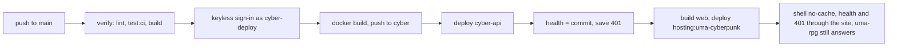

# Infrastructure

> **Status: live since 2026-11-12 (CY2, D6).** Every value below exists and was checked. The plan for every app in the
> project is uma-rpg's [cloud plan](https://github.com/luismlorenzana/uma-rpg/blob/main/docs/design/cloud/plan.md)
> (IN1–IN26); uma-quest's Q2 is the model this copies.

## The shared project

uma-cyberpunk lives in GCP project **`uma-rpg`** (number 727687479415, billing account `0101E5-D99B49-A8B713`), beside
uma-rpg, uma-quest and uma-farm, all live. Each app has its own pieces, and none can reach another's (IN2, IN5, IN6).
Four things are shared (IN3):
- Firebase Auth: Google sign-in and the one allowed email;
- the `github-actions` Workload Identity pool;
- the $5 budget alert ("Main Budget", emails at $1 and $5), which lists the project;
- read-only access to uma-platform's `gs://uma-platform-master-data`.

**Never change the active gcloud account.** Scope every command:

```bash
CLOUDSDK_ACTIVE_CONFIG_NAME=default CLOUDSDK_CORE_PROJECT=uma-rpg gcloud run services describe cyber-api --region=us-central1
```

Never run `gcloud config set …`, and never touch the other apps' pieces: `(default)`, `quest`, `farm`, `rpg-*`,
`quest-*`, `farm-*`, `github-deployer`, and the `uma-rpg`, `uma-quest` and `uma-farm` sites.

## uma-cyberpunk's pieces (live, 2026-11-12)

| Piece | Value |
|---|---|
| Repo | `luismlorenzana/uma-cyberpunk`, private |
| Site | `https://uma-cyberpunk.web.app`, Hosting site `uma-cyberpunk`, 20 versions kept |
| Firebase web app | Uma Cyberpunk web (`1:727687479415:web:783eab238dc074ff684672`); its public config is in `apps/web/.env.production` (CY3), auth domain `uma-cyberpunk.web.app` |
| Sign-in domain | `uma-cyberpunk.web.app`, added to Auth's authorized domains (the list was read and appended to, never replaced) |
| API URL | `https://cyber-api-727687479415.us-central1.run.app` |
| API | Cloud Run `cyber-api`, `us-central1`, min 0, max 1, 512 MiB, 1 CPU, public at the edge, owner guard on every route but `/api/health` |
| Runtime account | `cyber-api-runtime`: `datastore.user` only on `projects/uma-rpg/databases/cyber` (condition `cyber-database-only`); `storage.objectViewer` on `gs://uma-platform-master-data` |
| Database | Firestore `cyber`, Native, `us-central1`, delete protection and point-in-time recovery on: `saves/{uid}`, `saveRescues/{uid}`, `saveBackups/{uid}-v{n}` (CY3) |
| Images | Artifact Registry `cyber` (Docker, `us-central1`), keeping the last 3 and deleting what's older than a day |
| Deployer | `cyber-deploy`: writer on `cyber` images, admin of `cyber-api`, user of `cyber-api-runtime`; on the project, Hosting admin (project-wide, so the workflow names its site and CI checks it, IN7), service usage consumer and API keys viewer |
| Deploy sign-in | Provider `projects/727687479415/locations/global/workloadIdentityPools/github-actions/providers/uma-cyberpunk`: `main` of `luismlorenzana/uma-cyberpunk` only |
| Label | `app=cyber` on the service and the images |
| Local | API on 8121, web on 5214 (uma-rpg uses 8081 and 5174, uma-quest 8091 and 5184, uma-farm 8101 and 5194) |
| Owner-only Tier 1 campaign | `gs://uma-platform-content/campaign/cyberpunk/` serves immutable release content. The conditional grant `cyber-campaign-only` gives `cyber-api-runtime` read access to that prefix. |

**Repository variables (CY2):** `GCP_PROJECT_ID=uma-rpg`, `WIF_PROVIDER` (the provider above), `DEPLOY_SA`
(`cyber-deploy@uma-rpg.iam.gserviceaccount.com`), `ALLOWED_EMAIL` (copied from uma-rpg's), `MASTER_BUCKET`
(`uma-platform-master-data`), `FIRESTORE_DATABASE=cyber`, `HOSTING_SITE=uma-cyberpunk`, `DEPLOY_ENABLED=true` (set
last). The workflow's package token is the run's own `GITHUB_TOKEN`; there are no secrets.

## How a deploy runs

A qualifying push to `main` after a pull request merge runs `.github/workflows/deploy.yml`. Changes limited to
documentation and this workflow file run pull request checks. They do not redeploy the game.



The deploy job requires a `push` event on `main`, a successful verify job, and `DEPLOY_ENABLED=true`. Deployments run in
the `uma-cyberpunk-production` concurrency group. The Cloud Run action routes traffic to the latest revision. The
readiness step waits for that exact commit to answer before hosting deploys. GitHub Actions builds the Docker image using the npm token as a build
secret. `scripts/check-hosting-site.mjs` checks that `firebase.json` names the same site as the workflow.

If GitHub fails to queue a merge, check Actions and the GitHub incident status. Preserve the live release and report the
missing run or failed step. The next qualifying merge uses the automatic path. Production releases must go through that
workflow, including during a GitHub incident.

## Isolation, checked 2026-11-12 (IN21)

Policy Troubleshooter (`gcloud policy-troubleshoot iam`, scoped) for Cloud Run and images. It doesn't accept Firestore
database names, so the database cells come from the grant's condition (one `datastore.user` for `cyber-api-runtime`, on
`cyber` only) and the troubleshooter's project-level answer, which is only conditional (`UNKNOWN_CONDITIONAL`).

| Account | Own pieces | Every other app's |
|---|---|---|
| `cyber-api-runtime` | `cyber` database (`resource.name == "projects/uma-rpg/databases/cyber"`); reads master data | No grant on `(default)`, `quest` or `farm`; `rpg-api`, `quest-api`, `farm-api`: refused |
| `cyber-deploy` | Deploys `cyber-api`, pushes to `cyber`: granted | `rpg-api`, `quest-api`, `farm-api`; the `rpg`, `quest` and `farm` images: refused |
| `github-deployer`, `quest-deploy`, `farm-deploy` | — | `cyber-api` and the `cyber` images: refused |

Every API in the project is public at the edge (`allUsers` invoker), and each guards its routes itself.

## Re-run and rollback

- **Re-run:** `CLOUDSDK_ACTIVE_CONFIG_NAME=default CLOUDSDK_CORE_PROJECT=uma-rpg bash infra/bootstrap.sh` describes each
  piece before creating it, re-applies the grants as they are, and prints the repository variables. It changes nothing
  on a second run.
- **Rollback,** in this order: set `DEPLOY_ENABLED` to `false`; delete the provider; then the service, the deployer and
  the runtime account. The database keeps its delete protection, so removing it is a separate, deliberate step.

## What it costs

| Added to the `uma-rpg` project | Free tier | At one player |
|---|---|---|
| Firestore `cyber` | None: the free quota covers only `(default)` | A few cents a month |
| Point-in-time recovery on `cyber` | None; billed by the database's size | Under a cent: a save is a few KB |
| Cloud Run `cyber-api` (0 to 1 instances, 512 MiB) | Shared across the billing account: 2M requests, 180k vCPU-seconds and 360k GiB-seconds a month | $0 |
| Hosting site `uma-cyberpunk` | Shared across the project: 10 GB stored, 360 MB a day | $0 |
| Images `cyber` (keep 3, delete older than a day) | 0.5 GB per billing account, shared with the other apps' images | $0; a cent a month if all pass 0.5 GB |
| Deploy provider, accounts, IAM, the web app | Free | $0 |
| Image builds | In GitHub Actions on the private repo's minutes | $0 |
| **Total** | | **Under 10 cents a month.** The $5 alert covers every app |

## Production saves (live since CY3)

Save v1 syncs through `GET`/`PUT /api/save` into the `cyber` database ([the manual](../game/architecture.md#the-save)):

| Document | Holds |
|---|---|
| `saves/{uid}` | `{ revision, save, storedAt }`: the save as JSON text; `storedAt` is the server's write time, never `updatedAt`, so no server field shares the protected name |
| `saveRescues/{uid}` | The newest upload the server refused, as sent, with the reason |
| `saveBackups/{uid}-v{n}` | The stored document, copied whenever the save's version changes |

The save's own `account.updatedAt` is the device's and is never touched here. A stale revision or an older save version
gets 409 with what's stored. With `PERSISTENCE=firestore` the API refuses to start without `FIRESTORE_DATABASE`.
uma-rpg's rules, from its 2026-10-30 incident, where a hand grant wiped unsynced progress:
- never move `save.account.updatedAt`;
- no server ever writes into a save;
- a stale server date means stop and ask the owner.
